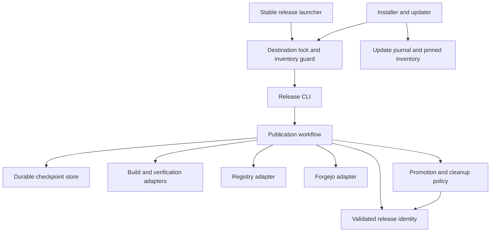

# Brooks-Lint Health Dashboard

- [Brooks-Lint Health Dashboard](#brooks-lint-health-dashboard)
  - [Scope and verdict](#scope-and-verdict)
  - [Dimension scores](#dimension-scores)
  - [Module Dependency Graph](#module-dependency-graph)
  - [Test suite map](#test-suite-map)
  - [Previous findings](#previous-findings)
  - [Top Findings](#top-findings)
  - [Recommendation](#recommendation)
  - [Review limits and persistence](#review-limits-and-persistence)

## Scope and verdict

**Mode:** Health Dashboard

**Scope:** Second plan-only review of `tasks/1-standardize-container-releases/2-plan.md`, including amendments addressing F1–F4. Scope remains `dev/container-release-template` only. Existing projects are read-only references. Balanced defaults apply; no workspace `.brooks-lint.yaml` was found during the preceding review, and no configuration change was reported.

**Composite Score:** 100/100 for the reviewed plan, not for unimplemented software or an unexecuted test suite.

**Verdict:** Ready for implementation within the stated local, template-only boundaries. All four prior findings have concrete design changes, failure-path tests, and acceptance criteria. No additional blocking design issue was identified. Approval of the plan does not authorize remote creation/push, live publication, destructive cleanup, or changes to existing projects.

## Dimension scores

- Code Quality: not scored because no implementation diff exists.
- Architecture: 100/100; the plan now defines policy/adapter separation, durable publication reconciliation, and recoverable installation transactions. Implementation still needs to demonstrate these boundaries.
- Tech Debt: 100/100; promotion eligibility and staging-reference lifecycle now have explicit owners and invariants. Generic multi-image support is justified by known reference needs, not speculative application expansion.
- Test Quality: 100/100 for the planned strategy; failure scenarios now cover stale retries, process termination, lost responses, staging retirement, and interrupted updates. There are no implemented tests to inspect for brittleness, obscurity, duration, or actual coverage.
- Calculation: `(100 × 0.30 + 100 × 0.25 + 100 × 0.20) / 0.75 = 100`. The implementation-diff dimension is omitted and its weight redistributed. No current findings incur deductions. The prior plan score was 89/100; the increase reflects closed planning gaps, not measured runtime improvement.

## Module Dependency Graph

This is the intended dependency direction supported by `2-plan.md:37-38`, not an observed import graph.

Candidate-selection policy consumes validated records; adapters collect evidence and execute approved operations. The stable launcher verifies installed files before importing the managed engine. No dependency-cycle or runtime-layering claims can be validated before implementation.

## Test suite map

- Unit tests planned: configuration, semantic version ordering, promotion eligibility, cleanup reachability, token-file defaults/overrides, and inventory verification. Counts are unavailable.
- Integration tests planned: disposable Git repositories, fake Docker commands, loopback API/OCI fixtures, process-kill/lost-response reconciliation, synthetic multi-image transitions, and interrupted fixture-only installation/updates. Counts and duration are unavailable.
- Live contract tests conditional: explicitly authorized disposable Forgejo publication/deletion semantics and retained-image pullability. The plan explicitly blocks destructive container cleanup without this evidence; mocks do not satisfy that gate.
- Required isolation: disposable token files/home directories, no production credentials, no test destination among existing projects, and no ordinary production release used as an integration test.

## Previous findings

- **F1 — stale-version promotion: addressed in the plan.** `2-plan.md:57-58` adds the pre-write version/source/predecessor gate, refuses stale checkpoint refresh, and handles only recorded mixed suite transitions. `2-plan.md:88` adds stale retry and zero-write assertions; `2-plan.md:110` makes this an acceptance requirement. Cross-host races remain explicitly outside the guarantees of a local lock.
- **F2 — crash windows: addressed in the plan.** `2-plan.md:52-53` defines durable intent, operation IDs, pending/completed transitions, remote reconciliation, and an explicit stop when immutable build evidence cannot be recovered. `2-plan.md:89` adds process termination and accepted-but-response-lost tests; `2-plan.md:111` requires this behavior. Build-once guarantees are no longer asserted where evidence is unavailable.
- **F3 — staging-reference retention: addressed in the plan.** `2-plan.md:70-71` records exact staging ownership/digests, retires successful-run aliases only when safe, preserves unfinished runs, and bounds explicit abandoned-run cleanup. `2-plan.md:91` tests repeated releases, interrupted runs, and evidence-gate failure; `2-plan.md:113` requires the lifecycle. Ambiguous external records remain protected rather than guessed obsolete.
- **F4 — interrupted template updates: addressed in the plan.** `2-plan.md:77-79` defines shared locking, staged inventory/journal/backups, lock-last updates, obsolete-file checks, restart recovery, and pre-import launcher validation. `2-plan.md:93` tests interruption and concurrent invocation; `2-plan.md:114` makes mixed-version execution unacceptable. Filesystem/locking support must be enforced during implementation, not assumed universally.

These statuses close the plan findings only. They do not claim the remedies have been implemented or tested.

## Top Findings

No new Critical, Warning, or Suggestion finding is established in this revision. Existing safety qualifications are deliberate scope boundaries, not defects: consumer adoption is deferred, historical records with uncertain ownership/order remain protected, and live deletion semantics require a separately authorized environment.

## Recommendation

Proceed with local template implementation when authorized, preserving the token-file default at `~/.config/forgejo/forgejo-token` and treating `FORGEJO_TOKEN` as a path override. Implement the identity/state and fixture tests before enabling remote adapters, then verify the stable launcher/updater transaction. Keep all seven existing projects untouched. Remote repository visibility/creation/push and disposable live contract testing still require approval; destructive container cleanup must remain disabled until its evidence gate is satisfied.

## Review limits and persistence

- Reviewed the complete current plan against all four dashboard dimensions using the twelve-source framework. No new source citation is attached without a concrete finding.
- No implementation code, test execution, actual imports, dependency cycles, test counts, runtime performance, or live Forgejo behavior was verified. A 100/100 plan score is not a production-readiness certificate.
- Replaced only `3-plan-review.md` with this second review, retaining F1–F4 resolution details. The plan, goal, existing projects, token file, and remote content remain unchanged.
- No separate health-history file was created because scope is a task-local plan-review artifact.
- The review cannot be committed at this location because `~/workdir` is not a Git repository. Do not initialize Git or commit into an existing project without separate authorization.
