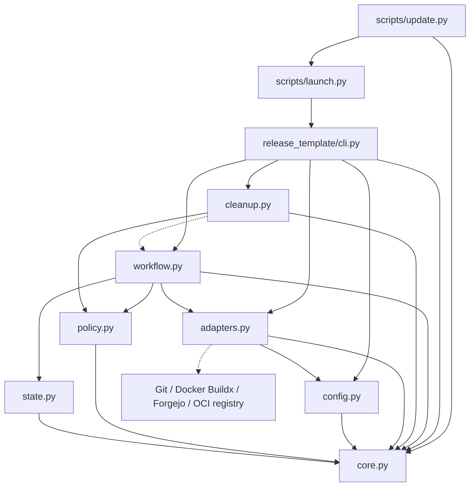

# Brooks-Lint Health Dashboard

- [Brooks-Lint Health Dashboard](#brooks-lint-health-dashboard)
  - [Scope and verdict](#scope-and-verdict)
  - [Dashboard scores](#dashboard-scores)
  - [Module Dependency Graph](#module-dependency-graph)
  - [Top Findings](#top-findings)
    - [Warning](#warning)
  - [Verification and test suite map](#verification-and-test-suite-map)
  - [Recommendation](#recommendation)

## Scope and verdict

**Mode:** Health Dashboard

**Scope:** All changes on `1-standardize-container-releases` through `b886300c085b80157b0172e90f7d6e08569943f2`: 40 tracked files across the initial implementation commit `65505b8` and task-artifact commit `b886300`. This repository has no base branch, remote, or earlier ancestor. The review therefore treats the empty tree as the baseline rather than excluding the implementation by comparing only with `HEAD^`. Existing task artifacts provide requirements context; implementation findings concern the added release tooling.

**Composite Score:** 98/100

**Trend:** First run — no trend data.

No `.brooks-lint.yaml` exists; balanced scoring and all default risks apply. The working tree was clean before review. No implementation fixes were made.

The module boundaries and existing recovery tests are strong, but retention and platform verification have reproducible safety gaps. Resolve both before enabling destructive cleanup or relying on exact platform verification. This abbreviated maintainability score is not release-readiness approval.

## Dashboard scores

- **Code Quality:** 100/100, weight 0.25. No separate R1/R2 finding: the long orchestration routines are mostly linear and their side effects have explicit stages.
- **Architecture:** 100/100, weight 0.30. No internal dependency cycles or inconsistent layering found. CLI and workflow fan-out is justified orchestration, not dependency disorder.
- **Tech Debt:** 90/100, weight 0.25. Two R6 Warning findings: retention does not protect every preserved reference, and the platform model silently excludes unexpected runnable architectures.
- **Test Quality:** 100/100, weight 0.20. No independent T1/T2 finding in the abbreviated scan. Scenario names, temporary fixtures, and observable-command assertions are generally appropriate; this score does not imply complete behavioral coverage.

Balanced scoring deducts five points per Warning. Findings are assigned to one dimension each, without duplicate deductions. Composite calculation: `100 * 0.25 + 100 * 0.30 + 90 * 0.25 + 100 * 0.20 = 97.5`, rounded half-up to `98`.

## Module Dependency Graph

Arrows indicate imports. Dashed arrows indicate runtime adapter calls through supplied workflow objects. Standard-library dependencies are omitted.

The stable launcher verifies managed code before importing the CLI. Policy depends only on shared core utilities; state owns durable checkpoint persistence. Shared filesystem utilities in `core.py` do not create upward imports or force policy functions to perform I/O.

## Top Findings

### Warning

**F1 — R6 Domain Model Distortion: preserved aliases do not protect their manifest graphs.**

**Location:** `release_template/cleanup.py:29-61` and `release_template/cleanup.py:84-102`.

**Symptom:** Protected roots come only from current outputs and unfinished checkpoints. Package enumeration skips unknown aliases, prerelease tags, newer aliases, and external staging references, but does not add their resolved graphs to the protected set. A separately listed `sha256:` record for that same content can then qualify for deletion using its older image labels. A disposable fixture reproduced a skipped `custom` alias pointing to a completed `1.0.0` digest while cleanup for `2.0.0` selected that exact digest as a deletion candidate.

**Source:** Domain-Driven Design — Aggregate Roots and invariant ownership. Retention models alias eligibility separately from the content dependency that makes a preserved alias usable.

**Consequence:** Preserving an unknown or otherwise ineligible alias does not preserve the manifests needed to pull it. Once destructive cleanup is enabled, deleting its backing digest can invalidate a reference the documented policy promises to preserve. The live Forgejo deletion effect was not tested here; the contradictory candidate selection is reproduced locally. The operator attestation does not replace reference-level reachability protection.

**Remedy:** Classify the full package inventory before choosing digest deletions. Resolve every reference that must remain, include its complete graph in the protected union, and fail closed if that graph cannot be established. Recheck preserved-reference protection before applying digest candidates. Add regression scenarios for unknown, prerelease, newer, and external-staging aliases sharing older content, including completed sibling checkpoints that no longer contribute protection.

**F2 — R6 Domain Model Distortion: platform verification silently drops unexpected runnable architectures.**

**Location:** `release_template/adapters.py:270-280`; related ownership filtering at `release_template/cleanup.py:94-100`.

**Symptom:** `Registry.verify()` first filters configurations to architectures `amd64` and `arm64`, then checks platform equality and OCI labels only on that subset. A fixture graph with valid `linux/amd64` and `linux/arm64` configurations plus a runnable `linux/riscv64` configuration with no required labels passed verification. Unsupported architectures are treated like non-runnable attestation configurations without evidence that they are artifacts.

**Source:** Domain-Driven Design — Ubiquitous Language and invariant ownership. The implementation conflates “not a supported configured platform” with “not a runnable image,” weakening the required-platform invariant.

**Consequence:** A custom build hook can publish extra runnable images with unchecked source/version/revision identity while the engine reports the exact required platform set as verified. Cleanup uses the same narrow architecture filter when establishing digest ownership, so unexpected runnable configurations can also escape ownership/version checks.

**Remedy:** Preserve descriptor media type, platform, and artifact evidence during graph traversal. Distinguish actual artifact/attestation entries from runnable configurations, then reject unexpected runnable platforms and verify labels on every runnable configuration. Apply the same classification to cleanup ownership checks. Add tests for unexpected architectures, unchecked labels, and valid attestations that must remain accepted.

## Verification and test suite map

- `TMPDIR=/tmp/opencode python3 -B -m unittest discover -s tests`: all 59 tests passed in 11.918 seconds.
- `bash -n scripts/release.sh`: passed.
- Reviewed all added production modules, launch/update entry points, test files, example hooks, documentation, and task requirements. Internal imports form an acyclic graph.
- Test inventory: 9 core tests, 6 CLI tests, 21 workflow/cleanup tests, 12 adapter tests, and 11 installer/update tests.
- Approximate suite layers by primary boundary: 30 small in-process unit/orchestration tests, 29 local integration tests, and zero live-service E2E tests. The integration group includes 12 adapter fixtures, 11 updater fixtures, five CLI fixtures using durable state, and the core child-process durability test. Individual methods can combine layers; these counts describe test methods, not assertion or subtest counts.
- Local integration fixtures use temporary Git repositories, subprocesses, loopback HTTP, filesystem transactions, and fake Docker. Their roughly 12-second feedback loop makes this integration-heavy mix reasonable; no pyramid-ratio finding is warranted.
- F1 reproduction used only temporary checkpoints and synthetic adapters: publish `1.0.0`, finish its cleanup, publish `2.0.0`, then list `custom` and its older backing digest. The planner skipped `custom` but selected its backing digest.
- F2 reproduction supplied three configuration records to the real `Registry.verify()` through its graph seam. Verification accepted an extra unlabeled `linux/riscv64` image. This isolates the classification defect; it is not a live registry test.
- Existing fake registry verification checks source/version/commit but does not enforce platform membership (`tests/support.py:38-42`). The existing OCI test covers `unknown` architecture as an attestation stand-in, not an unexpected runnable architecture (`tests/test_adapters.py:105-122`). Passing tests therefore do not refute F2.
- No production credentials were read. No real Docker build, remote creation, push, publication, or deletion was performed. Real Forgejo/Docker contracts remain unverified, as the implementation documentation already states.

## Recommendation

Fix F1 first because it concerns destructive retention and preserved-reference availability. Fix F2 before trusting published platform/source claims. Keep the live deletion gate closed until separately authorized disposable-server verification succeeds. A focused `brooks-debt` assessment would deepen the lowest-scoring dimension, but these two concrete safety gaps take priority. This stage records findings only; it does not implement remedies.
