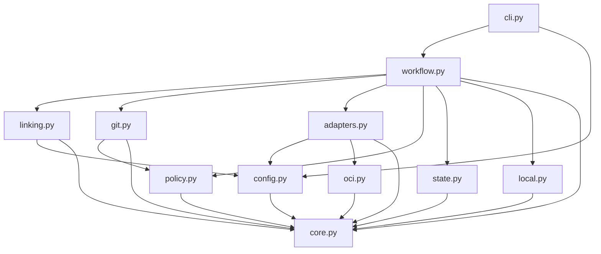

# Brooks-Lint Health Dashboard

- [Brooks-Lint Health Dashboard](#brooks-lint-health-dashboard)
  - [Scope And Verdict](#scope-and-verdict)
  - [Dimension Scores](#dimension-scores)
  - [Module Dependency Graph](#module-dependency-graph)
  - [Test Suite Map](#test-suite-map)
  - [Top Findings](#top-findings)
  - [Previous Warning Disposition](#previous-warning-disposition)
  - [Tradeoffs And Safety Boundaries](#tradeoffs-and-safety-boundaries)
  - [Verification And Limits](#verification-and-limits)
  - [Recommendation](#recommendation)

## Scope And Verdict

**Mode:** Health Dashboard

**Scope:** Plan-only review of `tasks/10-fix-release-review-warnings/2-plan.md` at `64fe87d`, against its goal and task 9's B1–B3 findings. Targeted inspection covered current linking authority, deterministic Git object creation, workflow tag intent, historical note loading, checkpoint equality, and relevant test seams. This is not a new branch implementation review.

**Composite Score:** 100/100

**Trend:** 96 → 100 (+4) from the most recent Health Dashboard record. That record reviewed task 9 implementation; this score assesses the proposed remediation design, not an improvement already verified in code.

The plan is actionable and addresses B1–B3 without weakening existing ownership or recovery boundaries. No new actionable Critical, Warning, or Suggestion finding was identified. Current implementation still contains the reviewed defects until these changes and regressions are implemented.

## Dimension Scores

| Dimension | Score | Top Finding |
|-----------|-------|-------------|
| Code Quality | 100/100 | Bounded changes separate captured Git paths from current filesystem state |
| Architecture | 100/100 | Dispatch-time authority and exact content-addressed tag restoration address the failure boundaries |
| Tech Debt | 100/100 | Existing mechanisms are reused without new locking or ref-retention subsystems |
| Test Quality | 100/100 | Proposed tests reproduce actual I/O, persistence, pruning, and historical-tree scenarios |

All four dimensions apply to the explicit plan-change review. With balanced scoring and no active findings, `100 × 0.25 + 100 × 0.30 + 100 × 0.25 + 100 × 0.20 = 100`. Scores describe identified design risks, not implemented coverage or a production safety certificate.

## Module Dependency Graph

The graph shows the targeted existing dependency directions. The plan's lexical helper stays in core and can be shared by adapter and policy without adding a cycle or network dependency to pure validation.

No new dependency cycle or policy-to-network flow is proposed. Workflow orchestration retains durable intent and remote reconciliation. The final time decision is explicitly separated from blocking linking I/O; committed blob validation no longer depends on current working-tree path resolution.

## Test Suite Map

Static discovery found 230 existing test methods across 13 modules. This review did not execute them. Task 9's latest branch review recorded a passing 230-test baseline; that historical result does not verify task 10's proposed fixes.

- Primarily unit/fake-port file families: 140 methods across core, evidence-time, workflow, retirement, CLI, Ubuntu-hook, local-image, and package-linking suites. Files can mix filesystem persistence and subprocess-boundary tests, so these are family counts rather than exact test-level classifications.
- Mixed adapter/identity/compatibility families: 79 methods across adapter, Gitea absence, Gitea migration, and publication-note suites, including injected transports, loopback HTTP, and real local Git/bare-remote checks.
- Installer/update integration: 11 methods using temporary source/consumer repositories and launcher execution.
- Focused extension points: `test_package_linking.py` currently has 14 methods; `test_publication_notes.py` has 15. New B1–B3 regressions are planned, not present yet. Live end-to-end runs in this review: zero.

The plan replaces helper-call-count-dependent expiry tests with observable clock advances at actual I/O/persistence boundaries. Real local Git pruning and clean two-commit tree cases exercise external behavior that fakes previously omitted. Keeping fake-port full-workflow write counts alongside real object tests is complementary coverage, not unjustified duplication. No separate T1/T2 finding is raised.

## Top Findings

No active findings within this plan-review scope. B1–B3 are addressed in design only; their implementation and regression outcomes remain to be verified.

## Previous Warning Disposition

- **B1 — Addressed in design:** `2-plan.md:25-30` captures one bounded canonical authority snapshot per attempted mutation, performs blocking server/association checks, persists that exact snapshot, and then uses a fresh pure time check immediately before POST. This closes the existing `linking.py:78-82` gap where version I/O follows expiry validation. The plan covers expiry during lookup, association, and persistence, file replacement/renewal, and confirmation after a valid dispatch. It preserves inclusive start, exclusive expiry, pending intent on refusal, and no duplicate POST for confirmed matching outcomes. The temporal boundary is explicit, consistent with *The Pragmatic Programmer* and *Clean Architecture*.
- **B2 — Addressed in design:** `2-plan.md:34-38` ensures the deterministic tag object before inspecting an existing pending object ID, while requiring exact equality to stored intent and complete expected identity. Current `Git.create` already has stable tag bytes and an epoch tagger; current `State.intent` enforces unchanged details. Reusing these mechanisms avoids a new private-ref lifecycle. Real temporary-Git tests must prove the object is actually absent after pruning and cover both pre-push interruption and an already accepted remote tag. This addresses the identity/lifecycle distinction from *Domain-Driven Design* without introducing equivalent-but-different annotations or treating Git failures as absence.
- **B3 — Addressed in design:** `2-plan.md:42-45` separates pure lexical committed-path validation from filesystem-aware destination checks. Literal/NUL-separated tree lookup, exact filename equality, regular blob modes, and object-ID reads enforce safety in the captured commit, not the current checkout. Existing `child()` behavior remains intact for real mutable destinations. Two-commit tests include current symlinks, absent paths, external symlink targets that must not be read, and negative captured-tree symlink cases. This removes the unintended change coupling identified through *A Philosophy of Software Design* and preserves orthogonality between historical source and current layout.

## Tradeoffs And Safety Boundaries

- A final clock check cannot guarantee atomic wall-clock completion of a remote request. The plan correctly limits software enforcement to dispatch-time authority and retains actual operator exclusion through in-flight completion. It does not relabel a JSON assertion or local checkout lock as enforced server-wide serialization.
- Loading authority once gives the durable record and dispatch the same meaning. The plan explicitly states that replacing the file is not an implicit mid-attempt extension or revocation protocol; a new attempt loads new authority. This is a documented transaction boundary, not hidden mutable-input behavior.
- Recreating the identical content-addressed tag object is distinct from creating a new release identity. Exact recorded object equality, local-tag conflict refusal, completed-remote-tag disappearance refusal, and unchanged intent are essential acceptance conditions. A future implementation must not serialize a different tagger/date or silently update the stored ID.
- A pure Git-path validator does not justify removing destination path protections elsewhere. Captured symlinks, gitlinks, traversal, and mismatched literal paths must still fail. Current configuration/source cleanliness checks remain separate from historical blob reads.
- Preserving configuration/publication/checkpoint/retirement/local-record schemas and exact-pin refusal avoids an unauthorized compatibility migration. The planned 0.2.6 fixture note path is preparation only. Existing published notes, tags, live checkouts, and task 9 evidence remain historical records, not fixtures to rewrite.
- Tests with injected clocks and owned temporary repositories are sufficient to reproduce these three defects locally. Production image publication, privileged platform setup, broad Docker cleanup, and a new remote deletion attestation are neither necessary nor authorized for this remediation plan.

## Verification And Limits

- Read the latest goal/plan, applicable shared instructions/dashboard references, prior findings, current linking/Git/blob/checkpoint boundaries, and focused test context. No repository `AGENTS.md` or `.brooks-lint.yaml` was found.
- Recounted test methods statically. Did not run runtime tests, repeat the previous review's probes, access credentials, contact remote services, prune this or preserved repositories, remove images, or alter implementation/test files.
- This review writes only `3-plan-review.md` and appends the dashboard-history record. It does not revise `2-plan.md`, update the project version, approve a live 0.2.6 release, or implement any remedy. `todo.md` remains untouched.

## Recommendation

Proceed to implementation of the bounded B1–B3 changes and their failing-before/passing-after regressions. Verify the final check's exact ordering, equality of regenerated annotation bytes/ID, and absence of current-filesystem access during historical blob loading at the concrete adapter/checkpoint boundaries. Retain all conflict, source/config/template pin, package authority, local-image protection, and deletion gates; live publication remains a separate approval decision.
