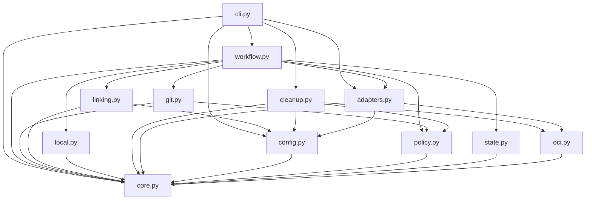

# Brooks-Lint Health Dashboard

- [Brooks-Lint Health Dashboard](#brooks-lint-health-dashboard)
  - [Scope And Verdict](#scope-and-verdict)
  - [Dimension Scores](#dimension-scores)
  - [Module Dependency Graph](#module-dependency-graph)
  - [Test Suite Map](#test-suite-map)
  - [Top Findings](#top-findings)
  - [Closure Of Previous Warnings](#closure-of-previous-warnings)
  - [Compatibility And Design Tradeoffs](#compatibility-and-design-tradeoffs)
  - [Verification And Limits](#verification-and-limits)
  - [Recommendation](#recommendation)

## Scope And Verdict

**Mode:** Health Dashboard

**Scope:** All 17 changed files on `10-fix-release-review-warnings` through implementation commit `4460857`, relative to parent branch `9-publish-images-readable-releases` at merge base `55546c1e9730a80deffb3ed04bd9f7a82ead5183`. The implementation diff contains 585 insertions and 36 deletions. Goal, plan, and plan-review commits are inherited from the base; this is not a cumulative review against main. Supporting unchanged code was read to assess contracts and safety boundaries.

**Composite Score:** 100/100

**Trend:** Stable at 100 against the latest Health Dashboard record, which assessed the task 10 plan rather than implementation. The previous branch implementation review scored 96; its three warnings are closed within this scope.

No actionable Critical, Warning, or Suggestion finding was identified. B1–B3 are addressed by the implementation and focused local regressions. All 256 tests passed during this review; this is not certification of live v0.2.6 operation.

## Dimension Scores

| Dimension | Score | Top Finding |
|-----------|-------|-------------|
| Code Quality | 100/100 | Clean; committed-path validation no longer depends on the current checkout |
| Architecture | 100/100 | Clean; dispatch timing and annotation lifecycle boundaries are explicit |
| Tech Debt | 100/100 | No separate scoped R1–R6 finding |
| Test Quality | 100/100 | No independent T1/T2 finding; boundary and recovery behavior is tested |

Balanced scoring starts each dimension at 100 and deducts 15/5/1 for each Critical/Warning/Suggestion assigned to that dimension. With zero findings, `100 × 0.25 + 100 × 0.30 + 100 × 0.25 + 100 × 0.20 = 100`. All four dimensions apply. No deductions are hidden outside the displayed finding set; the score is scoped review judgment, not coverage or operational assurance.

## Module Dependency Graph

AST inspection, including function-local imports, found no package-local cycle. `core.git_path` is a pure leaf policy shared by identity validation and the Git adapter. Workflow's seven-module fan-out remains justified orchestration; this patch does not introduce an upward policy dependency or a new infrastructure subsystem. The graph includes unchanged neighbors for context, not additional whole-project audit scope.

## Test Suite Map

`python3 -B -m unittest discover -s tests -q` passed 256 tests in 47.987 seconds during this review. Static inventory found 13 test modules, with 26 additional test methods compared with the 230-test parent baseline.

- Primarily unit/fake-port families: 149 methods across core, evidence-time, workflow, retirement, CLI, Ubuntu-hook, local-image, and package-linking modules. Some exercise persistence or emitted subprocess boundaries; this is a file-family grouping, not a claim that every method is a pure unit test.
- Mixed adapter/identity/compatibility families: 96 methods across adapters, Gitea absence/migration, and publication-note modules. `test_publication_notes.py` contains five policy methods, 21 real temporary-Git methods, and six fake-port publication methods. Other mixed families include loopback HTTP and injected transport behavior.
- Installer/update integration: 11 methods in `test_update.py`, using temporary repositories and launcher execution.
- Live end-to-end tests performed by this review: zero. Docker, production Gitea, and real package-link exclusion were not exercised.

The tests distinguish policy boundaries, real Git object storage, and fake-port publication side effects. The old expiry test's dependency on a third helper call is replaced with clock advances inside actual validation/persistence boundaries. Assertions on durable intent, exact object IDs, and no duplicate emitted writes represent safety contracts, not incidental private implementation. Shared Git fixtures are isolated per method, and aggressive pruning is confined to newly created fixture repositories. Multiple assertions support coherent recovery/preservation claims rather than unrelated behavior bundles.

## Top Findings

None. The abbreviated code-quality, architecture, debt, and test-quality scans found no new actionable issue in the branch changes. The previous warnings are evaluated below rather than reported again as unresolved findings.

## Closure Of Previous Warnings

- **B1 — Closed:** `release_template/linking.py:40-48` loads one authority snapshot and validates the deployed version. `link_packages` performs its final association lookup, appends that snapshot and digest to attempt evidence, and flushes before calling the pure `active_window` at lines 120–121 immediately ahead of `link_package`. No window-file read, network validation, or state flush intervenes. Tests advance time during version lookup, final scoped association lookup, and authority flush; expired attempts produce no POST and retain pending intent. Additional scenarios verify inclusive start/exclusive expiry, snapshot replacement, explicit renewal, blocked later publication writes with build reuse, and accepted/lost responses reconciled after expiry. This closes the blocking-I/O gap without pretending the request completes atomically with a UTC deadline.
- **B2 — Closed:** `release_template/workflow.py:119-134` validates existing operation structure, ID/status, exact tag/commit/identity, and object-ID shape. It recreates canonical bytes through unchanged `Git.create`, requires equality with the recorded ID, then retains intent-before-push and ordinary non-force reconciliation. Real Git regressions verify the annotation is actually absent after fixture-only pruning, reopen the same transaction, and recover the identical object both before push and after an accepted-but-response-lost push. Malformed/conflicting intent, local and remote lightweight-tag conflicts, object creation failure, and disappeared completed remote tags stop without repair authority. Full fake-port recovery asserts unchanged identity and one build, promotion, tag push, and release creation.
- **B3 — Closed:** `release_template/core.py:89-94` validates committed paths lexically without resolving filesystem state. `release_template/adapters.py:69-87` uses literal/NUL-separated tree lookup, requires the exact filename and regular blob mode, and reads the selected object by ID under the existing size limit. Identity policy reuses that lexical validator. Real two-commit tests cover current symlink, external parent symlink, missing path, directory replacement, and successor publication while preserving historical body/tag data. Captured symlinks/gitlinks/directories, intermediate symlinks, unsafe and wildcard-mismatch paths, invalid UTF-8, oversize, and wrong-version notes remain rejected. Filesystem-aware `child()` is unchanged for real destinations.

## Compatibility And Design Tradeoffs

The implementation follows the plan without new private refs, generalized recovery frameworks, checkpoint rewrites, or broad exception-to-absence conversion. Guard expressions are lengthy but linear and directly express a safety boundary; no complexity finding is justified solely by condition count. Small pure helpers remove the historical filesystem dependency and isolate time decisions without distributing new business rules across unrelated modules.

Configuration and publication identity remain schema 2; outer checkpoint/retirement metadata remain schema 1, and nested local ownership remains schema 2. Canonical annotation serialization, fixed tagger identity/time, project-only release bodies, legacy reading, and exact source/config/template pin checks are unchanged. New code does not gain authority to adopt an old-pin checkpoint. Recreating an object is a local content-addressed write, not permission to alter a local tag or force a remote ref.

One captured authority governs one attempt. File replacement is deliberately not a mid-attempt revocation or renewal protocol. Actual operator exclusion must span in-flight completion; neither the JSON record nor a checkout-local lock enforces server-wide exclusion. Current external symlinks can no longer block historical blob reads, but filesystem-aware active configuration/build destination checks and archive extraction safety remain intact.

README, dedicated guides, release notes, version files, and Ubuntu fixture notes agree on prepared 0.2.6. They distinguish historical v0.2.5 live results from local-only v0.2.6 verification. No image catalog or machine metadata was added to release descriptions. Bootstrap, `state.py`, `cleanup.py`, `local.py`, published 0.2.4/0.2.5 notes, and task 9 evidence are unchanged against the base.

## Verification And Limits

- Read the shared workflow/dashboard instructions, approved task plan, implementation results, previous branch findings, every changed file, and relevant unchanged Git/state/destination contracts. No `.brooks-lint.yaml` or repository `AGENTS.md` was found; default balanced settings apply.
- Independently ran the full 256-test suite, AST syntax/import/test inventory, cycle detection, all six example configuration validations, root/module/README version agreement, Ubuntu notes-path agreement, Markdown heading anchors, `bash -n scripts/release.sh`, and `git diff --check 55546c1...HEAD`; all passed.
- Independently ran generic and Ubuntu launcher validation serially using `python3 -B scripts/launch.py validate --config examples/explicit.json` and `python3 -B scripts/launch.py validate --config examples/ubuntu-hello/release.json`. Both confirmed no credentials or remote operations were used.
- The implementation's six failing-before regressions and earlier baseline timings remain recorded implementation evidence, not a newly repeated pre-fix experiment. This review reran their passing current versions as part of the full suite.
- Local fixtures do not certify production package-link replacement semantics, real operator exclusion, Docker storage behavior, power-loss durability, or live v0.2.6 publication. No real credential file, production service, preserved live checkpoint, Docker daemon image, published tag/body, or package association was accessed or changed by this review. Test Git pruning and ref changes affected only newly created fixture repositories.
- No implementation or test fixes were applied. Only this report and the appended `.brooks-lint-history.json` entry are intended review changes. `todo.md` and historical task evidence remain untouched.

## Recommendation

Accept the task 10 implementation within its local verification scope. No follow-up fix is required by this review. Any live v0.2.6 publication, push, package mutation, or cleanup still requires separate explicit approval and must preserve historical release/checkpoint identity and existing deletion gates.
