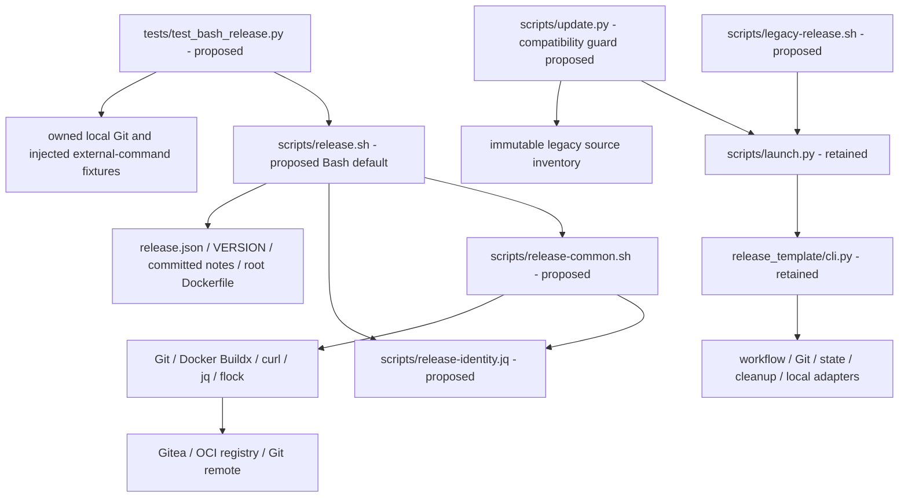

# Brooks-Lint Health Dashboard

- [Brooks-Lint Health Dashboard](#brooks-lint-health-dashboard)
  - [Scope And Verdict](#scope-and-verdict)
  - [Dimension Scores](#dimension-scores)
  - [Module Dependency Graph](#module-dependency-graph)
  - [Test Suite Map](#test-suite-map)
  - [Top Findings](#top-findings)
    - [Warning](#warning)
  - [Accepted Design And Tradeoffs](#accepted-design-and-tradeoffs)
  - [Verification And Limits](#verification-and-limits)
  - [Recommendation](#recommendation)

## Scope And Verdict

**Mode:** Health Dashboard

**Scope:** Plan-only review of `tasks/12-simplify-bash-release-template/2-plan.md` at `d9f46f6`, against task 12's goal and relevant existing source, installer, identity, credential, and test contracts. This is a design review, not a review of implemented Bash behavior or a whole-project audit.

**Composite Score:** 97/100

**Trend:** 100 → 97 (−3) against the latest dashboard record. The prior record reviewed task 10's implementation; this difference is not evidence of a runtime regression.

The smaller Bash adoption path is viable, but two implementation-significant ambiguities need resolution before execution. No Critical finding is identified. The proposed Bash implementation and tests do not yet exist.

## Dimension Scores

| Dimension | Score | Top Finding |
|-----------|-------|-------------|
| Code Quality | 95/100 | P1: startup recovery classification follows the proposed staging/build phase |
| Architecture | 95/100 | P2: remote input and pagination resource limits are unspecified |
| Tech Debt | 100/100 | No separate scoped R1–R6 finding beyond the two boundary issues |
| Test Quality | 100/100 | Behavior-focused proposed tests; add the two specific regression scenarios |

Balanced scoring deducts five points per Warning in its assigned dimension, without counting the same issue again as missing tests. Composite: `95 × 0.25 + 95 × 0.30 + 100 × 0.25 + 100 × 0.20 = 97.25`, rounded half-up to 97. All four dimensions assess the nonempty plan change. Scores describe the proposed design, not measured test quality, security certification, or implementation completeness.

## Module Dependency Graph

This is a logical proposed-dependency graph, not evidence that the new files already exist. The Bash path is independent of the Python runtime; policy serialization is centralized in jq rather than shell `eval`. The updater/legacy boundary is explicit and no new cycle is required. P1 concerns lifecycle sequencing within this structure; P2 concerns the external-input boundary, not module count or an argument against Bash itself.

## Test Suite Map

Static AST inventory found 256 existing test methods across 13 modules. No test suite was run during this plan review, and these counts do not validate the new workflow.

- Primarily unit/fake-port file families: 149 methods across core, evidence-time, workflow, retirement, CLI, Ubuntu-hook, local-image, and package-linking modules. Some also exercise persistence or emitted subprocess boundaries.
- Mixed adapter/identity/compatibility families: 96 methods across adapter, Gitea absence/migration, and publication-note modules. The publication-note family includes 21 real temporary-Git methods alongside policy and fake-port checks.
- Installer/update integration family: 11 methods using temporary repositories and managed destinations.
- Proposed new Bash tests: not yet implemented or countable. The plan specifies real entry-point subprocess tests, fake Docker/curl/Git boundaries, complementary real local Git checks, credential sentinels, and failure injection.
- Live end-to-end operations performed by this review: zero.

The planned tests sensibly assert observable identity, commands, remote-state reconciliation, absence of destructive operations, and private temporary cleanup. Retaining the Python suite and freezing a compatible installer fixture is preferable to silently accepting a new bootstrap. No independent T1/T2 finding is warranted from a test design that has not yet been implemented. P1 and P2 each need their explicit scenario added to the acceptance tests, without treating the current 256-test baseline as coverage of the Bash path.

## Top Findings

### Warning

**P1 — Code Quality / R2 Change Propagation: recovery authority is specified after the phase that can rebuild.**

Symptom: `2-plan.md:47` orders staging lookup/build and immutable verification before exact tag reconciliation. Line 50 directs a build when no recoverable matching staging object exists. Lines 58–59 instead make an existing annotated tag's bound digest authoritative, and line 61 requires startup refusal of ambiguous tag-only/release-only states. The plan does not explicitly classify those states before the build branch or define the completed-publication case where only the mutable staging alias is absent but the tag-bound immutable digest and final publication remain valid.

Source: *A Philosophy of Software Design* — information hiding and temporal information leakage; *The Pragmatic Programmer* — orthogonality between durable publication identity and expendable staging references.

Consequence: An implementation following the listed phase order can issue a new build before learning that it should verify an already completed publication or refuse an ambiguous partial state. It may then produce a different digest and conflict with the immutable annotation. The failure would be safe only after unnecessary package writes, contrary to the matching-retry/no-repeat intent. This is a plan ambiguity, not a reproduced defect in nonexistent Bash code.

Remedy: Make read-only startup classification of the requested remote tag and release precede any staging lookup that can build. Define separate branches: fresh publication may recover/build staging; matching completed publication reads and verifies the annotation-bound digest directly without requiring staging; ambiguous tag-only/release-only publication refuses before build/authenticated mutations. Keep the captured predecessor from existing identity authoritative and require its immutable object to exist. Add a test with a complete tag/release/latest and available bound digest but missing staging alias, requiring zero builds or publication writes, plus pre-build refusal tests for both ambiguous startup states.

**P2 — Architecture / R5 Dependency Disorder: the new HTTP and identity readers lack explicit resource budgets.**

Symptom: `2-plan.md:43` bounds waits and refuses redirects, line 48 requires all paginated release/tag evidence, and lines 51–53 require parsing remote manifests, configurations, and annotations. However, the plan specifies no response-byte cap, page/item or cumulative inventory limit, non-advancing-page detection, or annotation-size limit. Only project-note input has an explicit 64 KiB bound. Existing safeguards are concrete: `release_template/adapters.py:139-151` caps HTTP bodies at 64 MiB, lines 180–191 cap pagination and reject repeated page fingerprints, and `release_template/git.py:30-34` bounds tag annotations before parsing.

Source: *Clean Architecture* — explicit policy at infrastructure boundaries; *Code Complete* — defensive validation and bounded failure paths.

Consequence: Bounded individual requests do not bound an unlimited page sequence or downloaded/parser input. A server repeating a page or returning oversized JSON/annotations can keep the new Bash command running indefinitely, consume unbounded temporary storage/memory, or move failure outside the intended bounded-error path. Keeping the old Python implementation does not protect the independent new Bash readers.

Remedy: Specify conservative explicit maximums for API/registry bodies, annotation bytes, pages/items, and cumulative inventory, with non-advancing-page detection and fail-closed overflow before mutation. Enforce download/command-output bounds while receiving data, not only after jq has allocated the complete response; do not truncate and treat a partial inventory as complete. Reuse the current limits where suitable or document narrower Bash limits. Add isolated tests for a never-ending/repeated page, oversized API/manifest/config/tag data, and a result exactly at each allowed boundary. Require bounded termination, private temporary cleanup, and zero subsequent publication writes.

## Accepted Design And Tradeoffs

- A root Dockerfile, one JSON settings file, a linear Bash entry point, and a single jq identity policy are a coherent smaller adoption surface. Keeping an explicitly isolated legacy implementation is justified preservation, not automatically duplication debt or a demand to delete historical work.
- The plan deliberately excludes suites, arbitrary hooks, archives/attachments, automatic linking, retention, and local removal. A successful new publication can exit zero without the Python workflow's absent-deletion-evidence failure. These exclusions reduce scope rather than weaken an enabled deletion operation.
- Credentials remain protected-file inputs, not token-value environment defaults copied from home-web. TLS verification, non-redirecting authenticated requests, Docker auth/context isolation, and credential-free local validation are explicit requirements. Implementation must still demonstrate these guarantees with adversarial fixtures.
- New Bash identities are clearly distinct from Python schema 2. Old checkpoints stay on their captured source/config/template pin; changing wrapper bytes does not grant managed-bootstrap migration authority. The installer refusal and old-revision compatibility tests are necessary consequences of the interface change.
- Without a durable journal, exactly-once builds and automatic recovery of every partial state are deliberately not promised. Refusal of ambiguous tag-only/release-only startup states is an acceptable conservative scope decision, provided it happens before mutation as P1 requests. Documentation must not advertise it as a general replacement for the Python checkpoint protocol.
- Operator serialization remains an external precondition. Local flock, fresh version checks, and predecessor comparison are not server-wide locks or compare-and-swap. The plan acknowledges this limitation rather than adding a false safety claim.
- Existing release history, notes, archived evidence, protected local images, and live checkpoints are outside implementation mutation authority. The new notes/version/config preparation does not itself authorize publishing v0.3.0.

## Verification And Limits

Read the latest goal and full plan, shared dashboard instructions, current launcher/updater locking and inventory flow, credential/HTTP/registry boundaries, Git annotation lifecycle, ignore rules, installer fixture setup, and the relevant home-web reference sequence. No `.brooks-lint.yaml` was found; balanced defaults apply. Static test inventory was counted directly from the existing files.

No tests, builds, credential reads, Git network requests, Gitea/registry probes, package mutations, live cleanup, or implementation changes were performed. The findings describe design omissions/ambiguities, not experimentally reproduced Bash runtime failures. Current implementation verification remains the separate historical task 10 evidence.

This review creates `3-plan-review.md` and appends a dashboard-history record only. The original goal and `2-plan.md` remain unchanged, as do implementation code, `todo.md`, other projects, and historical release records. The next workflow stage can update the plan explicitly; no fixes are silently applied here.

## Recommendation

Resolve P1's startup state machine first, then add P2's explicit external-input budgets and regression scenarios. The remaining design can proceed without extra framework layers, automatic cleanup, or a new durable shell journal. Re-review the updated plan before implementation; this report grants no live-release authority.
