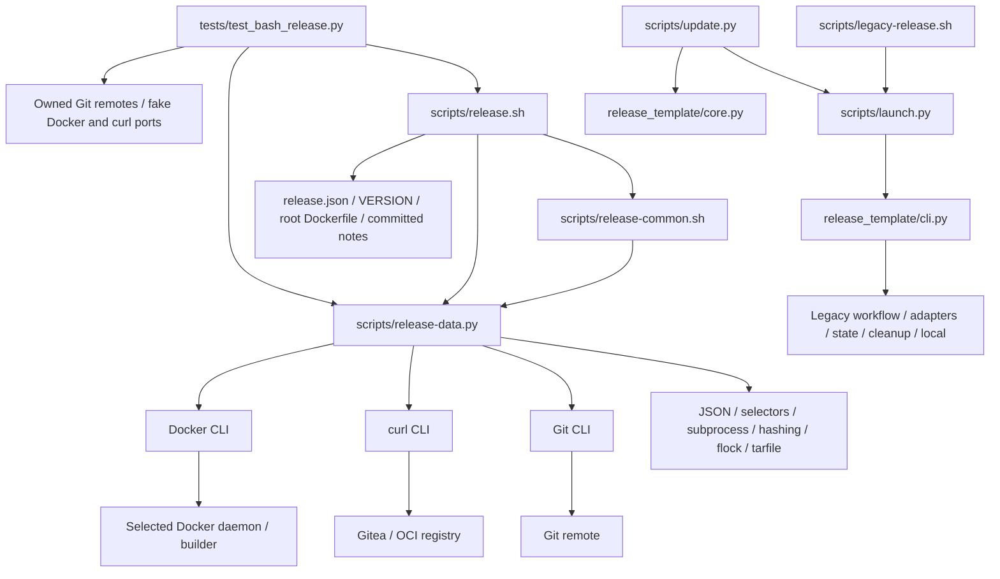

# Brooks-Lint Health Dashboard

- [Brooks-Lint Health Dashboard](#brooks-lint-health-dashboard)
  - [Scope And Verdict](#scope-and-verdict)
  - [Dimension Scores](#dimension-scores)
  - [Module Dependency Graph](#module-dependency-graph)
  - [Test Suite Map](#test-suite-map)
  - [Top Findings](#top-findings)
    - [Warning](#warning)
  - [Plan Closure And Accepted Tradeoffs](#plan-closure-and-accepted-tradeoffs)
  - [Verification And Limits](#verification-and-limits)
  - [Recommendation](#recommendation)

## Scope And Verdict

**Mode:** Health Dashboard

**Scope:** All 25 changed files on `12-simplify-bash-release-template` through implementation commit `9c25334`, relative to actual base `main` at `de5bda6f75674a1a2692095eed5a83615da28181`. The implementation diff has 1,729 insertions and 32 deletions. Earlier task goals/plans/review commits are inherited from main; the implementation's recorded jq-free plan adjustment is included in this diff. Relevant unchanged legacy code was inspected for compatibility boundaries.

**Composite Score:** 96/100

**Trend:** 97 → 96 (−1) against the latest dashboard record, which assessed the original task 12 plan rather than implementation. This is not a measured regression in previously published releases.

The ordinary single-command publication and conservative startup-retry paths are useful, but three locally reproduced warnings remain at the mutation and Docker-environment boundaries. No Critical finding is identified. Resolve these before live publication; no fixes are applied by this review.

## Dimension Scores

| Dimension | Score | Top Finding |
|-----------|-------|-------------|
| Code Quality | 95/100 | B1: a failed lookup inside a Bash condition permits promotion |
| Architecture | 90/100 | B2: confirmed-tag disappearance permits later writes; B3: Docker host selection changes |
| Tech Debt | 100/100 | No independent scoped R1–R6 finding beyond these boundary defects |
| Test Quality | 100/100 | Useful behavior tests; add the reproduced boundary scenarios |

Balanced scoring deducts five points for each Warning in its assigned dimension, without charging the same defect again as missing test coverage. Composite: `95 × 0.25 + 90 × 0.30 + 100 × 0.25 + 100 × 0.20 = 95.75`, rounded half-up to 96. All dimensions apply to this nonempty branch diff. Scores are scoped judgment, not a safety certificate or coverage percentage.

## Module Dependency Graph

The arrows summarize file/data and external-execution dependencies, not only Python imports. The new helper imports no legacy package; the legacy engine/updater remain deliberately isolated. The data helper's lock-holder action also starts one locked Bash child with an inherited descriptor; this bounded bootstrap is not an import cycle. The file count and linear protocol helpers do not independently justify a complexity finding. B3 is a real environmental dependency change despite the otherwise reasonable module separation.

## Test Suite Map

`python3 -B -m unittest discover -s tests -q` passed all 297 tests in 144.222 seconds during this review. Static inventory found 297 test methods across 14 modules, an increase of 41 from the parent baseline.

- Preserved primarily unit/fake-port families: 149 methods across core, evidence-time, workflow, retirement, CLI, Ubuntu-hook, local-image, and package-linking modules. Some include persistence or emitted-command boundaries.
- Preserved mixed adapter/identity/compatibility families: 96 methods across adapters, Gitea absence/migration, and publication-note modules. These include policy, injected transport, loopback HTTP, and real temporary Git tests.
- Installer/update integration: 12 methods, including the new refusal-before-destination-change case and frozen compatible legacy wrapper fixtures.
- New Bash family: 40 methods, comprising three entry-interface checks, 24 real Bash/local-Git publication scenarios with fake Docker/curl ports, and 13 data/helper checks. The latter combine pure validation, injected inventory inputs, and real bounded subprocess tests.
- Live end-to-end verification performed by this review: zero.

The tests verify meaningful identity, no-repeat writes, private state, bounded capture, and refusal behavior. No separate T1/T2 finding is raised. The full fake-port flow does not currently fail a lookup specifically inside the promotion condition, remove a tag after in-process confirmation, or model Docker's effective DOCKER_HOST/DOCKER_CONTEXT precedence. These explain why the following probes expose gaps despite the existing coverage; no duplicate deduction is made for missing regressions.

## Top Findings

### Warning

**B1 — Code Quality / R2 Change Propagation: a failed registry read is converted into permission to promote.**

Symptom: `scripts/release.sh:116-117` performs `data resolve` inside the `if [[ $(...) != "$prepared" ]]` condition. Bash does not apply normal errexit behavior to this conditional command substitution. When the helper refuses an oversized response or exits for a transport/HTTP/parser failure, empty stdout compares unequal to the prepared digest and the script dispatches `docker buildx imagetools create` instead of stopping. The helper's correct nonzero status is lost at its shell caller boundary.

Source: *Code Complete* — explicit error-handling discipline; *A Philosophy of Software Design* — information leakage and cross-module change coupling in failure contracts.

Consequence: Unknown or resource-refused registry evidence can be followed by a final-alias mutation and release POST. A later successful verification can return zero even though the command violated its documented fail-closed read/budget rule. This is distinct from intentional reconciliation of a write whose response was lost: the failed operation here was a prerequisite read.

Remedy: Capture the resolved digest through an explicitly checked command/status before entering the comparison, or reuse a checked guard result with clearly defined freshness. Refuse all failed reads before any promotion/release write; do not rely on global `set -e` inside conditional expressions. Add full-entry regressions at this exact lookup for overflow, malformed JSON, 401/500, and transport failure, requiring zero subsequent promotion or release POST.

Reproduction: Reused an exclusively owned `BashPublicationTests` fixture, modifying only its temporary curl port to return 4 MiB plus one byte on the fifth `latest` lookup, immediately after the final guard and inside this condition. The helper emitted a byte-limit refusal, but the command returned zero and printed `Publication verified`. The port log recorded one promotion and one release POST after the injected refusal. No real HTTP or Docker command ran.

**B2 — Architecture / R6 Domain Model Distortion: the guard treats a disappeared confirmed tag as fresh absence.**

Symptom: `scripts/release-common.sh:34-39` permits an empty `remote_oid` unconditionally. This is appropriate before the first tag push, but the same `fresh_guard` is reused at `scripts/release.sh:115` and `:121` after lines 111–113 have confirmed the exact remote tag. It contains no phase/confirmation invariant requiring that tag to remain present for promotion and release creation.

Source: *Domain-Driven Design* — lifecycle invariants and explicit identity ownership; *The Pragmatic Programmer* — temporal coupling across external-service boundaries.

Consequence: A confirmed source/identity tag can disappear and the workflow still changes `latest` and sends a release POST. It only discovers the missing tag during final verification, after additional partial publication writes. Requiring single-writer operation is still necessary, but does not justify accepting already-observed contradictory remote state.

Remedy: Distinguish the pre-push absence allowance from the post-confirmation invariant, using an explicit in-memory confirmed state or separate guards. After confirmation, require the exact object and peeled commit before every subsequent mutation; absence must stop, not become implicit tag/release repair authority. This needs no new durable journal. Add tests removing the tag after first confirmation and before promotion/release creation, asserting no later writes or rollback and preservation of the previously observed predecessor alias.

Reproduction: In a new local Git/bare-remote fixture, allowed the initial push and first confirming advertisement, then removed only that fixture's tag before the next advertisement. The real Bash command performed one promotion and one release POST after the disappearance. It exited nonzero only at final verification, leaving fixture latest at the prepared digest and the tag absent. This demonstrates the late stop; no deployed Gitea auto-tag behavior is assumed or claimed.

**B3 — Architecture / R5 Dependency Disorder: auth isolation can switch the selected Docker daemon.**

Symptom: `scripts/release.sh:60-63` captures `docker context show` and always exports `DOCKER_CONTEXT`, including `default`. When the caller supplied DOCKER_HOST without DOCKER_CONTEXT, Docker's context environment setting overrides the host selection. Thus preflight can inspect the requested host, while later login/build/promotion select the default context. The unchanged legacy adapter deliberately exports a context only when it is non-default or the caller explicitly selected one (`release_template/adapters.py:118-121`).

Source: *Clean Architecture* — keep infrastructure selection consistent across boundaries; *The Pragmatic Programmer* — orthogonality of private authentication and daemon selection.

Consequence: Creating a private auth configuration can unintentionally redirect Docker work to another daemon/builder or cause a later failure after successful preflight. This contradicts the documented preservation of the selected connection. It is not proof that any actual production daemon was contacted during this review.

Remedy: Preserve the caller's effective host/context/TLS selection independently of auth isolation. Do not newly export the default context over an existing host-only selection; retain explicit context choices and necessary private context metadata. Test host-only, non-default context, explicit default context, and local-default cases across preflight, login, build, and promotion, asserting the same effective endpoint selection rather than merely the presence of environment variables.

Reproduction: Used a temporary fake Docker port to record only synthetic connection variables, with DOCKER_HOST set to `tcp://fixture.invalid:2376` and DOCKER_CONTEXT absent. Preflight saw that host with no context override. The subsequent build saw the same host string but `DOCKER_CONTEXT=default`, which changes Docker's effective precedence. The fixture publication returned zero because its port does not implement daemon routing. No actual daemon or network endpoint was used.

## Plan Closure And Accepted Tradeoffs

- P1's startup ordering is implemented: initial tag/release classification precedes staging, matching completed retries do not require staging, and ambiguous startup records refuse. B2 concerns the separate in-process post-confirmation lifecycle, not a request to undo that conservative startup policy.
- P2's receiving and inventory budgets are substantially implemented and tested: strict duplicate-aware JSON, bounded concurrent pipes and stdin, producer-group termination, per-object bytes, cumulative inventory counters/deadlines, and explicit termination. B1 prevents end-to-end closure because a resource refusal at one conditional caller still permits a later mutation.
- The user-requested jq-free adjustment is explicitly recorded in the modified plan and implementation results. Bash owns the publication sequence, while a standalone standard-library helper handles data and bounded I/O. This is not silent reuse of the old Python engine.
- No automatic package linking, attachment uploads, retention, local-image deletion, source push, force tag update, or rollback is added. Notes stay project-focused; new identity is distinct from Python schema 2. Existing original-pin transactions are not adopted or rewritten.
- The new updater guard rejects a Bash source inventory before destination lock creation. Freezing the original compatible wrapper in installer tests preserves the old protocol rather than bypassing checksum checks. Historical example/notes/evidence preservation is intentional, not a demand to delete the legacy tree.
- No durable Bash journal, exactly-once unbound build, server-wide locking, atomic cross-service commit, runtime emulation, or power-loss guarantee is promised. These explicit scope decisions do not need a larger recovery framework to remedy B1–B3.

## Verification And Limits

Read shared workflow/dashboard guidance, all branch changes, the latest plan/results/review context, and relevant unchanged legacy auth/launcher/state contracts. No `.brooks-lint.yaml` or repository `AGENTS.md` was found; balanced defaults apply. The full 297-test suite passed in 144.222 seconds. Static AST inventory, Python syntax, all Bash syntax checks, six legacy example validations, version agreement, Markdown TOC/file links, and `git diff --check main...HEAD` passed. ShellCheck is not installed and was not run or installed.

Independently ran root Bash validation, generic and Ubuntu legacy validation serially, and help under an empty environment with no external-tool PATH. Validation reported no credential or remote operations. The three focused probes altered only newly created fixture ports, synthetic environment values, and an owned bare-remote tag. Every Git fetch/push/ref change targeted those fixture repositories; Docker/curl were fake executable ports. No real token, production service, real Docker daemon/image, old live checkpoint, published tag/body, package, or foreign project was accessed or changed.

This review applies no implementation/test fix and does not modify the goal, plan, implementation results, prior plan-review report, historical evidence, or `todo.md`. Only this report and the appended `.brooks-lint-history.json` record are intended tracked changes. Local probes/suite results do not certify deployment behavior or grant live-release authority.

## Recommendation

Fix B1's read-status propagation first, then enforce B2's post-confirmation tag invariant and preserve B3's effective Docker connection. Add the exact local regressions before the next implementation/live-release decision. Keep the simpler single-image scope, original-pin legacy separation, and absence of automatic cleanup; no live publishing, repair, or deletion is authorized by this review.
