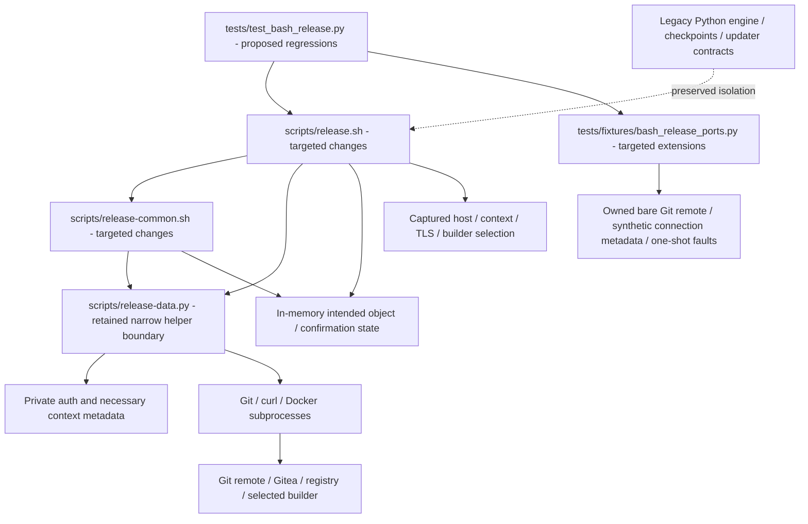

# Brooks-Lint Health Dashboard

- [Brooks-Lint Health Dashboard](#brooks-lint-health-dashboard)
  - [Scope And Verdict](#scope-and-verdict)
  - [Dimension Scores](#dimension-scores)
  - [Module Dependency Graph](#module-dependency-graph)
  - [Test Suite Map](#test-suite-map)
  - [Top Findings](#top-findings)
  - [Assessment Of B1–B3](#assessment-of-b1b3)
  - [Compatibility And Tradeoffs](#compatibility-and-tradeoffs)
  - [Verification And Limits](#verification-and-limits)
  - [Recommendation](#recommendation)

## Scope And Verdict

**Mode:** Health Dashboard

**Scope:** Plan-only review of `tasks/13-fix-bash-release-review-warnings/2-plan.md` through `6d62ebe`, against its goal, task 12's recorded B1–B3 findings, and the current shell/helper/auth/test boundaries. This does not review a task 13 implementation or re-audit the entire project.

**Composite Score:** 100/100

**Trend:** 96 → 100 (+4) against the latest dashboard record. That record evaluated task 12's implementation; this score evaluates the proposed remediation, not a measured runtime improvement.

No actionable Critical, Warning, or Suggestion finding was identified in the plan. B1–B3 are addressed in design with focused failure-boundary regressions and explicit compatibility limits. The current implementation still contains the reviewed defects until the fixes are implemented and verified.

## Dimension Scores

| Dimension | Score | Top Finding |
|-----------|-------|-------------|
| Code Quality | 100/100 | Explicit read-status propagation and same-result alias validation are planned |
| Architecture | 100/100 | Confirmed-tag lifecycle and Docker connection/auth boundaries are explicit |
| Tech Debt | 100/100 | Narrow fixes; no new journal, schema, framework, or legacy refactor |
| Test Quality | 100/100 | Behavior-driven fault injection and effective-connection matrix are specified |

Balanced scoring starts each dimension at 100 and deducts 15/5/1 per Critical/Warning/Suggestion. With zero findings, `100 × 0.25 + 100 × 0.30 + 100 × 0.25 + 100 × 0.20 = 100`. All four dimensions assess the nonempty plan change. This is a scoped design assessment, not implementation approval, coverage measurement, or operational certification.

## Module Dependency Graph

This is a proposed logical file/data boundary map, not proof of completed changes. The legacy dashed edge denotes an isolation constraint, not a new import. The plan keeps the release sequence in Bash and data/I/O in the existing standalone helper. No new package dependency or import cycle is required. Confirmation state is local to the running invocation; it is not a second durable checkpoint protocol.

## Test Suite Map

Static AST inventory found 297 existing test methods across 14 modules. No test suite was run during this plan review. The 297-pass result in task 12's branch review is historical baseline evidence, not verification of the future task 13 fixes.

- Primarily unit/fake-port legacy families: 149 methods across core, evidence-time, workflow, retirement, CLI, Ubuntu-hook, local-image, and package-linking modules. Some include persistence or emitted subprocess boundaries.
- Mixed adapter/identity/compatibility legacy families: 96 methods across adapter, Gitea absence/migration, and publication-note modules, combining pure checks, injected transport, loopback HTTP, and owned Git tests.
- Installer/update integration: 12 methods, including frozen protocol-1 fixtures and Bash-source refusal before destination changes.
- Existing Bash family: 40 methods, comprising three interface checks, 24 local Git/fake-port publication scenarios, and 13 data/bounded-I/O checks.
- Proposed additional regressions: not yet implemented or countable. The plan requires full-entry read faults, confirmed-tag loss/replacement at two post-confirmation boundaries, and a Docker selection/metadata matrix, with explicit injection and operation-order assertions.
- Live end-to-end operations performed by this review: zero.

The new test design measures exit status, absence of subsequent writes, preservation of accepted state, immutable intent, and effective endpoint/builder selection. It avoids using the existence of a host environment string as a substitute for Docker precedence and avoids making a global fifth-helper-call count the public contract. These are meaningful changes to scenario coverage rather than extra happy-path execution. No independent T1/T2 design finding is warranted.

## Top Findings

None. The plan contains no new actionable issue in the abbreviated code-quality, architecture, debt, or test-quality scans. The original implementation warnings remain open operationally; the following assessment records their planned remediation, not an implemented closure.

## Assessment Of B1–B3

- **B1 — Addressed in design:** `2-plan.md:27-31` requires an explicitly checked named read before comparison, validates that same successful digest against the immutable predecessor/prepared pair, and audits the nearby conditional call sites. It distinguishes failed prerequisite reads from reconciliation of already dispatched writes. Lines 51–52 require actual injection at the vulnerable post-guard boundary for overflow, malformed/null data, 401/500, transport and timeout-equivalent errors, with nonzero exit, no success message, and no later promotion/release POST. The already-prepared and newly foreign alias cases guard against both duplicate promotion and overwriting fresh contradictory evidence. This directly addresses error-handling and cross-boundary contract propagation rather than relying on additional shell flags.
- **B2 — Addressed in design:** Lines 35–39 define a one-way in-memory transition only after exact object/peeled-commit reconciliation, separate intended identity from fresh observations, and require the confirmed identity before subsequent mutations. Absence can no longer erase confirmation or regain pre-push authority. Line 53 specifies both disappearance before promotion and disappearance after promotion but before release creation, plus conflicting/lightweight/wrong-source evidence. The latter case correctly preserves an already accepted alias rather than demanding unsafe rollback. Startup completed/no-staging and ambiguous-partial behavior remain unchanged. No new persistence layer is needed for the reproduced in-process gap.
- **B3 — Addressed in design:** Lines 43–47 distinguish effective connection selection from private auth files, preserve host/TLS/buildx inputs, and explicitly cover empty versus nonempty context settings. Config-selected named contexts carry their endpoint/TLS metadata without copying the original auth/helper inventory. Lines 54–55 require the fake port to model precedence and metadata resolution across preflight/login/build/promotion using synthetic inputs. Host-only, empty context, config-selected context, explicit context/default overrides, and ordinary default are all covered. This resolves the environmental dependency identified by review without claiming a fake port proves live daemon routing.

## Compatibility And Tradeoffs

The production scope is proportionate: primarily two shell files, with narrowly justified auth/helper changes only if necessary. Existing input budgets, strict JSON/notes validation, same-identity retries, private credentials, and bounded failure reporting remain requirements, not optional work deferred to later cleanup.

The intended 0.3.1 patch changes version metadata, committed project notes, and the new Bash notes setting consistently, without altering configuration schema 1 or `container-release-bash/1` fields/serialization. Changed source/config/script hashes remain distinct identities. No new pin may silently adopt an old transaction, and no goal/review/result evidence is rewritten to claim earlier fixes.

Explicit in-memory confirmation is sufficient for the observed tag-disappearance bug but does not supply restart recovery, distributed exclusion, compare-and-swap, or atomic cross-service publication. Likewise, preserving effective Docker selection is an auth-isolation invariant, not authority to connect to live endpoints during implementation. These limitations are honestly retained.

The plan rejects repair, rollback, package reassignment, deletion, broad pruning, privileged platform setup, and unrelated legacy refactoring. Its verification sequence retains all current tests, adds failing-before/passing-after evidence, validates configuration/docs/version agreement, and records ShellCheck absence rather than installing tools. No extra framework or generalized context manager is justified by this scope.

## Verification And Limits

Read shared workflow/dashboard instructions, the latest goal/full plan, previous B1–B3 review evidence, and relevant current shell guards, promotion sequence, helper auth preparation, and test fixture setup. No `.brooks-lint.yaml` or repository `AGENTS.md` was found; balanced defaults apply. Counted current test methods statically without importing/executing their fixtures.

No tests, builds, Git network requests, real credential reads, Docker daemon operations, production probes, or implementation fixes were performed. The current code still unconditionally allows missing tags in its shared guard and exports the default Docker context; only a future implementation can change and verify those behaviors. Neither the score nor this report is live verification or permission to publish 0.3.1.

Only this report and an appended `.brooks-lint-history.json` record are intended review edits. The goal, plan, production/test code, historical task records, protected resources, other projects, and `todo.md` remain unchanged.

## Recommendation

Proceed with the implementation workflow for task 13 as planned. Require the focused regressions to fail before the fixes and pass afterward, then run the full retained suite before claiming B1–B3 closed in implementation. No additional plan revision is required by this review, and no live publication or cleanup is authorized.
