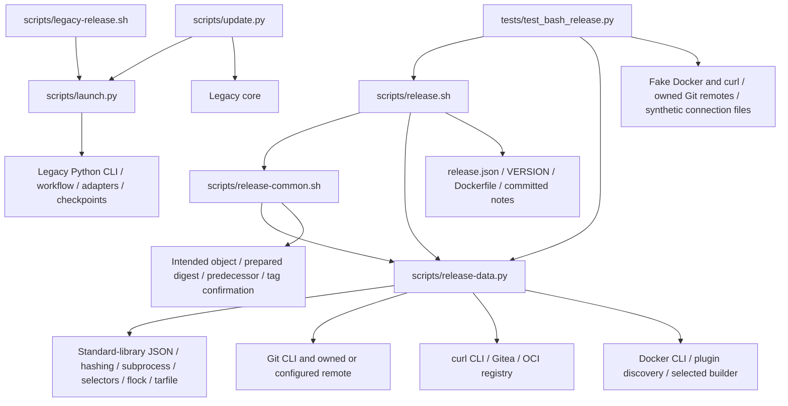

# Brooks-Lint Health Dashboard

- [Brooks-Lint Health Dashboard](#brooks-lint-health-dashboard)
  - [Scope And Verdict](#scope-and-verdict)
  - [Dimension Scores](#dimension-scores)
  - [Module Dependency Graph](#module-dependency-graph)
  - [Test Suite Map](#test-suite-map)
  - [Top Findings](#top-findings)
    - [Warning](#warning)
  - [Closure Of Previous Findings](#closure-of-previous-findings)
  - [Compatibility And Tradeoffs](#compatibility-and-tradeoffs)
  - [Verification And Limits](#verification-and-limits)
  - [Recommendation](#recommendation)

## Scope And Verdict

**Mode:** Health Dashboard

**Scope:** Current branch `13-fix-bash-release-review-warnings` through `d5ddfd9`. Its actual parent branch is `12-simplify-bash-release-template` at `19edb71a6b74dab858c6d8f747fd526f14e574b4`; that direct diff contains all 14 task 13 implementation files, with 440 insertions and 28 deletions. Also reviewed the complete cumulative integration diff against local `main` at `de5bda6`: 32 files, 2,497 insertions and 32 deletions, including inherited task 12 implementation, documentation, and review records. Findings below explicitly distinguish inherited behavior from task 13 regressions. Relevant unchanged legacy boundaries were inspected, not re-audited project-wide.

**Composite Score:** 97/100

**Trend:** 100 → 97 (−3) against the latest dashboard record, which reviewed the task 13 plan rather than implementation. Against task 12's implementation review, the score is 96 → 97 (+1); the finding sets differ, so neither comparison is a deployment-quality measurement.

Task 13 closes the original B1–B3 scenarios. No new defect attributable solely to its 14-file implementation diff was identified. Two additional inherited boundary warnings remain in the cumulative integration scope: release creation accepts an observed reversion of the promoted alias, and private Docker auth drops user-installed Buildx plugin discovery. No Critical finding was identified. No fixes are applied in this review.

## Dimension Scores

- **Code Quality: 95/100.** One Warning: N1, a pre-promotion alias predicate is reused after promotion.
- **Architecture: 95/100.** One Warning: N2, private auth changes the Docker plugin dependency search path.
- **Tech Debt: 100/100.** No independent scoped R1–R6 finding beyond the two boundary defects.
- **Test Quality: 100/100.** No independent T1/T2 finding; behavior-oriented fixtures and focused failure assertions remain useful.

Balanced scoring deducts five points per Warning in its assigned dimension. Neither defect is counted again as test debt. Composite: `95 × 0.25 + 95 × 0.30 + 100 × 0.25 + 100 × 0.20 = 97.25`, rounded half-up to 97. All dimensions apply to the nonempty diff. This scoped score is not a safety certificate or coverage percentage.

## Module Dependency Graph

Arrows include file/data and process dependencies, not only imports. Bash retains publication policy; the standalone data helper imports no legacy package. Its lock-holder starts one locked Bash child, a bootstrap rather than an import cycle. No new package cycle or reversed legacy dependency was found. The explicit confirmation state improves lifecycle ownership without introducing a durable recovery subsystem. N2 concerns an external dependency search path omitted by that otherwise reasonable separation.

## Test Suite Map

Static AST inventory confirms 322 methods across 14 modules, including every original Bash method and 25 additional task 13 methods. The suite mixes layers within files, so these are family counts rather than invented exact unit/integration splits.

- Primarily unit/fake-port legacy families: 149 methods across core, evidence-time, workflow, retirement, CLI, Ubuntu-hook, local-image, and package-linking modules; some exercise local persistence or emitted commands.
- Mixed adapter/identity/compatibility families: 96 methods across adapters, Gitea absence/migration, and publication notes, combining pure checks, injected transport, loopback HTTP, and owned Git integration.
- Installer/update integration: 12 methods, preserving frozen protocol-1 wrapper fixtures and Bash-source refusal before destination changes.
- Bash family: 65 methods comprising three interface checks, 48 Bash/local-Git publication scenarios with fake Docker/curl, and 14 data/helper checks mixing pure validation, injected inventory inputs, and real bounded subprocesses.
- Live end-to-end verification: zero. No real builder, daemon routing, TLS handshake, runtime emulation, or deployed Gitea behavior is certified.

The added tests verify fault activation, nonzero exit, absence of subsequent writes, preserved accepted state, intended annotation identity, and effective synthetic endpoint/builder selection. They characterize the requested changes rather than merely increasing line coverage. Their post-confirmation read counter is local to the target phase, not a global fifth-call contract. The larger subprocess suite is justified by Bash failure semantics and publication risk. N1 and N2 lack their precise regression scenarios; that gap is recorded with the production findings rather than charged again as a separate test-quality defect.

## Top Findings

### Warning

**N1 — Code Quality / R6 Domain Model Distortion: the release guard accepts an already-promoted alias reverting to its predecessor.**

Symptom: `scripts/release-common.sh:29-32` permits either `predecessor` or `prepared` every time `alias_guard` runs. After `scripts/release.sh:130` confirms promotion, line 132 reuses that predicate before release POST. If this fresh read now observes the original predecessor, the guard accepts the contradictory state and line 133 still creates the release. Final verification catches the mismatch only after that additional write. This predicate was inherited from task 12; task 13 correctly strengthens tag lifecycle but does not make alias eligibility phase-specific.

Source: *Domain-Driven Design* — lifecycle invariants and identity ownership; *Code Complete* — defensive checks must enforce the invariant at the operation they protect.

Consequence: A known incomplete final-image state can be followed by release creation, leaving another partial publication before the command refuses. This is not an unavoidable unseen race: the later alias read actually observes the reversion. Operational single-writer exclusion remains necessary but should not turn contradictory observed evidence into permission to write. No deployed auto-tag or concurrent writer behavior is assumed.

Remedy: Keep predecessor-or-prepared permission before promotion, but require exactly the prepared digest in the checked guard before release creation once promotion has been confirmed. Stop without repromotion, rollback, or predecessor refresh. Add a full-entry fixture that changes latest to the captured predecessor after the first successful promotion confirmation and during the next guard; require nonzero exit, zero subsequent release POST, unchanged tag, one promotion, and no repair.

Reproduction: In a new owned `BashPublicationTests` fixture, seeded a predecessor, allowed build/tag/promotion and the immediate successful latest verification, then changed only the fixture alias on the next latest read. The injection log recorded `review-alias-reverted` before `release-post`. The real Bash entry returned 1 only after final verification, with one release record, latest still at the predecessor, and no repush or rollback. Only the temporary curl port and its owned state were modified; no tracked test or production file was changed.

**N2 — Architecture / R5 Dependency Disorder: private auth loses a config-local Buildx plugin.**

Symptom: `scripts/release.sh:53` performs builder preflight under the original Docker config, then line 64 replaces `DOCKER_CONFIG` before build/promotion. `scripts/release-data.py:302-307` creates minimal auth and copies contexts, but preserves neither the original `cli-plugins` path nor configured plugin directories. `BUILDX_CONFIG` at shell line 60 preserves Buildx state, not Docker CLI plugin executable discovery. Docker's plugin manager searches the active config's `cli-plugins`, configured extra directories, and system locations; a user-local plugin may disappear or be shadowed by another system installation after isolation. This omission is inherited from task 12, not introduced by task 13's host/context fix. The legacy adapter already preserves the original config-local plugin path at `release_template/adapters.py:106-108`.

Source: *Clean Architecture* — stable infrastructure dependency selection; *The Pragmatic Programmer* — orthogonality between authentication and executable/plugin selection.

Consequence: A valid common user-local Buildx installation passes preflight, but build fails after auth isolation because the plugin is no longer discoverable. If another system plugin exists, preflight and publication can use different plugin binaries. Preserved endpoint and builder-state strings do not establish the same usable toolchain. The fixture port currently bypasses Docker plugin discovery, so its connection matrix cannot detect this condition.

Remedy: Preserve or explicitly pin the selected Buildx plugin discovery independently of registry auth, without copying auth/helper inventories or installing tools. Resolve relative paths against the caller's original working directory. Include a config-local-only plugin scenario and a shadowed-system-plugin scenario; assert consistent plugin identity before and after isolation, or refuse before publication writes if preservation is unsupported. Retain the existing effective host/context/TLS matrix.

Reproduction: In a new owned fixture, created only a synthetic `original-docker/cli-plugins/docker-buildx` marker. A temporary Docker port modeled config-local discovery and refused Buildx when that marker was absent from the active config. Preflight logged `builder`; login ran under private auth; the next Buildx call logged `review-buildx-plugin-missing` and the entry returned 2 with zero publication writes. This is a model-based boundary reproduction, not a real Docker execution. The dependency is independently confirmed by Docker CLI v29.0.0's [plugin manager](https://github.com/docker/cli/blob/v29.0.0/cli-plugins/manager/manager.go), specifically `getPluginDirs` and `PluginRunCommand`, read as public source during review.

## Closure Of Previous Findings

- **B1 closed for the reviewed scenario:** `scripts/release.sh:125-127` checks the read's status, validates that same value against the captured predecessor/prepared digests, and only then decides promotion. The new overflow, malformed/null, 401/500, transport, timeout-equivalent, foreign, and already-prepared tests exercise the precise decision boundary. Guard helper failures explicitly stop even in conditional callers. Final-verification comparisons fail closed and do not authorize subsequent writes.
- **B2 closed for the reviewed scenario:** `tag_confirmed` starts false for fresh publication, becomes true only after exact post-push object/peeled-commit reconciliation, and never clears. Subsequent guards require the same intended object and commit. Tests remove the tag before promotion and after promotion, replace it with lightweight/foreign evidence, and alter peeled evidence; accepted prior work is preserved without repush or release POST. Lost-response reconciliation and conservative startup ambiguity remain distinct.
- **B3 closed for the reviewed scenario:** Default context is no longer exported over a host-only selection, including empty context values. Explicit default/named context precedence, config-selected named context metadata, empty Docker config fallback, relative connection paths, TLS variables, and explicit/default builder state are covered. These tests establish synthetic connection selection, not native routing. N2 is the separate omitted plugin-executable dependency, not evidence that the host-precedence fix failed.

## Compatibility And Tradeoffs

Version metadata, README, notes heading, and configured notes path agree on prepared 0.3.1. Schema 1 and `container-release-bash/1` fields/canonical serialization are unchanged by task 13. New source/config/script identity remains distinct from old transactions; no old-pin adoption is authorized. Cumulative task 12 changes intentionally replace the default wrapper and preserve the legacy engine behind an explicit entry and installer refusal.

The jq-free standard-library helper is an explicitly recorded user-requested plan adjustment, not hidden reuse of the legacy engine. Linear orchestration, small shell guards, protocol switches, historical legacy files, and the absence of a general hook/journal framework do not independently justify decay findings. No package linking, deletion, retention, privileged setup, source push, forced tag update, or automatic recovery is added. Cross-service atomicity, distributed writer exclusion, exactly-once unbound builds, and power-loss durability remain explicit non-guarantees.

## Verification And Limits

Read shared dashboard/risk/source guidance, both branch diffs, current entry/helper/fixture/tests, latest task goal/plan/review/results, inherited task 12 records, and relevant legacy auth/launcher/updater code. No `.brooks-lint.yaml` or repository `AGENTS.md` was found; balanced defaults apply.

`python3 -B -m unittest discover -s tests -q` passed all 322 tests in 264.892 seconds during this review. Independently replayed the three core B1–B3 regressions against the actual parent's three scripts copied into owned fixtures: all three failed as expected, with no setup errors. This confirms that the new tests distinguish the pre-fix behavior rather than merely accepting either version. Static checks passed for Python AST syntax, every shell file with `bash -n`, all six legacy example configurations, version/notes agreement, README/docs TOC anchors and file links, and `git diff --check main...HEAD`. Serial root Bash validation, generic legacy validation, and Ubuntu legacy validation each passed with a nonexistent token override and no-credentials/no-remote-operations messages. Dependency-free help passed under an empty environment with `PATH=/nonexistent`. ShellCheck is unavailable and was not installed or run.

Both additional probes used newly created owned fixtures under `/tmp/opencode`; only copied fake command ports and fixture files changed. Git object/ref/fetch/push activity targeted those fixtures. No real credentials, Docker config/TLS keys, daemon, production service, old live checkout/checkpoint, published tag/body/package, or foreign project was accessed or changed. Public Docker source retrieval was read-only. No implementation or test fixes were applied. Only this report and an appended dashboard-history record are intended tracked edits; plans, results, earlier reviews, and `todo.md` remain unchanged.

## Recommendation

Accept closure of the original B1–B3 regressions, but resolve N1 before live publication and preserve the selected Buildx plugin boundary in N2 before claiming general Docker setup compatibility. Use narrow phase-specific guards and plugin-path preservation rather than adding recovery or rollback machinery. Keep local verification separate from any separately approved live-release decision.
