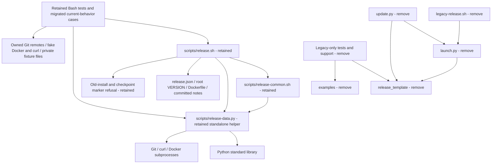

# Brooks-Lint Health Dashboard

- [Brooks-Lint Health Dashboard](#brooks-lint-health-dashboard)
  - [Scope And Verdict](#scope-and-verdict)
  - [Dimension Scores](#dimension-scores)
  - [Module Dependency Graph](#module-dependency-graph)
  - [Test Suite Map](#test-suite-map)
  - [Top Findings](#top-findings)
  - [Plan Assessment](#plan-assessment)
  - [Compatibility And Tradeoffs](#compatibility-and-tradeoffs)
  - [Verification And Limits](#verification-and-limits)
  - [Recommendation](#recommendation)

## Scope And Verdict

**Mode:** Health Dashboard

**Scope:** Plan-only review of `tasks/14-remove-legacy-release-support/2-plan.md` through `12b1a8b`, against its goal and the current Bash/helper, legacy tooling, tests, documentation, and historical-preservation boundaries. This evaluates the proposed removal, not a completed implementation or whole-project audit.

**Composite Score:** 100/100

**Trend:** 97 → 100 (+3) against the latest dashboard record. That record assessed task 13's implementation and inherited defects; this score assesses task 14's removal plan. The two unresolved publication warnings have not improved or disappeared.

No actionable Critical, Warning, or Suggestion finding was identified in the plan. It specifies dependency removal, safety-guard retention, useful coverage migration, current documentation cleanup, and historical preservation without widening into publication fixes or automatic migration. Implementation remains unverified.

## Dimension Scores

- **Code Quality: 100/100.** The plan traces removal through executable pointers, imports, version metadata, tests, and active documentation rather than deleting directories alone.
- **Architecture: 100/100.** The supported Bash/standalone-helper boundary already excludes the old package; the plan removes the separate legacy dependency tree without introducing a replacement framework.
- **Tech Debt: 100/100.** Root `VERSION` remains authoritative, current support is narrowed explicitly, and historical evidence is separated from active dependencies.
- **Test Quality: 100/100.** Behavior mapping and targeted migration precede legacy-test deletion; current Bash safety coverage and no-write assertions remain required.

Balanced scoring starts each dimension at 100 and deducts 15/5/1 per Critical/Warning/Suggestion. With zero findings, `100 × 0.25 + 100 × 0.30 + 100 × 0.25 + 100 × 0.20 = 100`. All dimensions assess the nonempty plan change. This is a design assessment, not implementation approval, coverage measurement, or live-release certification.

## Module Dependency Graph

This is a proposed file/data/process boundary map, not proof of completed deletions. The standalone helper imports standard-library modules rather than `release_template`; retaining it does not retain the old release engine. The old-state refusal edge represents defensive filename checks, not an import or supported legacy launcher. The plan creates no new dependency cycle, adapter framework, or durable migration protocol.

## Test Suite Map

Static AST inspection found 322 methods across 14 current test modules: 65 in the Bash family and 257 in the 13 legacy-dependent families. No tests were run during this plan review.

- Primarily unit/fake-port legacy families: 149 methods across core, evidence-time, workflow, retirement, CLI, Ubuntu-hook, local-image, and package-linking modules. Some exercise local persistence or emitted-command boundaries.
- Mixed adapter/identity/compatibility families: 96 methods across adapters, Gitea absence/migration, and publication notes, combining pure validation, injected transport, loopback HTTP, and owned Git integration.
- Installer/update integration: 12 methods tied to the retiring tooling.
- Retained Bash family: three interface checks, 48 Bash/local-Git publication scenarios with fake Docker/curl, and 14 helper checks combining pure validation, injected inventory, and bounded real subprocesses.
- Planned migrated/additional cases: not yet implemented or countable. The plan requires a coverage map, supported HTTP/Bearer/digest/notes/annotation cases where not already covered, early unsupported-option refusal, complete marker refusal, and an active-footprint check.
- Live end-to-end verification in this review: zero.

These are mixed-layer family counts, not fabricated exact unit/integration/E2E totals. The expected smaller suite follows retirement of unsupported capabilities, not an assumed increase in quality from deleting tests. Existing Bash event/state assertions protect meaningful effects; keeping or renaming its obsolete pointer test is explicitly tied to changed supported behavior. No independent T1/T2 design finding is warranted.

## Top Findings

None in the scoped plan. Existing N1/N2 remain recorded implementation defects outside this removal task; they are not charged as newly introduced plan findings or silently treated as fixed.

## Plan Assessment

- **Removal dependencies are explicit:** `2-plan.md:34-39` names the engine/examples and three retiring scripts, replaces unsupported CLI pointers, retains marker/symlink refusals, and removes module-version dependencies. This addresses the actual references observed at `scripts/release.sh:12`, `:28`, and `:49`, rather than assuming the standalone Bash path is the only current consumer.
- **Coverage retirement is controlled:** Lines 28–30 and 43–49 require baseline inventory, behavior classification, retention of the 65 Bash tests, migration against current production seams, and honest final counts. `tests/support.py` imports legacy policy/core/OCI code, so its deletion is conditioned on removing consumers or moving genuinely generic utilities. This follows characterization and seam-based change protection rather than copying old implementation code into test fixtures.
- **Active documentation is distinguished from history:** Lines 53–58 enumerate retiring pages while retaining image/platform guidance and fixing its legacy cleanup/linking references. Old release notes and archived tasks stay byte-identical; active-link checks intentionally exclude immutable historical references. That is a justified scope boundary, not permission for stale links in current instructions.
- **Version authority is coherent:** Lines 62–64 require root 0.4.0, matching README/notes configuration and heading, and no replacement module version constant. The minor-version change deliberately identifies removal of current-tree compatibility tooling; the plan does not alter settings or annotation schemas.
- **Verification matches the smaller tree:** Lines 68–73 require the retained full suite, syntax checks, strict settings/version/notes checks, credential-free validation/help, active dependency searches, historical comparisons, and implementation results. Removed example/legacy commands are not mistakenly included in post-removal verification.

## Compatibility And Tradeoffs

The user requested retirement of legacy support, so preserving two current implementations or replacing the managed updater would oppose the desired outcome. The plan instead preserves original immutable pins/checkouts and keeps current old-state refusals. Marker names and ignore rules are defensive compatibility boundaries, not accidental leftovers to remove through a global zero-match search.

Retaining Python 3.11+ for strict data and bounded I/O is consistent with the existing jq-free Bash design. Root `VERSION` as the sole authority does not prohibit versioned notes or README text; those are checked against that authority. Removing old tests is acceptable only after identifying supported behavior still needing protection; recreating retired cleanup/linking/suite/journal features is not required.

N1's observed alias-reversion gap and N2's config-local Buildx discovery gap remain visible and out of scope. Deleting legacy code neither makes those guards correct nor certifies native Docker routing/TLS/plugin behavior. The plan correctly retains conservative retries, immutable identity, private credentials, bounded I/O, and the absence of automatic repair, rollback, deletion, and privileged host setup.

## Verification And Limits

Read shared dashboard/risk/source guidance, the latest goal/full plan, current shell refusal boundaries, helper imports and entry points, test fixture/import seams, documentation references, ignore rules, and previous dashboard context. No `.brooks-lint.yaml` or repository `AGENTS.md` was found; balanced defaults apply. Static AST inventory confirmed the plan's 322/65/257 counts, and the plan's table of contents matches all headings.

No tests, builds, Git network operations, real credential/config reads, Docker daemon operations, production probes, or implementation fixes were performed. The earlier 322-test pass is historical evidence only. Planned migrated tests, deletion completeness, version updates, and final retained-suite results still require implementation verification.

Only this report and an appended `.brooks-lint-history.json` record are intended review edits. The goal, plan, implementation/test/docs files, historical records, protected resources, and `todo.md` remain unchanged. The plan's dashboard-history preservation requirement applies to future implementation against its branch base, including this review's appended record; earlier history entries are not rewritten.

## Recommendation

Proceed with implementation as planned; no plan revision is required by this review. Require the behavior-retirement/migration map and retained-suite verification before claiming the smaller tree is complete. Keep N1/N2 as separate unresolved publication work and require separate approval for any live experiment or push.
