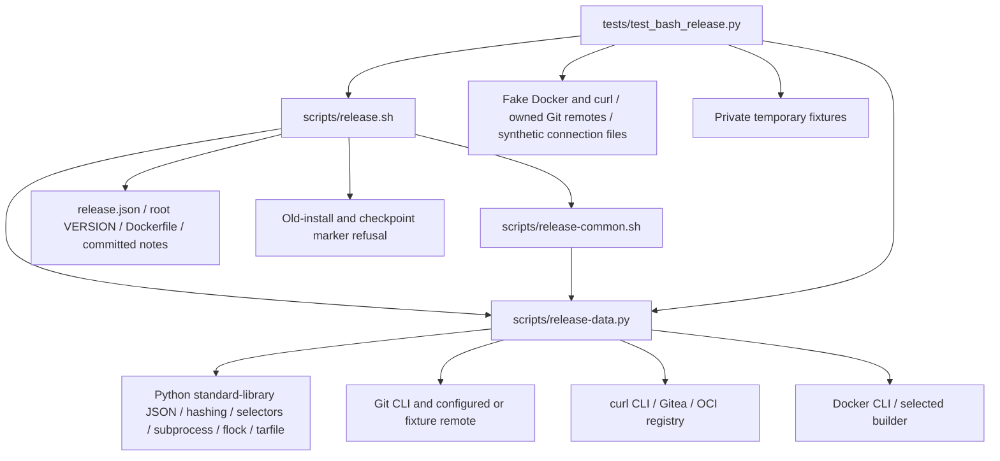

# Brooks-Lint Health Dashboard

- [Brooks-Lint Health Dashboard](#brooks-lint-health-dashboard)
  - [Scope And Verdict](#scope-and-verdict)
  - [Dimension Scores](#dimension-scores)
  - [Module Dependency Graph](#module-dependency-graph)
  - [Test Suite Map](#test-suite-map)
  - [Top Findings](#top-findings)
    - [Warning](#warning)
  - [Plan Closure And Accepted Tradeoffs](#plan-closure-and-accepted-tradeoffs)
  - [Inherited Publication Warnings](#inherited-publication-warnings)
  - [Verification And Limits](#verification-and-limits)
  - [Recommendation](#recommendation)

## Scope And Verdict

**Mode:** Health Dashboard

**Scope:** All 65 changed files on `14-remove-legacy-release-support` through implementation commit `2b0dafd`, relative to actual base `main` at `da45c0093b95b9a38265973761390dd3e0bee14a`: 289 insertions and 7,729 deletions. This includes 52 deleted tracked legacy files, retained-source diagnostics, tests, documentation, version/notes settings, and task 14 implementation results. Relevant unchanged helper/guard boundaries and removed test-family inventories were checked for dependency and coverage continuity. Historical tasks/notes were checked for preservation, not re-audited as active instructions.

**Composite Score:** 99/100

**Trend:** 100 → 99 (−1) against the latest dashboard record, which assessed the task 14 plan rather than implementation. This comparison is not a measurement of deployed publication safety.

Legacy support is removed coherently without changing retained publication policy or weakening old-state refusal. One new Warning remains in a migrated test's host-directory dependency. No Critical finding or newly introduced production defect was identified. Previously recorded N1/N2 remain unresolved and explicitly outside this removal task; this score does not certify publication readiness.

## Dimension Scores

- **Code Quality: 100/100.** The retained execution diff changes only two removal-facing diagnostics; no new R1/R2 finding.
- **Architecture: 100/100.** Supported Bash/helper code has no remaining import or executable dependency on removed tooling; original refusal/identity boundaries remain.
- **Tech Debt: 100/100.** Single root-version authority and a smaller explicitly supported footprint; no independent scoped R1–R6 finding.
- **Test Quality: 95/100.** One Warning, B1: the new Bearer test requires a harness-specific temporary parent directory.

Balanced scoring deducts five points for the Warning only in Test Quality. Composite: `100 × 0.25 + 100 × 0.30 + 100 × 0.25 + 95 × 0.20 = 99`. All dimensions apply to the nonempty branch diff. Inherited N1/N2 are not newly introduced removal defects and are not charged again in this scoped assessment. Scores are review judgments, not coverage percentages or operational guarantees.

## Module Dependency Graph

Arrows represent file/data/process dependencies, not only imports. The old engine/examples and legacy launcher/updater tree are absent. The helper still imports only the standard library; no shim or copied old engine replaces the removed dependency. Marker checks remain defensive filename boundaries, not supported legacy commands. No new import cycle or reversed policy dependency was found. The helper's unchanged lock-holder starts one locked Bash child; that bootstrap is not an import cycle.

## Test Suite Map

Static inventory confirms 75 methods in the remaining test module: five interface/footprint/version checks, 53 owned-Git/Bash/publication cases, and 17 data/helper checks. The latter mix pure validation, injected transport/inventory evidence, and real bounded subprocesses. The owned-Git cases also include direct blob/tag helper tests, so these family counts are not presented as an exact unit/integration split. Live end-to-end verification in this review is zero.

AST comparison against the base confirms all 65 former Bash methods remain represented, with the intentional legacy-pointer test rename and expanded marker assertions. Ten methods were added. The 257 old-engine methods were deliberately retired; they are neither counted as passing nor described as equivalent coverage of removed capabilities. The implementation report maps all 13 retired families to retained behavior, migrated current-helper cases, or explicitly removed features.

The migrations exercise current `http`/`registry`, committed-blob/notes, and canonical-tag logic rather than importing the removed package. Private-token and redirect/options assertions inspect emitted curl arguments and file content under an injected capture seam; bounded pipe/subprocess behavior remains tested separately. Real owned Git covers literal filenames, normalization, invalid notes, deterministic annotations, and conflicts. This layering is appropriate for a Bash workflow and does not justify a duplicate mock-abuse or pyramid finding. The tests retain meaningful no-write, accepted-state, identity, bounds, and cleanup assertions; B1 is the independent environmental dependency below.

## Top Findings

### Warning

**B1 — Test Quality / T1 Test Obscurity: the migrated Bearer test requires a harness-only temporary parent.**

Symptom: `tests/test_bash_release.py:715` calls `tempfile.TemporaryDirectory(dir="/tmp/opencode")` unconditionally. That parent is pre-created by this coding harness, not by the test or the project's documented Linux/Python prerequisites. On a normal development/CI host where it does not exist, the test errors with `FileNotFoundError` before exercising the Bearer flow. Existing publication fixtures at line 74 deliberately use this parent only when available and otherwise use the platform temporary directory.

Source: *xUnit Test Patterns* — Mystery Guest and hidden environmental dependencies; *The Art of Unit Testing* — test isolation.

Consequence: The documented full-suite command is no longer self-contained on an otherwise supported host. A green result inside this harness conceals the extra directory prerequisite, disrupting contributor/CI verification after the legacy test migration. This is a test-portability issue, not a failure of production Bearer authentication or evidence of a live credential leak.

Remedy: Use the existing conditional temporary-parent selection or a shared fallback-aware fixture, preferring `/tmp/opencode` only when present and otherwise using the standard temporary directory. Keep the generated auth file inside the private owned directory. Add a targeted absent-preferred-parent check that runs the actual test/fixture setup without creating a global host directory or requiring privileged installation; retain the ordinary harness-path case.

Reproduction: Ran the actual `BashDataTests.test_same_origin_bearer_challenge_retries_with_private_token` with a narrowly injected `tempfile` mkdir boundary that raises ENOENT only for a child of `/tmp/opencode`, modeling a host without that pre-created parent. The one-test result contained one `FileNotFoundError` setup error and no assertion failure. No production helper call ran, no tracked file changed, and the existing `/tmp/opencode` directory was not removed or renamed. This is a controlled missing-parent simulation, not a claim that this harness lacks its configured directory.

## Plan Closure And Accepted Tradeoffs

- **Removal scope:** Confirmed all 52 approved tracked deletions: 13 engine files, 12 examples, three legacy scripts, 13 old test modules plus their support file, and ten legacy-only docs. No current package or executable import points to the removed engine. Remaining references in tests are negative footprint/diagnostic assertions, not imports or commands.
- **Safety boundaries:** `scripts/release-common.sh`, `scripts/release-data.py`, and `tests/fixtures/bash_release_ports.py` are byte-identical to the base. The entry changes only unsupported-argument usage and the old-install diagnostic. Managed markers, same-version checkpoints, symlink refusal, credentials, locks, input budgets, source/config/script identity checks, conservative retries, and mutation order are unchanged.
- **Coverage continuity:** All 65 Bash methods remain represented, including checked-read and confirmed-tag regressions. New missing-token option refusal and existing/dangling old-marker symlink cases assert no publication writes. Retiring old retention/linking/installer/hook/journal capabilities does not require recreating their framework or preserving misleading current test counts. B1 prevents fully portable closure of the migrated-test verification boundary, not closure of the directory removals.
- **Version and settings:** Root 0.4.0, README, configured notes path, and the new release-note heading agree. Only the notes field changed in release settings; target/image/login/token/platform fields remain unchanged. No replacement module-version constant was added. This intentionally retires current-tree compatibility tooling rather than promising old transactions will run under the new pin.
- **Docs and historical evidence:** Active README/guides/new notes have working TOCs and file/fragment links, describe Python's continuing role, and point to known limits rather than a deleted local launcher. The old release notes and archived task evidence remain byte-identical. Historical references to retired files are accepted evidence, not stale active support instructions.
- **Untracked cache handling:** The implementation records inspection and external byte-preserving relocation of three generated Python caches rather than broad deletion. This review did not inspect or modify that preserved cache directory, old live checkouts, or checkpoint data. No production history was rewritten to make removal appear compatible with old transactions.

## Inherited Publication Warnings

N1 and N2 from `tasks/_archives/13-fix-bash-release-review-warnings/5-code-review.md` remain open: an observed post-promotion predecessor alias can still pass the release guard, and private auth can lose config-local Buildx plugin discovery. Their runtime code remains unchanged and README/configuration/publication guidance explicitly acknowledges them. They were not reimplemented, repaired, or retired by this branch. Resolve them through separate work before claiming publication readiness or general Docker setup compatibility.

## Verification And Limits

Read the shared dashboard/risk/source guidance, full branch change inventory and surviving diffs, task 14 plan/results, current helper/guard/test seams, active guides, retired-family mappings, and dashboard history. No `.brooks-lint.yaml` or repository `AGENTS.md` was found; balanced defaults apply.

`python3 -B -m unittest discover -s tests -q` passed all 75 tests in 218.541 seconds during this review, with no skips. This harness has the preferred temporary parent, so that result does not invalidate B1's missing-parent failure. Independently checked 52 deletions, directory/launcher absence, all 65 prior Bash methods after the intentional rename, all 75 current methods, absence of removed-package imports, remaining Python/shell syntax, strict settings/version/notes agreement, and active Markdown TOC/file/fragment links. Root validation passed with a nonexistent token override; dependency-free help passed under an empty environment with `PATH=/nonexistent`. ShellCheck is unavailable and was not installed or run. `git diff --check main...HEAD` and review whitespace checks passed.

Byte comparisons confirm unchanged archived tasks, all preexisting release notes, prior dashboard history, task 14 goal/plan/plan review, root Dockerfile, `.gitignore`, publication guard/helper, and fake command port. The review will append one history record without rewriting prior entries. The controlled missing-parent probe changes no tracked implementation/test file and does not alter the real preferred temporary parent.

Test Git operations affect only owned local fixtures; Docker/curl publication ports are fake. No real credentials, Docker config/TLS keys, production service, daemon/image, published tag/body/package, original live checkout/checkpoint, foreign project, or `todo.md` was accessed or changed. No fixes, production pushes, live publication, rollback, repair, reassignment, pruning, or deletion operations were performed. The only intended review edits are this report and the appended history record.

## Recommendation

Fix B1's fallback-aware temporary-directory setup before treating the suite as portable to ordinary developer/CI hosts. Otherwise, the requested legacy removal and version/documentation boundaries are coherent. Keep inherited N1/N2 visibly unresolved and separate from this cleanup; no live release or push is authorized by this review.
