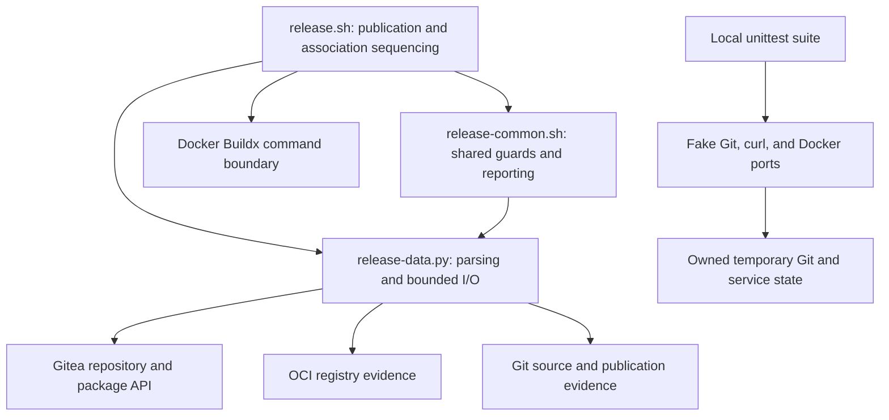

# Brooks-Lint Health Dashboard

- [Brooks-Lint Health Dashboard](#brooks-lint-health-dashboard)
  - [Dashboard](#dashboard)
  - [Module Dependency Graph](#module-dependency-graph)
  - [Test Suite Map](#test-suite-map)
  - [Top Findings](#top-findings)
  - [Recommendation](#recommendation)

**Mode:** Health Dashboard

**Scope:** Plan-only review of `tasks/15-link-container-package/2-plan.md` at `5c8edf7`, checked against the goal, current Bash entry point, shared shell guards, Python HTTP boundary, and local test seams. Scores assess the proposed design, not an implemented feature or the whole project's release readiness.

**Composite Score:** 100/100

**Trend:** Previous Health Dashboard entry: 99/100; current entry: 100/100. Scopes differ, so this is not evidence of an implementation improvement.

No `.brooks-lint.yaml` exists; balanced defaults apply. The plan is ready for implementation under its stated exclusive-writer prerequisite.

## Dashboard

- Code Quality: 100/100. The proposed change is bounded to one release capability; related documentation, version, and tests are justified coordinated changes rather than unrelated propagation.
- Architecture: 100/100. Bash retains workflow policy; Python owns bounded HTTP and strict evidence parsing. Existing adapters remain the test seams, with no new dependency or legacy-engine restoration.
- Tech Debt: 100/100. Package-wide association, repository identity, transport uncertainty, and completed-retry authority are explicit. No additional actionable R1–R6 design finding emerged.
- Test Quality: 100/100. Planned tests verify external writes, final state, refusals, and retries rather than private call structure. Test-only local ports are appropriate for nondeterministic services; their live-contract limits are explicit.

All four dimensions apply to the proposed change. With no findings, balanced deductions are zero; the weighted score is `100 × 0.25 + 100 × 0.30 + 100 × 0.25 + 100 × 0.20 = 100`.

## Module Dependency Graph

Proposed dependency flow; package-association operations are not implemented yet.

## Test Suite Map

Static inspection found 75 existing test methods in `tests/test_bash_release.py`: 5 interface tests, 53 publication integration tests using fake service ports and temporary Git repositories, and 17 data-helper tests. These are class-level categories, not a claim that every helper test is a pure unit test. No live end-to-end package-link or Packages-tab test exists.

The plan adds stateful association cases at the command boundary and strict parsing/HTTP cases at the helper boundary. The same feature is exercised at both layers for distinct risks: workflow mutation authority versus response interpretation. Exact link-route and write-count assertions protect externally observable scope and idempotency, not incidental private implementation order.

Tests were not run for this document-only review. Existing test counts do not demonstrate coverage of the proposed feature.

## Top Findings

No new Critical, Warning, or Suggestion findings in the plan. No remedies are proposed without a diagnosed defect.

The key tradeoffs are already addressed in `2-plan.md`: links affect every version of the configured package; a successful association POST is insufficient without read-back; completed retries may perform only the newly authorized link; and failed prerequisites cannot grant mutation permission. The existing pre-release `fresh_guard` cannot simply be reused after release creation because it requires an absent release, but the plan correctly requires completed-publication evidence instead.

The documented API lacks a conditional association update. Therefore, no-reassignment safety remains conditional on excluding external package-association writers, including UI changes and in-flight requests. This is an acknowledged operational prerequisite, not an atomic guarantee supplied by read-before-write or the local lock. API compatibility confirmation remains an implementation gate, not live deployment certification.

## Recommendation

Implement the plan without expanding scope. Preserve explicit failure propagation when introducing the shared post-publication association stage, and retain the planned refusal and lost-response tests. Confirm the supported Gitea contract before coding against it; obtain separate authorization for any live verification. Keep the existing promotion and Buildx-plugin warnings visible and out of this task. No implementation code or plan text was changed by this review.
