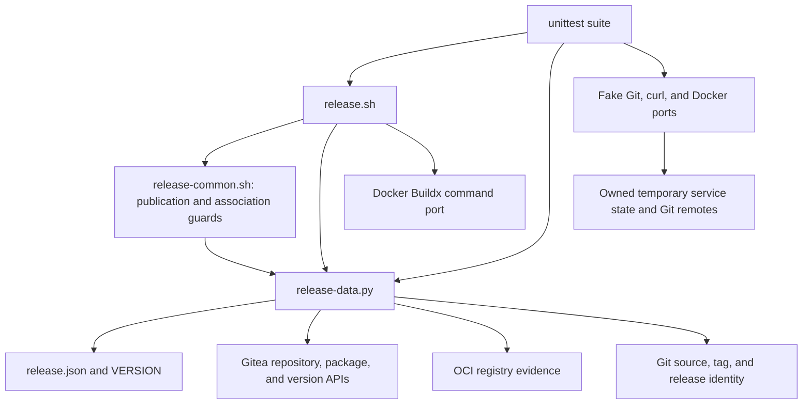

# Brooks-Lint Health Dashboard

- [Brooks-Lint Health Dashboard](#brooks-lint-health-dashboard)
  - [Dashboard](#dashboard)
  - [Module Dependency Graph](#module-dependency-graph)
  - [Test Suite Map](#test-suite-map)
  - [Top Findings](#top-findings)
  - [Verification](#verification)
  - [Recommendation](#recommendation)

**Mode:** Health Dashboard

**Scope:** All 14 changed files on `15-link-container-package` through `2219d25`, relative to local base branch `main` at `4a0ad6f`. Reviewed both implementation commits, the implementation record, tests, version/configuration updates, README, and all changed documentation. The remote `origin/main` is older and is not this branch's immediate base. No implementation fixes were made.

**Composite Score:** 100/100

**Trend:** Stable at 100 relative to the last Health Dashboard entry. That entry reviewed the plan, so this is not a measured whole-project improvement.

No `.brooks-lint.yaml` exists; balanced defaults apply. No new actionable defects were found in the branch changes. This verdict is conditional on the documented server compatibility and exclusive-writer prerequisites, not live-publication approval.

## Dashboard

- Code Quality: 100/100. The added routines are linear and guarded. Changes to release metadata, documentation, and tests belong to the same capability; their file count is not unrelated change propagation.
- Architecture: 100/100. Bash retains publication sequencing and Python owns structured evidence and bounded transport. The new stage reuses existing process/HTTP boundaries without adding dependencies, cycles, or retired engine imports.
- Tech Debt: 100/100. R1–R6 scans found no additional actionable design smell. The conservative server-version gate is a documented safety tradeoff, not speculative generality. Repeated protocol data in fakes and tests represents independent boundary assertions rather than duplicated production policy.
- Test Quality: 100/100. New tests assert externally observable package scope, write counts, refusal behavior, accepted state, and retry authority. Their detailed HTTP sequences protect required refresh and reconciliation semantics rather than arbitrary private function ordering. No additional actionable T1/T2 finding emerged.

All dimensions have zero findings. Balanced deductions are zero, and the weighted score is `100 × 0.25 + 100 × 0.30 + 100 × 0.25 + 100 × 0.20 = 100`.

## Module Dependency Graph

## Test Suite Map

There are 99 test methods in `tests/test_bash_release.py`: 5 interface tests, 66 publication integration tests, and 28 data-helper tests. The helper class includes process and shell-boundary checks, so these categories are not a claim of 28 pure unit tests. All 75 prior methods remain, with 24 additions. There are no live end-to-end registry, Gitea association, or Packages-tab UI tests.

The integration-heavy suite is justified by this tool's risks: actual shell failure propagation, immutable Git evidence, subprocess isolation, and cross-service partial outcomes. Focused helper tests cover parsing, identity mismatches, HTTP status/body interpretation, version eligibility, and receiving bounds. No production seam exists solely for test lifecycle management.

## Top Findings

No new Critical, Warning, or Suggestion findings in the reviewed branch diff.

The main safety paths were checked explicitly:

- `scripts/release-data.py:346–403` distinguishes configured package and repository names, validates repository ID and owner/name, requires explicit nullable association evidence, and rejects incorrect shapes or identities. Correct existing links return without a POST.
- A null repository response can hide an inaccessible existing link. The stable-Gitea-1.25.x write gate and that server family's existing-link refusal address this case; the fake models the refusal and tests preservation of the hidden link. The version allowlist must not be widened without reviewing the corresponding server semantics.
- The bodyless link POST requires HTTP 201 and a fresh exact read-back. Only `CommandFailed` permits reconciliation; status/input/resource refusals stop. No path automatically repeats the POST in the same invocation or calls unlink/DELETE/rollback.
- `scripts/release-common.sh:45–63` checks captured source/settings, the exact tag/commit, release body, immutable image, and final alias around the association stage. Failed reads have explicit stop branches, including under conditional shell callers.
- Both entry-point paths use the shared stage only after completed-publication evidence. A completed retry can finish the missing link without rebuilding, promoting, posting a release, pushing a tag, or looking up staging.
- README, configuration, versioned notes, and active documentation agree on version 0.5.0, package-wide effects, stable-1.25.x eligibility for writes, exclusive writers, partial failure handling, and the absence of live certification.

The documented operator exclusion remains necessary: the server's existing-link check is not an atomic compare-and-set, and neither read-before-write nor the checkout lock serializes external UI/API writers. This limitation is explicitly accepted in the plan and is not reported as a newly discovered guarantee violation.

## Verification

- Reused the completed final implementation run: all 99 tests passed in 194.0 seconds across four isolated workers with workspace-backed temporary directories. No product or test-method changes followed that run; `2219d25` only recorded its result.
- Independently reran all 28 `BashDataTests` during this review: passed in 0.965 seconds. Used the same runner-only temporary-directory relocation to avoid the observed container overlay cleanup stall; no committed source was modified for that accommodation.
- `./scripts/release.sh --validate`, Bash syntax checks for both supported scripts, and `git diff --check main...HEAD` passed.
- Inspected every branch-changed file and checked integration with existing settings validation, HTTP status handling, source checks, startup classification, and test-fixture isolation. No live credentials, publication, package mutation, or deployed UI were used.

## Recommendation

The branch changes are acceptable under their documented prerequisites. Keep the stable-1.25.x write restriction, explicit read-back, narrow completed-retry authority, and external writer exclusion intact. The inherited promotion-alias and config-local Buildx-plugin warnings in `docs/bash-publication.md` remain unresolved; the inherited harness-specific temporary-directory portability issue and observed overlay cleanup stalls also remain separate limitations. This branch review does not certify general release readiness, deployed-server behavior, or a normal unmodified test run on every filesystem. No implementation changes are requested by this review.
