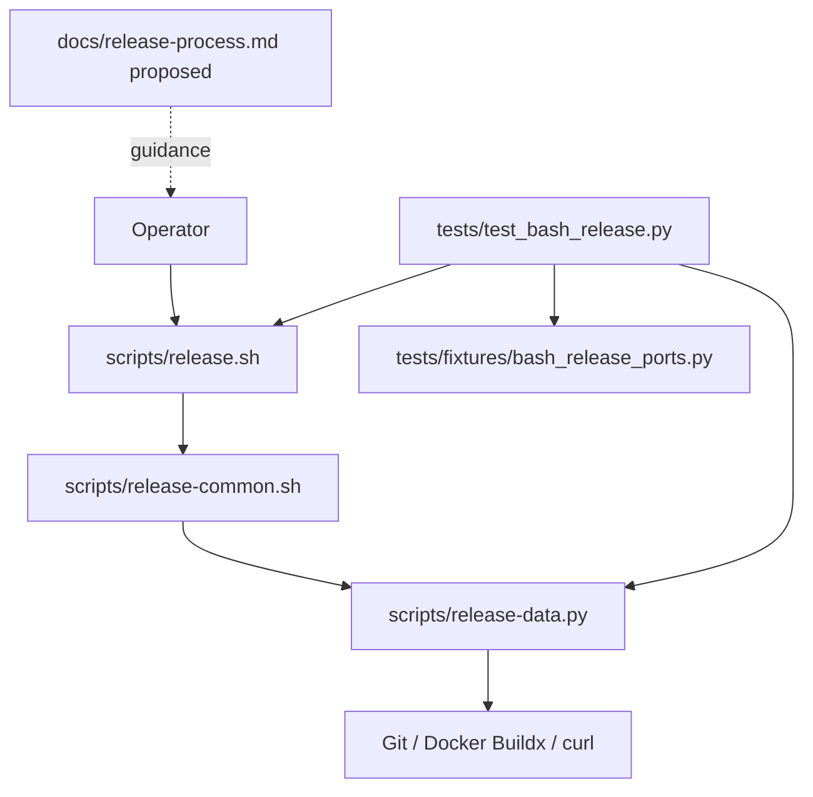

# Brooks-Lint Health Dashboard

- [Brooks-Lint Health Dashboard](#brooks-lint-health-dashboard)
  - [Scores](#scores)
  - [Module Dependency Graph](#module-dependency-graph)
  - [Test Suite Map](#test-suite-map)
  - [Top Findings](#top-findings)
    - [Warning](#warning)
  - [Recommendation](#recommendation)

**Mode:** Health Dashboard

**Scope:** Plan-only review of `tasks/17-improve-release-process/2-plan.md` at `5f4d6ab`, checked against the current Bash entry point, shared helpers, test harness, and release documentation. Scores assess the proposed change, not implemented behavior or whole-project release readiness. No `.brooks-lint.yaml` exists; balanced defaults apply. The unrelated deletion of task 16 is excluded.

**Composite Score:** 99/100

**Trend:** Previous Health Dashboard score 100; current 99, a decrease of 1. The previous scope was a branch implementation review, so this is not evidence of project regression.

The plan is well bounded, but its proposed tests do not yet prove the central live-progress requirement.

## Scores

- Code Quality: 100/100. The proposed stage helper is small, uses stderr, and preserves parseable helper stdout and final success output.
- Architecture: 100/100. Bash retains sequence ownership, Python retains bounded I/O and validation, and documentation reuses existing checks rather than introducing another workflow.
- Tech Debt: 100/100. The plan avoids duplicate protocol descriptions, speculative configuration, privileged automatic setup, and unrelated remediation. Known publication warnings remain explicitly unresolved.
- Test Quality: 95/100. One Warning: final captured-output assertions cannot establish that progress is available before a long operation completes.
- Calculation: `100 × 0.25 + 100 × 0.30 + 100 × 0.25 + 95 × 0.20 = 99`. Code Quality evaluates the proposed task change; no implementation diff is claimed.

## Module Dependency Graph

The existing shared-shell access to entry-point variables is intentional orchestration glue. The plan does not add a new dependency direction, and a fixed-message progress helper is justified rather than speculative abstraction.

## Test Suite Map

- Statically counted 99 test methods: 5 interface methods, 66 publication methods, and 28 data-helper methods in `tests/test_bash_release.py`.
- Interface tests exercise the real CLI through subprocesses. Publication tests exercise Bash, Python, temporary Git repositories, and fake Docker/curl/Git ports. Data tests provide focused validation and bounded-I/O coverage; method counts are not a strict unit/integration split.
- No live end-to-end coverage is claimed. No tests, Docker commands, privileged setup, or network operations were run for this plan review.
- `BashPublicationTests.release()` currently uses `subprocess.run(..., capture_output=True)` at `tests/test_bash_release.py:132-137`. Its caller sees logs only after the invocation exits.
- Planned state-preservation, secret-sentinel, retry, and validation-boundary checks match the change risks. The existing fake-port seam is sufficient; production-only test hooks are unnecessary.

## Top Findings

### Warning

**P1 — T5 Coverage Illusion: Verify progress while the operation is still running.**

**Symptom:** `2-plan.md:37` requires a start message before long operations, but `2-plan.md:52-56` proposes milestone-order and final-output assertions without a test that observes a running operation. The current `release()` helper captures output only after exit. A regression that delays all stage messages until after the build could satisfy final ordering assertions while leaving the operator without progress during the wait.

**Source:** *How Google Tests Software* — change coverage rather than execution coverage; *Working Effectively with Legacy Code* — sensing through an existing process boundary.

**Consequence:** The suite could pass while the task's primary user-visible benefit is absent during a lengthy build. It would also miss a premature completion/success message emitted before immutable verification.

**Remedy:** Add one bounded subprocess test using `Popen` and an explicit fake-build synchronization barrier. Have the fake signal that it entered the build and wait for release; while it is blocked, assert that the parent has received the build/staging-push start message and has not received build-verification completion or `Publication verified`. Release the barrier, then verify normal completion. Use selectors or another bounded read, not arbitrary sleeps; always terminate/reap the child and release the barrier during cleanup. Keep this separate from broad publication-order assertions and require no real Docker process or production-code test hook.

## Recommendation

Add P1's live-observation case to the test plan before implementation. No publication-protocol redesign or additional service probes are needed. Preserve the existing constraints on secrets, stderr, reconciliation status codes, script-bound historical identities, and administrator-only emulation setup. No implementation or plan changes were made during this review; existing publication warnings remain outside this task's score and must not be presented as resolved.
