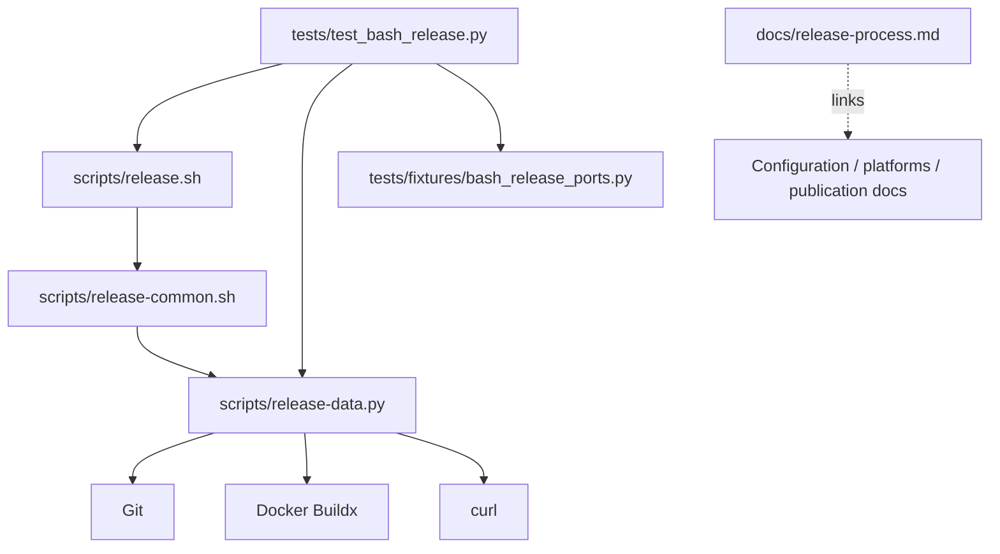

# Brooks-Lint Health Dashboard

- [Brooks-Lint Health Dashboard](#brooks-lint-health-dashboard)
  - [Scores](#scores)
  - [Module Dependency Graph](#module-dependency-graph)
  - [Test Suite Map](#test-suite-map)
  - [Top Findings](#top-findings)
    - [Warning](#warning)
  - [Verification](#verification)
  - [Recommendation](#recommendation)

**Mode:** Health Dashboard

**Scope:** All 15 changed files on `17-improve-release-process` through `3051a43`, relative to local base `main` at merge base `63924b1`. This branch contains one implementation commit. The pre-existing unstaged deletion of task 16 is excluded. No `.brooks-lint.yaml` exists; balanced defaults apply. No implementation fixes were made.

**Composite Score:** 99/100

**Trend:** Stable at 99 compared with the previous Health Dashboard. That run reviewed the plan, not this implementation; P1's live-progress testing gap is addressed, while B1 below is a separate early-failure diagnostic gap.

The implementation preserves publication guards and improves operator visibility, but early local setup failures still bypass the advertised recovery guidance.

## Scores

- Code Quality: 95/100. One Warning, B1: the diagnostic boundary begins after lock acquisition and temporary-directory creation.
- Architecture: 100/100. No new dependency disorder; Bash still owns sequencing and Python still owns validation and bounded I/O. Publication-state tracking changes diagnostics only.
- Tech Debt: 100/100. No additional in-scope finding. Fixed phase messages, deliberate suppression of raw output, a small shared helper, and linked documentation are justified choices rather than speculative abstractions or unrelated change propagation.
- Test Quality: 100/100. No independent test-obscurity or brittleness finding. The FIFO test observes real process output during a blocked fake build; its assertions concern externally visible behavior, not private implementation details.
- Calculation: `95 × 0.25 + 100 × 0.30 + 100 × 0.25 + 100 × 0.20 = 98.75`, rounded half-up to 99. B1 is counted once, not deducted again for its missing regression assertions.

## Module Dependency Graph

The shell helper's shared access to entry-point variables is existing orchestration glue. New messages do not alter source validation, inventories, identity checks, mutation guards, timeout/output budgets, or transport-only reconciliation. The diagnostic state is not used to authorize writes.

## Test Suite Map

- 104 statically counted methods: 5 CLI/interface, 71 publication-flow, and 28 focused data/helper methods. Publication cases exercise the real Bash/Python workflow with temporary repositories and fake command ports; helper cases include validation and subprocess boundaries, so these categories are not a strict unit/integration split.
- Live production end-to-end tests: none. This is intentional for a publication tool; fake-port state/event assertions exercise accepted writes, retries, and refusals without production effects.
- Five new methods cover blocked-build observation, missing prerequisites, readiness diagnostics, unsafe credentials, and failed builds. Existing methods add fresh/completed/reused progress, skipped promotion, hostile-output isolation, rejected metadata, API refusal, partial-state preservation, interruption, and validation assertions.
- P1 is closed: the test drains stderr while an explicit FIFO prevents build completion, checks absence of premature completion/success, then releases the build and verifies completion. Its bounded waits and fake-only synchronization avoid a production test hook.
- Existing lock tests assert refusal and preservation, but not actionable instructions. They therefore do not catch B1; extend them rather than duplicating full publication scenarios.

## Top Findings

### Warning

**B1 — R1 Cognitive Overload: Early local failures bypass recovery guidance.**

**Symptom:** `scripts/release.sh:31-41` replaces the shell with the locking helper, checks the inherited lock, and creates the temporary directory before installing `unexpected_failure`. Consequently `recovery()`'s local-setup guidance in `scripts/release-common.sh:10-11` never handles those failures. In owned fixture repositories, a held checkout lock returned exit 1 with only `Release progress: prerequisite checks` and `Release stopped: Invalid or unavailable input`; a nonexistent `TMPDIR` parent returned exit 1 with only the prerequisite milestone and raw `mktemp` failure. Neither output contained `Next:`. This contradicts the unqualified stage-specific recovery claim in `docs/release-process.md:74`.

**Source:** *Code Complete* — defensive programming and explicit error-handling discipline; *A Philosophy of Software Design* — hiding operational complexity behind a consistent interface.

**Consequence:** Common local setup problems remain indistinguishable or lack a next step even though the branch promises actionable failures. Operators must infer whether another release owns the lock or whether temporary storage is misconfigured, and the new tests can pass without enforcing guidance on these paths. These cases stop safely with no publication writes; this is an operator-diagnostics defect, not observed publication corruption.

**Remedy:** Extend safe early-failure reporting to lock acquisition/checking and temporary-directory creation, including the Python process that replaces the shell. Provide fixed advice to wait for or inspect the active lock owner and to check a valid, writable temporary parent; do not recommend deleting a lock file or bypassing writer exclusion. Preserve lock inheritance, signal forwarding, nonzero exits, secret suppression, and validation's no-state/no-network contract. Add held-lock and invalid-temporary-parent cases that assert useful next steps and zero publication events. Do not merely move the shell ERR trap before `exec`: an executed Python process does not run that shell trap on its own failure.

## Verification

- Read the complete branch diff, including all documentation/version changes and the implementation record. Root `VERSION`, README version, configured notes path, and new release-note heading consistently use `0.6.0`.
- The final implementation run in this session passed all 104 tests in 636.977 seconds. The full suite was not rerun during this review.
- Independent review rerun: all five selected tests passed in 41.660 seconds. Cases cover blocked-build progress, readiness guidance, interruption cleanup, hostile-output-safe fresh/completed publication, and lost-response reconciliation.
- Two additional owned-fixture probes reproduced B1. Both returned nonzero, generated zero publication events, exposed no sentinel token, and contained no `Next:` guidance. No tracked implementation/test files were edited for the probes.
- Bash syntax checks, local `--validate`, and `git diff --check main...HEAD` passed. Relative links, header anchors, and TOCs passed for the 12 existing active/task Markdown files before this report was added.
- No production credentials, Docker daemon operations, network publication, privileged setup, image pulls, resource deletion, or rollback occurred. The inherited post-promotion alias and config-local Buildx-plugin warnings remain unresolved, explicitly documented, and outside this branch's finding count. Milestones are not live build-output streaming or runtime certification.

## Recommendation

Address B1 before claiming consistent actionable failure handling, using the existing local fixture seams. No publication-protocol redesign is indicated by this diff. Keep the inherited publication warnings separate and do not treat this branch's score or local test success as general live-release approval. A focused error-path review is more useful than an unrelated architectural refactor here.
