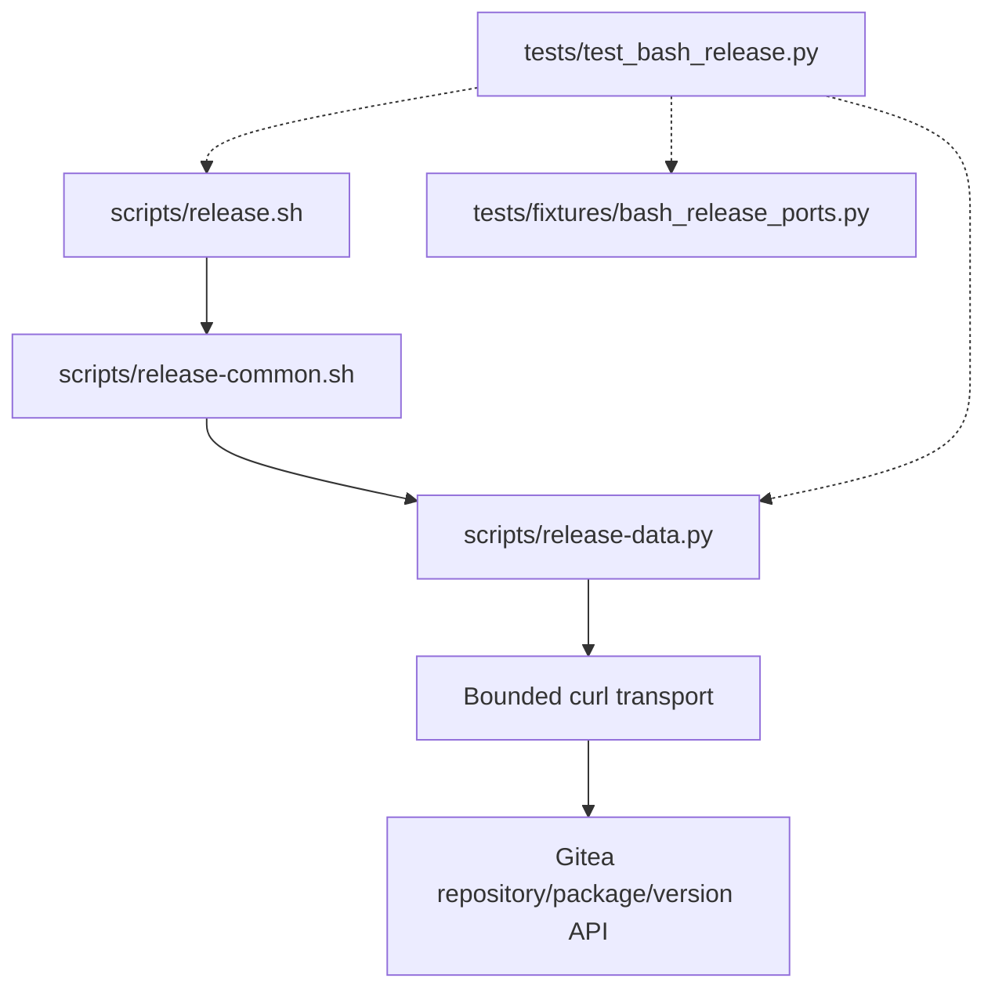

# Brooks-Lint Health Dashboard

- [Brooks-Lint Health Dashboard](#brooks-lint-health-dashboard)
  - [Dashboard](#dashboard)
  - [Module Dependency Graph](#module-dependency-graph)
  - [Top Findings](#top-findings)
    - [Suggestion](#suggestion)
  - [Test suite map and evidence](#test-suite-map-and-evidence)
  - [Recommendation](#recommendation)

**Mode:** Health Dashboard

**Scope:** Plan-only review of `tasks/18-support-gitea-28-2-0/2-plan.md` at `8b3c56b`, checked against its goal, current association implementation, existing tests, and upstream `v28.2.0` service/converter source. Scores assess the proposed change, not an implemented or deployed result. No `.brooks-lint.yaml` exists; balanced defaults apply.

**Composite Score:** 100/100 (rounded from 99.75)

**Trend:** 99 → 100 (+1) versus the previous Health Dashboard entry; that entry reviewed a different scope, so this is not evidence of implementation improvement.

The plan is ready for implementation with one minor test-target correction and no Critical or Warning findings.

## Dashboard

- Code Quality: 99/100. One misleading test-class name in the implementation instructions; otherwise the proposed change is narrow and actionable.
- Architecture: 100/100. Version policy remains inside the existing association boundary; no new dependency edges or configuration surface are proposed.
- Tech Debt: 100/100. The plan avoids a speculative compatibility framework, retains historical contracts, and explicitly limits new support to exact `28.2.0`.
- Test Quality: 100/100. Proposed coverage exercises real association control flow, externally visible writes, failure states, both supported contracts, and unsupported-version boundaries.

Composite calculation: `99 × 0.25 + 100 × 0.30 + 100 × 0.25 + 100 × 0.20 = 99.75`, rounded half-up to 100. One Suggestion is assigned to Code Quality only; no double deduction.

## Module Dependency Graph

Solid arrows show the relevant production call/dependency direction. Dashed arrows show test execution and injected command ports. The version check stays in `package_association`; preserving explicit `ensure`, refreshed identity checks, and transport-only reconciliation avoids weakening its existing safety boundary. No structural refactoring is needed for one additional reviewed server contract.

## Top Findings

### Suggestion

**P1 — R1 Cognitive Overload: name the existing association test owner accurately.**

Symptom: `2-plan.md:37` instructs implementation to parameterize or extend `BashPackageAssociationTests`, but that class does not exist. The association scenarios at `tests/test_bash_release.py:885-1036` belong to `BashPublicationTests`, declared at line 74.

Source: *Code Complete* — meaningful names; *A Philosophy of Software Design* — reducing cognitive load.

Consequence: An implementer may search for a nonexistent test suite or unnecessarily introduce another class/fixture instead of extending the established scenarios. The file path and scenario descriptions remain correct, so this is not a blocker.

Remedy: Replace `BashPackageAssociationTests` with `BashPublicationTests` in the plan. Keep per-version cases isolated using fresh fixtures or explicitly reset state when parameterizing; no production refactoring is required.

## Test suite map and evidence

- Static AST inspection counted 104 existing test methods: five `BashInterfaceTests`, 71 `BashPublicationTests`, and 28 `BashDataTests`. These are method counts, not executed case or subtest counts.
- Interface tests cover command help, validation, retired-tree checks, and version consistency. Publication tests combine real disposable local Git repositories with fake Docker/curl/Git command ports. Helper tests include injected bounded transport and local subprocess/data behavior. These mixed classes should not be described as 104 pure unit tests.
- Relevant existing association coverage includes correct/unlinked/conflicting links, hidden foreign links, missing-link retries, accepted-but-lost responses, unsupported-server refusal, failed prerequisites, refreshed identities, and post-link failures. The plan extends these risks to `28.2.0` without dropping `1.25.0` coverage.
- Safety-relevant request-order and POST-count assertions are appropriate here: they verify no duplicate mutation, fresh evidence, and exact target routing rather than incidental private implementation details. Helper and full-entry tests cover different boundaries, so their overlap is justified.
- Independently reread upstream `v28.2.0` `services/packages/package_update.go` and `services/convert/package.go`. The service rejects existing links and requires matching owners and package-unit write permission; the converter may return a null repository for a hidden association. The plan additionally requires route/schema/model review and commit-pinned provenance before implementation.
- The plan explicitly retains operator-enforced exclusion because existing-link refusal is not an atomic database compare-and-set. Its no-reassignment acceptance criterion must be read under that prerequisite, not as protection against arbitrary concurrent external writers.
- No tests, live-server requests, credential reads, Docker operations, or publication writes were performed during this review. Implementation and live compatibility remain unverified. Existing unrelated publication limitations are outside this plan's scope.

## Recommendation

Proceed with the narrow compatibility change after correcting P1 in the plan. Retain exact `28.2.0` matching, existing `1.25.x` behavior, strict identity evidence, and the source-review stop condition. The implementation report must distinguish upstream contract evidence and local fake-port regressions from any separately approved live verification; this review does not authorize production experiments.
