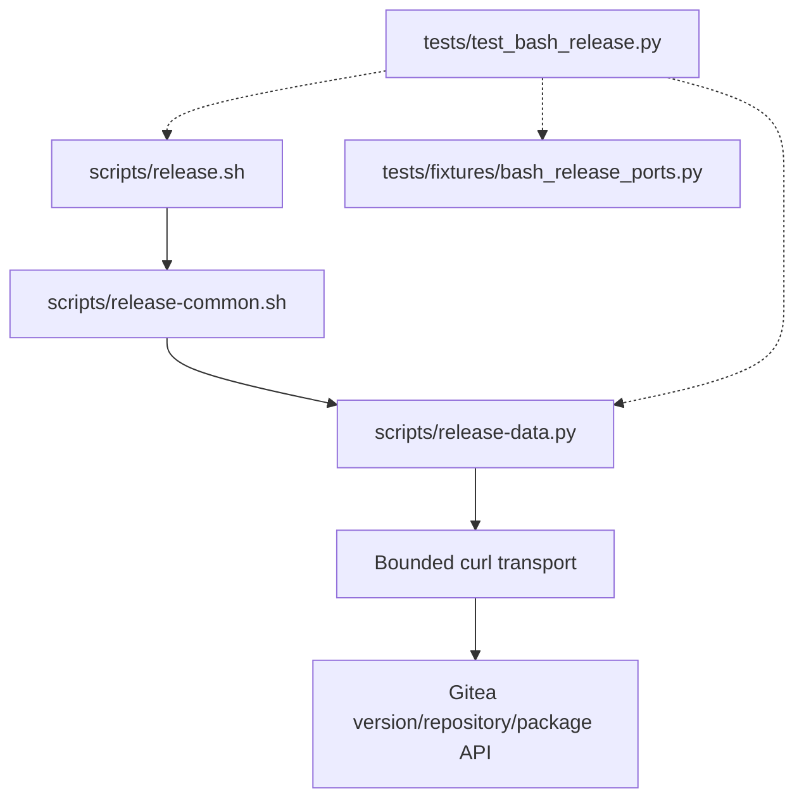

# Brooks-Lint Health Dashboard

- [Brooks-Lint Health Dashboard](#brooks-lint-health-dashboard)
  - [Dashboard](#dashboard)
  - [Module Dependency Graph](#module-dependency-graph)
  - [Top Findings](#top-findings)
  - [Test suite map](#test-suite-map)
  - [Verification and evidence](#verification-and-evidence)
  - [Recommendation](#recommendation)

**Mode:** Health Dashboard

**Scope:** All 12 changed files on branch `18-support-gitea-28-2-0` through `9bbda7e`, relative to local base branch `main` at merge base `42f9a7ce3e46367e78165f092c09d0ee9cd4e850`. Reviewed the complete branch diff, the approved plan, association/transport callers, fixture behavior, tests, version metadata, documentation, and implementation evidence. Planning/review commits already belong to the base and are not attributed to this implementation delta. No `.brooks-lint.yaml` exists; balanced defaults apply.

**Composite Score:** 100/100

**Trend:** Stable at 100 versus the previous Health Dashboard entry. The previous entry was a plan review, so the scores do not establish a measured implementation trend.

Ready to merge within the approved compatibility scope. No new Critical, Warning, or Suggestion finding was established; this does not certify the deployed server or resolve inherited publication limitations.

## Dashboard

- Code Quality: 100/100. The only production behavior change is a whole-string version allowlist extension in `scripts/release-data.py:385-390`; object/string validation and fixed diagnostics remain defensive. The small additional regex alternative does not justify a new compatibility abstraction.
- Architecture: 100/100. Association/version policy stays at its existing boundary. No new imports, dependency edges, configuration fields, or transport/publication ordering changes were introduced.
- Tech Debt: 100/100. Exact `28.2.0` support does not imply unsupported `28.x` compatibility. Existing `1.25.x` behavior is retained, source provenance is pinned, and historical transaction restrictions remain explicit. Coordinated updates to docs/version metadata are related contract maintenance, not unrelated change propagation.
- Test Quality: 100/100. Helper tests exercise association control flow and malformed/unsupported evidence; generated full-entry cases reuse existing scenarios without duplicating their bodies. The wrapper captures each function through its argument, avoiding loop-variable late binding, and unittest gives each generated method an independent fixture lifecycle. No new T1/T2 obscurity or brittleness defect was established.

Composite calculation: `100 × 0.25 + 100 × 0.30 + 100 × 0.25 + 100 × 0.20 = 100`.

## Module Dependency Graph

Solid arrows show relevant production call dependencies; dashed arrows show test execution/injection. Bash remains the publication orchestrator, and Python retains bounded transport and identity validation. The changed version predicate neither creates a module cycle nor exposes version policy to unrelated orchestration code.

## Top Findings

None within this branch's changes. Plan-review P1 was already corrected in the base plan, and the implementation extends the existing `BashPublicationTests` rather than referring to a nonexistent class.

The version guard accepts only exact `28.2.0` or the existing strict stable `1.25.x` pattern. Existing correct associations return before the version read; explicit null is still only a link candidate. Refreshed identities precede one POST, HTTP/input/resource refusals remain fatal, and only transport failures may reconcile through read-back. The unchanged fixture models server-side rejection of already-linked packages, including permission-hidden foreign links. No unlink, reassignment, deletion, or rollback path was added.

The no-reassignment guarantee still depends on operator-enforced exclusion of external writers. A non-conditional upstream database update cannot become atomic through client checks or the checkout lock. Documentation preserves this prerequisite and distinguishes source inspection from deployed-binary provenance and live verification.

## Test suite map

- Discovery finds 117 runnable tests: five `BashInterfaceTests`, 83 `BashPublicationTests` (71 original plus 12 generated `28.2.0` methods), and 29 `BashDataTests`. Counts describe discovered methods, not the larger number of subtest cases.
- Interface methods run local command/configuration/tree checks. Publication methods use actual Bash/helper execution, owned temporary Git/bare repositories, synthetic tokens, and fake external command ports. Helper methods mix isolated data/transport tests and bounded local subprocess behavior. These classes are not 117 pure unit tests.
- No live end-to-end test was run. The 12 new full-entry cases model the reviewed contract, not independent proof of real Gitea behavior. Safety-significant request ordering and POST-count assertions verify externally relevant write discipline rather than arbitrary private wiring.
- The recorded full suite takes 836.205 seconds in this environment. That is a feedback-time limitation worth monitoring, not evidence by itself of a new structural defect from this narrow branch; no baseline timing comparison or profiling was performed during review.

## Verification and evidence

- Independently reran all 29 `BashDataTests` plus three generated `28.2.0` full-entry cases: fresh configured-package linking, permission-hidden foreign-link refusal, and completed missing-link retry followed by read-only verification. All 32 tests passed in 34.570 seconds. No production credentials or services were used.
- Implementation-stage full-suite evidence is 117 passing tests in 836.205 seconds, after an initial runner timeout. The full suite was not rerun during review; selected high-risk tests were independently executed as described above.
- Independently confirmed discovery count, `./scripts/release.sh --validate`, `bash -n` for each `scripts/*.sh`, `git diff --check main...HEAD`, and local Markdown links/TOCs across all 16 README/docs files. All passed. Reviewed root `VERSION`, README, configured notes path, and release-note heading for consistent `0.6.1` metadata.
- Independently fetched pinned upstream commit `829b49c1ae96015e345f9d2a0eb1ea7acd5f31e1` files `services/packages/package_update.go` and `services/convert/package.go`. They confirm existing-link refusal, same-owner and target package-unit permission checks, and permission-hidden null conversion. The branch records permanent route/schema/repository/model references and annotated-tag provenance; source evidence is not signature or deployed-server certification.
- Inspected all changed documentation and release metadata. New support claims consistently name exact stable `28.2.0` alongside retained `1.25.x`; historical release notes remain unchanged. No live publication or UI result is claimed. Changed script identities cannot adopt historical publications, and the docs preserve that restriction.
- No implementation fixes, live Gitea requests, real credential access, Docker daemon actions, host preparation, publication, or package mutation were performed by this review. Only this review and the required health-history entry are added.

## Recommendation

Merge the branch for the reviewed, source-backed compatibility extension. Keep operational writer exclusion and the documented live-verification limits. Existing promotion and config-local Buildx-plugin warnings remain separate unresolved issues; a passing local review does not authorize a production release or certify that an identically versioned customized deployment matches upstream behavior.
