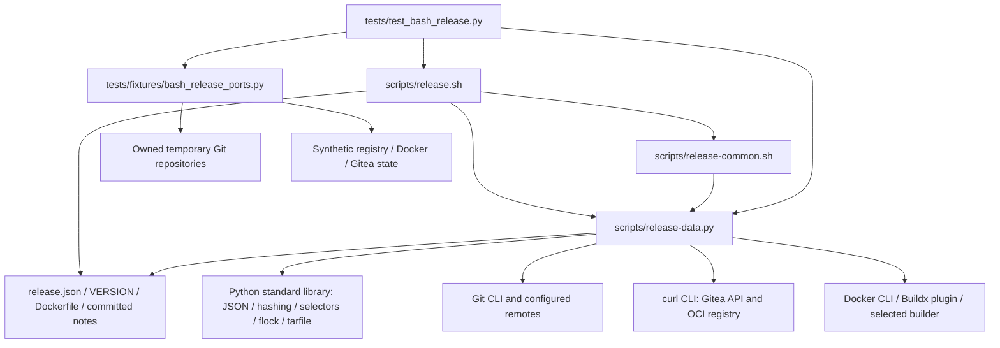

# Brooks-Lint Health Dashboard

- [Brooks-Lint Health Dashboard](#brooks-lint-health-dashboard)
  - [Scores](#scores)
  - [Module Dependency Graph](#module-dependency-graph)
  - [Test Suite Map](#test-suite-map)
  - [Top Findings](#top-findings)
    - [Warning](#warning)
  - [Verification and Limits](#verification-and-limits)
  - [Recommendation](#recommendation)

**Mode:** Health Dashboard

**Scope:** Whole `release-template` project on clean `main` at `b07f69302acd0285d599865ed7d483aebe4934b3`, prepared version 0.6.1. Reviewed all current production scripts, tests, fixture ports, configuration, Docker inputs, README, and active documentation; consulted archived reviews for unresolved findings. Historical release notes and archived tasks are evidence, not active implementation. No active task existed; this report creates task 19 after checking `tasks/` and `tasks/_archives/`. No `.brooks-lint.yaml` exists; balanced defaults apply. No implementation fixes were made.

**Composite Score:** 91/100

**Trend:** 100 → 91 (−9) against the previous Health Dashboard. That run covered only the Gitea compatibility branch, whereas this review includes inherited whole-project defects; the scores are not like-for-like deployment measurements.

Five warnings remain, including an unvalidated additional Git push destination. Local checks do not establish publication readiness.

## Scores

- **Code Quality: not applicable.** No staged, unstaged, or branch diff against `main` existed at review start; the PR dimension is skipped.
- **Architecture: 90/100.** Two warnings: F1, additional push destinations escape validation; F3, auth isolation changes Buildx executable discovery.
- **Tech Debt: 90/100.** Two warnings: F2, post-promotion guards accept the predecessor; F4, early failures bypass recovery guidance.
- **Test Quality: 95/100.** One warning: F5, a test requires an unprovisioned harness-specific temporary parent.

Each Warning deducts five points in its assigned dimension only. Remaining weights are redistributed by dividing by `1 − 0.25`: `(90 × 0.30 + 90 × 0.25 + 95 × 0.20) / 0.75 = 91.333…`, rounded half-up to 91. All five findings fit the dimension caps and are displayed below. No Critical findings were identified. Scores describe this lightweight scan, not exhaustive correctness or coverage.

## Module Dependency Graph

Arrows show process, file, and import dependencies. The helper's lock bootstrap starts one Bash child; this is not an import cycle. Bash owns sequencing and Python owns bounded I/O and validation. No internal module cycle, reversed domain dependency, or unjustified abstraction was found. The orchestration layer's external fan-out and standard-library imports are justified; F1 and F3 concern incompletely preserved external boundaries, not a need for more layers.

## Test Suite Map

- **117 discovered tests:** 5 interface/tree/version checks, 83 publication-flow cases, and 29 helper cases. Publication cases include 12 generated Gitea 28.2.0 variants with independent fixture lifecycles.
- **19 isolated helper cases** use in-process validation and injected dependencies without explicit local filesystem/subprocess exercises.
- **98 local integration/filesystem cases:** 83 real Bash/Python flows using owned Git and fake Docker/curl, 10 helper filesystem/subprocess cases, and 5 interface/tree checks. This conservative classification treats local I/O as integration, not live end-to-end coverage.
- **0 live end-to-end cases:** no real Docker builder, production Gitea, registry publication, runtime emulation, or Packages-tab verification.

Behavior-oriented assertions check accepted state, refused writes, actual fault injection, lost-response reconciliation, isolation, and progress visibility. Multiple assertions generally support one coherent scenario; the version variants exercise separate contracts rather than duplicate knowledge. No independent T2 brittleness finding was identified. F5 is a T1 Mystery Guest: developer-environment state is required before the named registry behavior is exercised. Missing regression coverage for F1–F4 is included in their remedies, not deducted again.

## Top Findings

### Warning

**F1 — Architecture / R5 Dependency Disorder: additional Git push URLs bypass target validation.**

Symptom: `scripts/release-data.py:245-251` validates `git remote get-url --push origin` without `--all`, which returns only the first push destination. `scripts/release.sh:136` later runs `git push origin`, which pushes to every configured push URL. Multiple ordinary remote URLs also fan out when no explicit push URLs exist. The guard can therefore accept a configured target while another destination remains unvalidated.

Source: *Clean Architecture* — dependency boundary integrity; *Code Complete* — defensive validation must cover the inputs actually used by the protected operation.

Consequence: A release tag can be sent to another repository even though source verification reports a matching target. Reconciliation reads the configured origin's fetch side, so success does not prove that no additional repository was changed. This needs no concurrent writer or malicious remote response; ordinary local Git configuration is enough.

Remedy: Enumerate all effective push destinations, including URL rewriting and fallback to ordinary remote URLs, and reject unsupported multiplicity or any nonmatching target before building or writing. Keep the non-force tag push and existing fetch/source checks. Add local-Git cases for multiple explicit push URLs and multiple ordinary URLs; require zero publication writes on refusal and preserve single-target SSH/HTTPS behavior.

Evidence: The real `source(..., remote=False)` helper accepted an origin with the permitted HTTPS first push URL and a second owned local repository. The same acceptance occurred with two ordinary URLs and no explicit push URLs. Only the remote-main advertisement check was omitted to keep these probes offline; the actual destination-validation path ran unchanged. Separate real Git pushes through explicit push URLs and ordinary-URL fallback updated both owned bare repositories, including a tag push through the latter. No configured HTTPS endpoint or production service was accessed. The [Git remote manual](https://git-scm.com/docs/git-remote) documents `get-url`'s first-URL default and `--all` behavior.

**F2 — Tech Debt / R6 Domain Model Distortion: release creation accepts an observed post-promotion alias reversion.**

Symptom: `scripts/release-common.sh:71-85` accepts either `predecessor` or `prepared` on every fresh guard. After `scripts/release.sh:151` confirms the prepared alias, line 154 reuses that guard before the release POST at line 155. A fresh read observing the original predecessor still authorizes release creation. This is the unresolved N1 documented in `docs/bash-publication.md:67`.

Source: *Domain-Driven Design* — lifecycle invariant ownership; *Code Complete* — checks must enforce the invariant required by the next operation.

Consequence: The command creates another public record after it has already observed an incomplete final-image state, then refuses only at final verification. This is an observed contradiction, not merely an unavoidable race between services. Writer exclusion remains required but should not convert contradictory evidence into write authority.

Remedy: Retain predecessor-or-prepared eligibility before promotion, but require exactly the prepared digest before release creation after promotion confirmation. Refuse without repromotion, rollback, or refreshing the predecessor. Add an entry-point regression that reverts the alias after initial promotion confirmation and requires zero subsequent release POSTs.

Evidence: An owned fixture produced `build → tag-push → promote → review-alias-reverted → release-post`. The real entry point exited 1 with one release record and `latest` still at the predecessor. Only the copied fake curl port and owned fixture state were changed.

**F3 — Architecture / R5 Dependency Disorder: private auth can lose or replace the selected Buildx executable.**

Symptom: Builder preflight at `scripts/release.sh:55` uses the original Docker config; line 72 then replaces `DOCKER_CONFIG`. `scripts/release-data.py:302-307` copies context metadata but not config-local CLI plugin discovery or configured extra plugin directories. `BUILDX_CONFIG` at shell line 67 preserves builder state, not Docker's plugin executable search path. This is the unresolved N2 documented in `docs/bash-publication.md:67`.

Source: *The Pragmatic Programmer* — Orthogonality between authentication and dependency selection; *Clean Architecture* — infrastructure dependency integrity.

Consequence: A config-local-only Buildx installation passes preflight but becomes unavailable before the build. A different system installation can also become selected after isolation. Matching endpoint and builder-state values do not prove a consistent executable toolchain.

Remedy: Preserve or explicitly pin Buildx plugin discovery separately from registry authentication, without copying unrelated auth or credential helpers. Preserve original working-directory semantics for relative paths. Add config-local-only and system-shadowing cases that enforce the same plugin selection or refuse before publication writes.

Evidence: A copied Docker port modeled config-local plugin lookup. It recorded `review-config-local-plugin-found`, builder preflight, login, then `review-config-local-plugin-missing`; the real entry exited 2 with zero publication writes. This is a model-based reproduction, not native Docker certification. Independently read Docker CLI v29.0.0's [plugin manager](https://github.com/docker/cli/blob/v29.0.0/cli-plugins/manager/manager.go): `getPluginDirs` and `PluginRunCommand` use configured extra directories, the active config's `cli-plugins`, and system directories. The current code still omits the discovery paths identified in the archived task 13 review.

**F4 — Tech Debt / R1 Cognitive Overload: early setup failures bypass actionable recovery guidance.**

Symptom: `scripts/release.sh:31-41` executes the lock helper, checks the inherited lock, and creates temporary storage before installing the error trap. The Python lock path at `scripts/release-data.py:661-678` reports generic unavailable input on lock contention. These failures never reach `recovery()`'s local-setup advice at `scripts/release-common.sh:9-11`, despite the general recovery claim in `docs/release-process.md:74`. This warning remains from the archived task 17 review.

Source: *Code Complete* — explicit error-handling discipline; *A Philosophy of Software Design* — hide operational complexity behind a consistent interface.

Consequence: A held release lock and invalid temporary-storage setup stop safely but provide no useful next step. Operators must infer the cause and cannot rely on the documented stage-specific guidance. Raw `mktemp` errors also bypass the fixed-message diagnostic boundary.

Remedy: Handle lock acquisition/checking and temporary-directory creation explicitly, including errors in the replacing Python process. Give fixed advice to inspect or wait for the active owner and to check a writable temporary parent. Never recommend deleting the lock or bypassing writer exclusion. Extend the existing lock tests and add invalid-parent assertions for guidance, secret suppression, and zero publication events.

Evidence: A held-lock fixture exited 1 with only the prerequisite milestone and `Release stopped: Invalid or unavailable input`. A nonexistent `TMPDIR` parent also exited 1 without `Next:`. Both generated zero publication writes.

**F5 — Test Quality / T1 Test Obscurity: a registry test requires an external harness directory.**

Symptom: `tests/test_bash_release.py:1182` unconditionally creates its temporary directory under `/tmp/opencode`. Unlike the publication fixture at line 76, it has no fallback when that parent does not exist. README promises a standard-library Linux/POSIX suite, but neither the test nor documented prerequisites provision this harness-specific path. This remains from the archived task 14 review.

Source: *xUnit Test Patterns* — Mystery Guest; *The Art of Unit Testing* — test isolation.

Consequence: On an otherwise supported developer or CI machine, the suite can fail with `FileNotFoundError` before asserting same-origin Bearer authentication. Passing inside this harness hides the portability failure and misdirects diagnosis toward registry behavior.

Remedy: Use an owned portable temporary parent, or the same optional approved-parent selection already used by the publication fixture. Do not require privileged creation of `/tmp/opencode`. Add a controlled missing-parent case that reaches and passes the registry assertions without changing global host state.

Evidence: A controlled `os.mkdir` failure only for children of `/tmp/opencode` caused the existing test to raise `FileNotFoundError` before its registry assertions. The real parent was not removed or modified. This simulates the missing-parent environment; it is not a second-host run.

## Verification and Limits

- Local Bash syntax checks, Python AST parsing for all current Python files, `./scripts/release.sh --validate`, and the initial `git diff --check` passed.
- `python3 -B -m unittest discover -s tests -v` passed all 117 tests in 857.974 seconds in this harness. Counts were independently collected through `unittest.TestLoader`, including generated cases. This passing run does not resolve the controlled missing-parent failure in F5.
- Active README/documentation and this report passed relative-link, heading-anchor, and table-of-contents checks. Both shell scripts passed `bash -n`; the staged report/history passed `git diff --cached --check`.
- Independently reproduced all five findings using owned temporary fixtures or narrowly controlled test injection. Probes changed no tracked implementation or test file. The additional push test used only owned local bare repositories; the source-validation probe omitted remote-main lookup to avoid network access.
- Scope excludes live publication, credentials, Docker configuration/TLS keys, daemon access, privileged preparation, production mutation, deletion, rollback, and unrelated projects. Public Git documentation and Docker source retrieval were read-only. No tools were installed.
- Strict JSON, bounded receiving, complete inventory checks, deterministic annotation identity, source snapshots, conservative retry authority, package identity/refusal checks, and operator-enforced writer exclusion remain useful protections. Their existence does not resolve these findings or certify deployed Gitea behavior.
- Only this report and the appended dashboard-history record are intended repository changes. Historical task records, release notes, version metadata, implementation, tests, and `todo.md` remain unchanged.

## Recommendation

Fix F1's target-validation gap and F2's phase-specific alias guard before live publication. Address Buildx discovery before claiming general Docker compatibility; then close early diagnostics and test portability. Prefer narrow boundary fixes and focused regressions over new recovery machinery. A focused architecture review can deepen the external dependency analysis; any live experiment still needs separate explicit approval.
