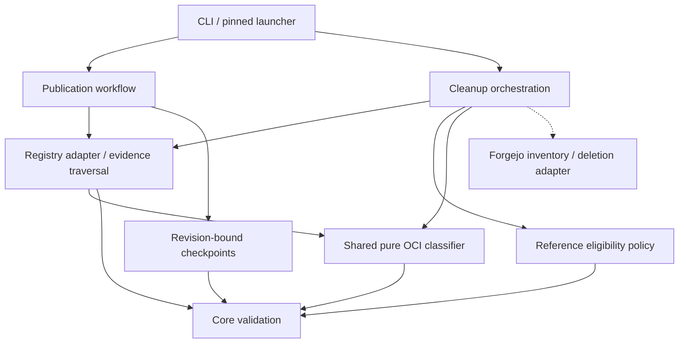

# Brooks-Lint Health Dashboard

- [Brooks-Lint Health Dashboard](#brooks-lint-health-dashboard)
  - [Scope and verdict](#scope-and-verdict)
  - [Dimension scores](#dimension-scores)
  - [Module Dependency Graph](#module-dependency-graph)
  - [Test suite map](#test-suite-map)
  - [Top Findings](#top-findings)
    - [Warning](#warning)
  - [Recommendation](#recommendation)
  - [Review limits](#review-limits)

## Scope and verdict

**Mode:** Health Dashboard

**Scope:** Plan-only review of `tasks/2-fix-release-review-warnings/2-plan.md` against its goal, the preceding branch review, and existing checkpoint/cleanup/registry interfaces. No implementation changes are being reviewed or made.

**Composite Score:** 97/100 for the proposed plan, not for implemented fixes.

**Trend:** 98 → 97 (−1) compared with the previous Health Dashboard record. That record assessed the implementation branch, not this plan; these different scopes do not establish a code-quality regression.

No `.brooks-lint.yaml` exists; balanced scoring applies. The plan addresses both original warnings in depth, including shared artifact classification, full graph protection, and saved-candidate revalidation. Two retry/upgrade contract gaps should be resolved before implementation.

## Dimension scores

- **Code Quality:** Not scored. There is no proposed implementation diff to assess for R1/R2 code-level symptoms.
- **Architecture:** 100/100 for the proposed boundaries. A shared pure classifier prevents competing publication/cleanup rules, and adapters retain I/O ownership. The proposed graph is acyclic; actual implementation remains unverified.
- **Tech Debt:** 90/100. Two Warning findings concern the survivor set of persisted cleanup plans and template-revision-bound checkpoint compatibility.
- **Test Quality:** 100/100 for the planned strategy. Regression scenarios include positive controls, realistic loopback OCI evidence, inventory order, and retries. This is not a claim about new test execution or coverage; the missing contract scenarios are included in the findings without duplicate deductions.
- **Calculation:** `(100 * 0.30 + 90 * 0.25 + 100 * 0.20) / 0.75 = 96.666...`, rounded half-up to `97`. The absent implementation-diff dimension is omitted and its weight redistributed proportionally.

## Module Dependency Graph

This graph describes intended dependency direction, not implemented new modules. Arrows indicate imports or coordination; dashed arrows indicate supplied adapter calls.

Separating graph evidence from classification is justified by two real callers, not speculative abstraction. No structural concern requires a new plugin system or broader release-engine rewrite.

## Test suite map

- **Planned unit tests:** Artifact/image classification, complete runnable-platform membership, descriptor consistency, and reference eligibility. New counts are not yet available.
- **Planned local integration tests:** Loopback OCI graphs; temporary checkpoints; completed older releases; saved cleanup inventories; aliases introduced between operations; partial retry and failed evidence collection. The plan keeps full installer/update and publication/recovery regression checks.
- **Live E2E tests:** None authorized. Docker/Forgejo publication and deletion semantics remain gated by separate disposable-server verification.
- **Existing baseline:** The preceding branch review recorded 59 passing tests. This review did not rerun them, and that earlier result does not validate the proposed changes.
- **Required additions from this review:** Test a newly discovered policy-eligible alias absent from the persisted candidate inventory, and test the actual CLI/pinned-template upgrade boundary rather than only calling cleanup with a fabricated legacy-shaped state.

## Top Findings

### Warning

**P1 — R6 Domain Model Distortion: fresh policy eligibility is not the saved transaction's deletion authority.**

**Location:** `2-plan.md:51-57` and `2-plan.md:61-64`.

**Symptom:** The plan classifies ordinary aliases as retained, older, owned staging, or preserved/uncertain. It adds retained and preserved aliases to protection, but also requires retries to keep the saved candidate inventory and never add replacement candidates. It does not explicitly protect a newly discovered older stable alias that is policy-eligible but absent from that inventory. For example, a saved plan contains a digest deletion; an alias `v0.9.0` is subsequently added pointing at that digest. A fresh scan classifies the alias as older, yet retry will not delete it because it was never recorded as a candidate.

**Source:** Domain-Driven Design — Aggregate Roots and invariant ownership. The cleanup transaction needs a single definition of which references will survive; general retention eligibility and recorded deletion authority are different concepts.

**Consequence:** The backing digest can still be deleted while the newly discovered alias remains, recreating the preserved-reference availability problem during retry. The existing planned tests for unknown aliases and general aliases introduced between candidates do not specify this policy-eligible-but-unscheduled case.

**Remedy:** Define the survivor set relative to the exact pending inventory. Any live reference not authorized for removal by a matching pending candidate must contribute graph protection, even if current retention policy would otherwise permit its deletion. Alternatively, abort retry when newly discovered eligible references change the transaction's survivor set and require explicit reviewed replanning. Do not silently add deletion authority. Test an older stable alias introduced after planning, both before apply and between digest candidates; assert it and its complete graph remain usable or retry stops before deleting them.

**P2 — R2 Change Propagation: legacy checkpoint reuse conflicts with immutable template identity.**

**Location:** `2-plan.md:34`, `2-plan.md:61`, and `2-plan.md:88`; existing contracts at `release_template/workflow.py:18-20`, `release_template/state.py:12-15`, and `release_template/cli.py:42-48`.

**Symptom:** The plan promises to apply new cleanup checks to legacy schema-1 checkpoints without a checkpoint migration, but checkpoints bind identity to the exact template revision. Updating a consumer's pin changes that revision. `State.__init__()` rejects the mismatch before CLI cleanup can reach the proposed legacy-inventory revalidation. A matching schema number does not make an old revision-bound checkpoint loadable by the patched CLI.

**Source:** Software Engineering at Google — Backward compatibility and code sustainability; A Philosophy of Software Design — Information Hiding and Leakage. The immutable revision is part of the observable recovery contract, not just an internal transient graph representation.

**Consequence:** A direct unit test that passes an old-shaped inventory to new cleanup code could pass while an actual upgraded consumer cannot use the advertised recovery path. Without a stated decision, implementation may either ship unreachable compatibility promises or weaken checkpoint identity checks to force adoption, risking source/template/publication identity integrity.

**Remedy:** Explicitly choose and document the supported upgrade behavior. The bounded option is to retain exact identity rejection for old template pins, distinguish legacy inventory-shape hardening from cross-revision checkpoint adoption, and defer adoption to a separately reviewed operator procedure without recommending vulnerable old-code cleanup. If actual cross-revision cleanup is required here, define an explicit cleanup-only adoption protocol with verified source/config/publication identity and retained provenance; never rewrite template identity implicitly. Add a CLI-level old-pin/new-pin test that demonstrates the chosen behavior and confirms zero remote mutations on rejection. Keep ordinary same-revision retries covered separately.

## Recommendation

Amend the plan to define transaction-relative survivors and the checkpoint upgrade boundary before implementation. Prefer preserving the current immutable identity guard and explicitly limiting compatibility claims unless cross-revision adoption is separately required. The shared classifier and conservative graph-protection design otherwise address the original findings well. Tech Debt is the lowest-scoring dimension; a broader `brooks-debt` assessment is optional, not a prerequisite for these focused amendments.

## Review limits

- Reviewed the complete plan and checked current state identity, CLI startup, graph callers, cleanup candidate handling, and relevant fixtures. Findings concern missing design decisions, not newly reproduced live failures.
- No implementation, goal, plan, version, bootstrap, credentials, or `todo.md` changes were made. Only this review and its scoped health-history record are written.
- No tests, builds, remote publications, pushes, deletions, or consumer changes were performed during this review. Prior branch-review test results are historical context only.
- Plan approval cannot prove runtime artifact compatibility, filesystem durability, distributed serialization, or Forgejo deletion semantics. The existing live deletion gate remains required.
