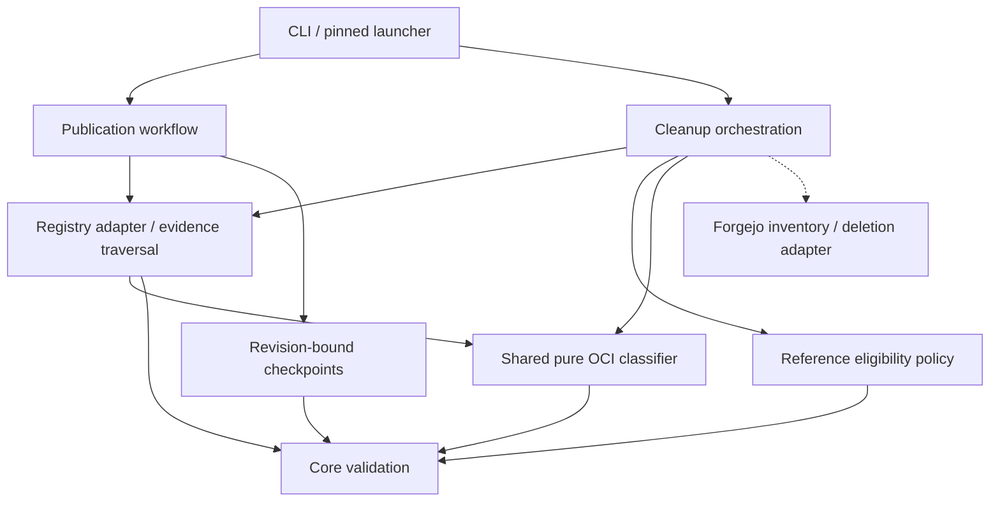

# Brooks-Lint Health Dashboard

- [Brooks-Lint Health Dashboard](#brooks-lint-health-dashboard)
  - [Scope and verdict](#scope-and-verdict)
  - [Dimension scores](#dimension-scores)
  - [Module Dependency Graph](#module-dependency-graph)
  - [Test suite map](#test-suite-map)
  - [Previous findings](#previous-findings)
  - [Top Findings](#top-findings)
  - [Recommendation](#recommendation)
  - [Review limits](#review-limits)

## Scope and verdict

**Mode:** Health Dashboard

**Scope:** Second plan-only review of `tasks/2-fix-release-review-warnings/2-plan.md`, updated in `beb7de8`, against its goal, the preceding review findings P1/P2, and existing checkpoint identity contracts. No implementation changes are being reviewed or made.

**Composite Score:** 100/100 for the proposed plan, not for implemented fixes.

**Trend:** 97 → 100 (+3) since the preceding review of this same plan. This reflects resolved planning gaps, not measured runtime improvement.

No `.brooks-lint.yaml` exists; balanced scoring applies. Ready for implementation within the stated template-only scope. Both retry/upgrade findings now have explicit decisions, regression tests, and acceptance criteria. The original implementation warnings remain unresolved until code changes and verification demonstrate these guarantees.

## Dimension scores

- **Code Quality:** Not scored. There is no proposed implementation diff to assess for R1/R2 code-level symptoms.
- **Architecture:** 100/100 for the proposed boundaries. A shared pure classifier prevents competing publication/cleanup rules, and adapters retain I/O ownership. The proposed graph is acyclic; actual implementation remains unverified.
- **Tech Debt:** 100/100 for the proposed design. Cleanup authority is bound to exact pending candidates, and cross-revision checkpoint adoption is explicitly deferred without weakening identity checks. No remaining concrete R1–R6 plan finding was established.
- **Test Quality:** 100/100 for the planned strategy. Positive controls, realistic OCI evidence, inventory order, unscheduled older aliases, recreated records, and CLI-level revision rejection are covered. This does not score the readability, brittleness, or actual coverage of tests not yet written.
- **Calculation:** `(100 * 0.30 + 100 * 0.25 + 100 * 0.20) / 0.75 = 100`. The absent implementation-diff dimension is omitted and its weight redistributed proportionally. No current findings incur deductions.

## Module Dependency Graph

This graph describes intended dependency direction, not implemented new modules. Arrows indicate imports or coordination; dashed arrows indicate supplied adapter calls.

Separating graph evidence from classification is justified by two real callers, not speculative abstraction. No structural concern requires a new plugin system or broader release-engine rewrite.

## Test suite map

- **Planned unit tests:** Artifact/image classification, complete runnable-platform membership, descriptor consistency, and reference eligibility. New counts are not yet available.
- **Planned local integration tests:** Loopback OCI graphs; temporary checkpoints; completed older releases; saved cleanup inventories; aliases introduced between operations; partial retry and failed evidence collection. The plan keeps full installer/update and publication/recovery regression checks.
- **Live E2E tests:** None authorized. Docker/Forgejo publication and deletion semantics remain gated by separate disposable-server verification.
- **Existing baseline:** The preceding branch review recorded 59 passing tests. This review did not rerun them, and that earlier result does not validate the proposed changes.
- **P1 regression coverage now specified:** `2-plan.md:36` tests unscheduled older aliases introduced before apply and between digest candidates, recreated completed references, and changed pending identities. `2-plan.md:68` additionally requires alias retirement before affected digest deletion, including differently ordered saved inventories.
- **P2 regression coverage now specified:** `2-plan.md:37` tests old-pin/new-pin CLI rejection, unchanged checkpoint bytes, no registry login or remote mutation, and a separate successful same-revision retry. Old-selection-shaped inventories are tested only under matching identity (`2-plan.md:35`).

## Previous findings

- **P1 — transaction-relative survivors: addressed in the plan.** `2-plan.md:56-57` distinguishes general retention eligibility from exact pending deletion authority. Live references without matching pending candidates protect their full graphs, including recreated records and newly discovered older aliases. `2-plan.md:66-68` repeats this invariant during retries and orders alias retirement before backing-digest deletion. `2-plan.md:86` makes it an acceptance criterion. No silent candidate expansion or new replanning authority is introduced.
- **P2 — immutable template identity: addressed in the plan.** `2-plan.md:26` recognizes schema and recovery identity as separate contracts. `2-plan.md:66` limits saved-inventory hardening to matching identity; `2-plan.md:70` retains mismatch rejection and defers adoption. `2-plan.md:77` documents the upgrade boundary without recommending identity rewrites, discarded checkpoints, source rollback, or vulnerable old-code cleanup. The CLI test at `2-plan.md:37` and acceptance criterion at `2-plan.md:87` verify the chosen boundary.

These statuses close the plan-review findings only. They do not claim that original branch findings F1/F2 are fixed or that pending old-pin cleanup is now supported by an upgraded template.

## Top Findings

No new Critical, Warning, or Suggestion finding is established. Conservative retention, refusal of unsupported OCI encodings, increased evidence reads, and explicit cross-revision adoption deferral are justified safety/scope tradeoffs rather than new defects. Keep their documented limitations visible during implementation.

## Recommendation

Proceed with implementation when separately requested. Start with the original warning reproductions and P1/P2 contract tests, then implement the shared classifier and transaction-relative protection without changing bootstrap or checkpoint identity rules. Keep destructive cleanup gated and defer live Forgejo/Docker checks and cross-revision adoption to separately authorized work. No further planning change is required by this review.

## Review limits

- Reviewed the complete updated plan, its goal, previous P1/P2 findings, and current `Workflow`/`State` identity checks. Other implementation context comes from the earlier review; no new implementation diff or runtime behavior was validated.
- No implementation, goal, plan, version, bootstrap, credentials, or `todo.md` changes were made. Only this review and its scoped health-history record are written.
- No tests, builds, remote publications, pushes, deletions, or consumer changes were performed during this review. Prior branch-review test results are historical context only.
- Plan approval cannot prove runtime artifact compatibility, filesystem durability, distributed serialization, or Forgejo deletion semantics. The existing live deletion gate remains required.
