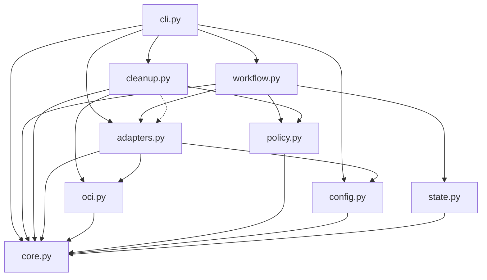

# Brooks-Lint Health Dashboard

- [Brooks-Lint Health Dashboard](#brooks-lint-health-dashboard)
  - [Scope and verdict](#scope-and-verdict)
  - [Dashboard scores](#dashboard-scores)
  - [Module Dependency Graph](#module-dependency-graph)
  - [Top Findings](#top-findings)
    - [Warning](#warning)
  - [Previous findings](#previous-findings)
  - [Verification and test suite map](#verification-and-test-suite-map)
  - [Recommendation](#recommendation)

## Scope and verdict

**Mode:** Health Dashboard

**Scope:** All branch changes in `1-standardize-container-releases...2-fix-release-review-warnings`, through implementation commit `fb88777`. The base and merge base are `7efb85f50929a84450823d11e3f137664663859b`: 16 changed files, 728 insertions, and 82 deletions. This includes production code, tests, documentation, version changes, and the implementation results. Existing task goals/plans/reviews provide context but are not new implementation changes on this branch.

**Composite Score:** 99/100

**Trend:** 100 → 99 (−1) from the preceding Health Dashboard record, which assessed the plan rather than implementation. These scopes are not directly comparable; the earlier 100 was not runtime approval.

No `.brooks-lint.yaml` exists; balanced scoring applies. Both original warnings received substantial fixes and regression coverage. One reproducible deletion-order defect remains: cleanup can remove a dependency before its still-pending index, then permanently block its own revalidation. Address this before treating cleanup as ready, regardless of the high abbreviated maintainability score. No implementation fixes were made during review.

## Dashboard scores

- **Code Quality:** 100/100, weight 0.25. No independent R1/R2 finding. Graph traversal and cleanup scans are longer because they make evidence and side effects explicit; length alone is not a defect.
- **Architecture:** 100/100, weight 0.30. The new pure OCI classifier is shared by publication and ownership checks. Internal imports remain acyclic; adapter/orchestrator fan-out is justified.
- **Tech Debt:** 95/100, weight 0.25. One R6 Warning: deletion scheduling ignores manifest dependencies among pending raw digest candidates.
- **Test Quality:** 100/100, weight 0.20. No independent T1/T2 finding established in the abbreviated scan. The missing destructive dependency-order scenario is documented with B1 rather than deducted twice. Passing tests do not imply complete failure-path protection.

Balanced scoring deducts five points for B1. Calculation: `100 * 0.25 + 100 * 0.30 + 95 * 0.25 + 100 * 0.20 = 98.75`, rounded half-up to `99`.

## Module Dependency Graph

Arrows indicate imports; dashed arrows indicate runtime calls through supplied adapters. Standard-library imports are omitted.

The stable bootstrap and checkpoint identity modules are unchanged. Transient graph evidence is not persisted into publication identity, avoiding an unnecessary checkpoint-schema change. Dependency direction is coherent; the remaining defect concerns scheduling operations over the content graph, not Python import cycles.

## Top Findings

### Warning

**B1 — R6 Domain Model Distortion: raw digest deletion order can invalidate pending parent evidence.**

**Location:** `release_template/cleanup.py:98-115`, `release_template/cleanup.py:154-176`, and `release_template/cleanup.py:188-196`.

**Symptom:** Cleanup orders aliases before releases before raw digests, but preserves inventory order among raw digests. Every subsequent operation and retry reconstructs every remaining package graph. If a provably older platform-manifest digest precedes its also-eligible index digest, the child is deleted first. The next scan tries to traverse the remaining index, encounters its now-absent child, and stops. Nothing records a dependency-aware order to prevent this transition.

**Source:** Domain-Driven Design — Aggregate Roots and invariant ownership. The index/child dependency is modeled for preservation but not for retiring a group of related manifest records. Code Complete — defensive programming and error-handling discipline also applies: a successful side effect invalidates the evidence needed to complete or reconcile the next operation.

**Consequence:** Publication remains intact, but valid historical cleanup becomes stuck after partial deletion. Ordinary retry cannot recover because the retained pending index still names the deleted child, so its graph fails before candidate absence/completion reconciliation can finish. This contradicts retryable cleanup expectations and can require separately reviewed operator recovery. The deletion gate does not supply a safe candidate order.

**Reproduction:** Using the real registry adapter and existing loopback OCI server, created an owned older image manifest and an index referencing it, plus an independently verified current image. The package inventory listed the older child digest before the older index digest. A disposable state and fixture-only deletion attestation exercised `cleanup.apply()`; the synthetic delete callback removed only the selected manifest and its package record. Attempt 1 deleted the child and stopped with `Required registry content is absent`. Attempt 2 stopped with the same error, with no additional deletion. The parent index remained present and the current publication still verified. No production service was contacted or deleted from.

**Remedy:** Determine dependency order among authorized digest candidates before the first deletion. Retire indexes or other referring manifests before deleting dependencies that are also authorized candidates; handle shared dependencies and subject edges conservatively. Persist sufficient approved ordering/evidence to reconcile interrupted operations without assuming a partially retired graph remains traversable, while still freshly protecting all surviving references. Keep ambiguous legacy partial states fail-closed rather than recreating or adopting content implicitly. Add a loopback apply-and-retry regression with child-first inventory, nested indexes, and shared children, including interruption after a successful deletion.

**Why existing tests miss it:** `FakeRegistry.graph()` constructs synthetic nodes from cached metadata without checking that all reported dependent digests still exist (`tests/support.py:45-64`). Fake digest deletion removes only one lookup (`tests/support.py:102-110`). The real nested-graph retention test is read-only (`tests/test_adapters.py:249-273`); it never deletes a child and then re-traverses its parent. Tests therefore cover alias-before-digest order, but not dependency order within digest deletions.

## Previous findings

- **Original F1 — preserved alias graph protection:** Addressed in selection/revalidation for the reproduced skipped-alias and transaction-relative survivor scenarios. Complete older checkpoints, uncertain roots, foreign associations, unscheduled older aliases, and recreated records now contribute protection. B1 is a distinct retirement-order problem among records that are all eligible for deletion, not a recurrence of deleting a preserved alias's graph.
- **Original F2 — unexpected runnable architectures:** Addressed by graph evidence plus the shared classifier. The real adapter rejects extra runnable architectures and validates all runnable members; explicit artifacts are separate from images. Conservative refusal of unsupported encodings is documented and justified.
- **Plan P1 — saved transaction survivors:** Implemented with exact pending candidate authority and tests for newly introduced older aliases, changed identities, and recreated completed references. No automatic inventory expansion was found.
- **Plan P2 — revision-bound checkpoints:** The immutable identity guard remains unchanged. CLI tests confirm that new-pin invocations reject old-pin checkpoints without state changes or remote mutations, separately from supported same-revision retries. Cross-revision adoption remains explicitly deferred.

## Verification and test suite map

- `TMPDIR=/tmp/opencode python3 -B -m unittest discover -s tests`: all 83 tests passed in 19.473 seconds during review.
- `git diff --check 1-standardize-container-releases...HEAD`: passed.
- Test counts: 9 core, 8 CLI, 34 workflow/cleanup, 21 adapter, and 11 installer/update methods. Approximate primary layers: 43 small in-process policy/orchestration tests, 40 local integration tests, and zero live-service E2E tests. Some methods mix layers; these are method counts, not assertion counts.
- The approximately 20-second suite and local integration focus fit the repository's filesystem, HTTP, subprocess, and durability risks. No test-pyramid ratio finding is warranted merely because integration coverage is substantial.
- Checked the changed registry/classifier/cleanup code, test-support behavior, relevant regression scenarios, documentation and version delta, plus unchanged identity contracts as context. Internal imports remain acyclic.
- B1 was reproduced separately with real loopback manifest retrieval and removal-aware synthetic deletion, outside the committed suite. The finding does not depend on real Forgejo cascading behavior; only the selected child disappeared in the fixture.
- No production credentials, Docker builds, remote creation, pushes, publications, live deletions, or existing consumer changes occurred. Real Forgejo/Docker semantics remain unverified, as documented. The unrelated untracked `todo.md` was left untouched.

## Recommendation

Fix B1 and add destructive dependency-order/retry coverage before cleanup readiness approval. Preserve the existing survivor checks, immutable identity guard, and live deletion gate rather than weakening revalidation to hide missing dependencies. A focused `brooks-debt` assessment could deepen the lowest-scoring dimension, but the concrete ordering defect is the immediate priority. This stage records findings only and does not implement remedies.
