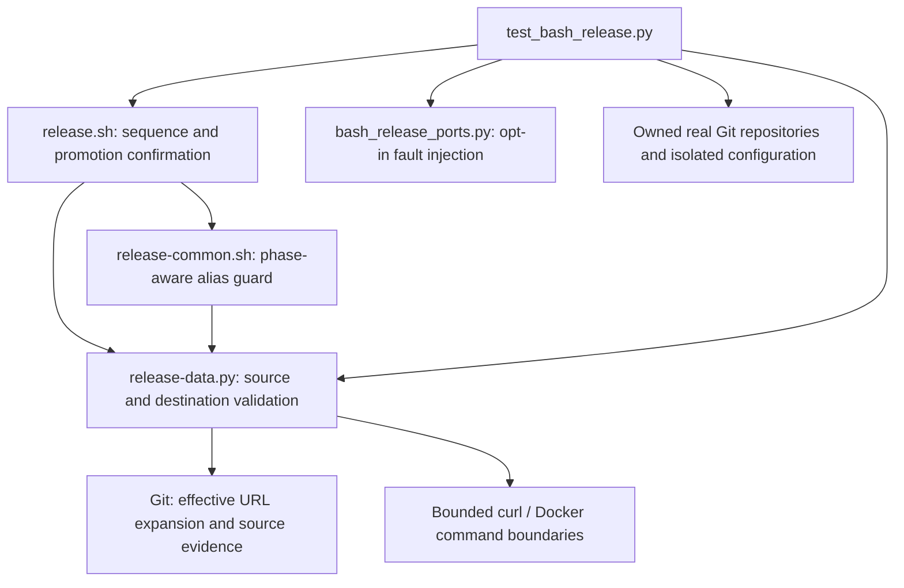

# Brooks-Lint Health Dashboard

- [Brooks-Lint Health Dashboard](#brooks-lint-health-dashboard)
  - [Scores](#scores)
  - [Module Dependency Graph](#module-dependency-graph)
  - [Test Suite Map](#test-suite-map)
  - [Top Findings](#top-findings)
  - [Goal Coverage and Decisions](#goal-coverage-and-decisions)
  - [Verification and Limits](#verification-and-limits)
  - [Recommendation](#recommendation)

**Mode:** Health Dashboard

**Scope:** Plan-only review of `tasks/20-fix-release-target-and-alias-guards/2-plan.md` at `5f50e66`, against `1-goal.md`, task 19 findings F1/F2, and the affected source/test boundaries. No `.brooks-lint.yaml` exists; balanced defaults apply. This assesses the proposed design, not completed fixes or whole-project health.

**Composite Score:** 100/100

**Trend:** 91 → 100 (+9) against the previous dashboard, which reviewed the whole implementation. These scopes are not comparable; no implementation improvement has occurred yet.

The plan is actionable and addresses both requested findings without expanding repair authority. No blocking plan defects were identified.

## Scores

- **Code Quality: not applicable.** The working tree and branch against `main` had no diff at review start; the PR dimension is skipped.
- **Architecture: 100/100.** The plan retains Bash sequencing and Python boundary validation, with no new module cycle or infrastructure layer.
- **Tech Debt: 100/100.** Complete push enumeration and one-way promotion evidence address the identified invariant gaps without speculative recovery machinery.
- **Test Quality: 100/100.** Real-Git enumeration, full-entry fault injection, conditional-shell checks, and baseline replay protect distinct failure boundaries.

No scored findings. Redistributed composite: `(100 × 0.30 + 100 × 0.25 + 100 × 0.20) / 0.75 = 100`. Unchanged implementation findings F1–F5 are not charged again as defects in this scoped plan.

## Module Dependency Graph

Arrows represent proposed process and test dependencies. Existing orchestration fan-out is appropriate. Keeping URL expansion in Git avoids a second rewrite implementation; retaining promotion state in Bash keeps lifecycle authority with sequencing.

## Test Suite Map

- **Existing inventory:** 117 discovered tests: 5 interface/tree/version, 83 publication-flow, and 29 helper cases. Counted through `unittest.TestLoader` during this review, without running tests.
- **Existing layer map:** the task 19 review classified 19 isolated helper cases and 98 local integration/filesystem cases; live end-to-end cases remain zero. No exact count is assigned to tests that have not been written.
- **Planned helper checks:** actual Git URL expansion/cardinality and both alias phases, including failed reads inside Bash conditionals.
- **Planned local integration checks:** startup and later destination refusal, precise post-confirmation alias mutation, skipped-promotion handling, preserved accepted state, and positive retry/reconciliation cases.
- **Planned regression sensitivity:** replay primary cases with copied pre-fix scripts and distinguish behavioral assertion failures from fixture errors.

The current fake Git port always emits one URL, so the required real-Git tests are necessary independent evidence. Phase-local injection events and no-later-write assertions make failures observable without production test hooks. Multiple state assertions support one safety claim rather than an Eager Test. F3–F5 remain deliberately excluded, not silently resolved by this test plan.

## Top Findings

None. No Critical, Warning, or Suggestion finding is supported within the proposed design scope.

## Goal Coverage and Decisions

- **F1 addressed in design:** plan lines 27–32 require bounded `get-url --push --all` enumeration, exactly one destination before normalization, preservation of fetch/main checks, and revalidation through `source()`/`scan()`. Lines 44–47 require real explicit/fallback URL cases, duplicates, rewrites, failed enumeration, and full-entry refusal before the next write. This covers the difference between the first advertised URL and Git's actual push set.
- **F2 addressed in design:** lines 36–40 make promotion confirmation monotonic and require the first post-confirmation alias observation to match `prepared`. Confirmation follows a successful read, not merely a Docker write event, so skipped and reconciled promotions receive the strict invariant too. Lines 48–51 specify precise injection, state preservation, and conditional-caller safety.
- **Compatibility restriction is explicit:** rejecting duplicate or otherwise matching multiple push endpoints is intentional single-endpoint support, not accidental fan-out reconciliation. The first effective fetch endpoint remains the read authority. Tests must preserve supported SSH/HTTPS normalization.
- **Scope is controlled:** preparing 0.6.2 and updating active warnings/version links directly follow changed release behavior. Old notes/reviews, schema/annotation formats, Gitea gates, and original-pin recovery rules remain unchanged.
- **No new safety claim is implied:** unseen changes after a read and cross-service atomicity remain operational limitations. F3/N2 Buildx discovery, F4 diagnostics, and F5 temporary-parent portability remain open. Their implementation is not a condition for approving this narrower plan.

## Verification and Limits

Read the shared health/source/risk guidance, goal, complete plan, previous findings, current destination validation, alias/source guards, publication transition, and relevant fake-port/helper-test boundaries. Confirmed the plan's file references and current test classes. The previous full-suite result of 117 passing tests in 857.974 seconds belongs to task 19; no tests, regressions, native Docker operations, remote publication, or live checks ran in this plan review.

Only this review and a dashboard-history record are changed. The plan, goal, implementation, tests, version metadata, historical evidence, and `todo.md` remain unchanged. Approval is conditional on implementing and passing the specified acceptance checks, not a statement that F1/F2 are already fixed.

## Recommendation

Proceed with this plan through `@implement`. No plan revision is required. Keep real-Git URL tests and post-confirmation injection as implementation gates, and report F3–F5 separately after verification.
