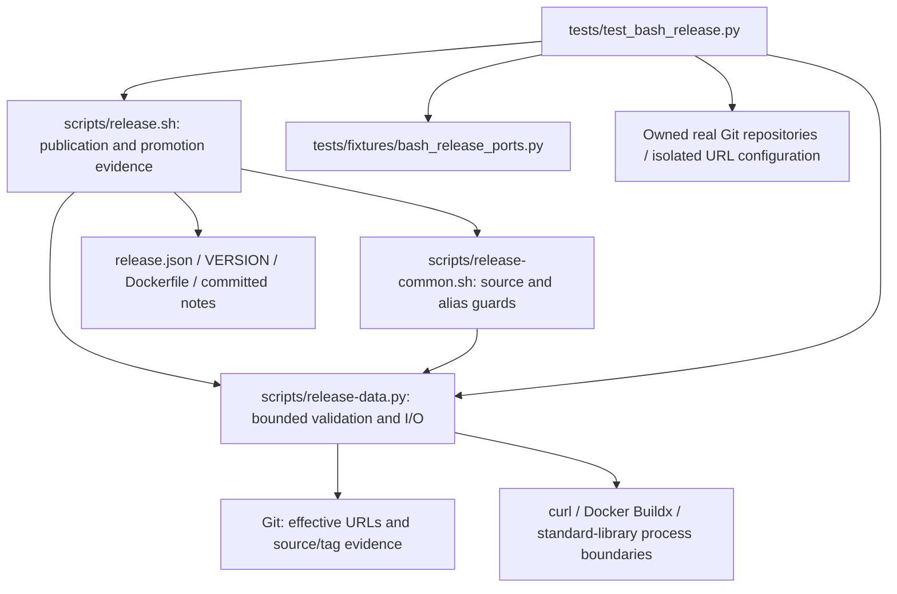

# Brooks-Lint Health Dashboard

- [Brooks-Lint Health Dashboard](#brooks-lint-health-dashboard)
  - [Scores](#scores)
  - [Module Dependency Graph](#module-dependency-graph)
  - [Test Suite Map](#test-suite-map)
  - [Top Findings](#top-findings)
  - [Closure of F1 and F2](#closure-of-f1-and-f2)
  - [Compatibility and Remaining Limits](#compatibility-and-remaining-limits)
  - [Verification](#verification)
  - [Recommendation](#recommendation)

**Mode:** Health Dashboard

**Scope:** All 15 changed files on `20-fix-release-target-and-alias-guards` through `31fbfad`, relative to local base `main` at merge base `acbf40f60468e0e3cf58643a7d03a6235f3cc758`. The branch contains one implementation commit, with 297 insertions and 18 deletions. Reviewed the complete diff and affected source/test boundaries against task 20's plan. No `.brooks-lint.yaml` exists; balanced defaults apply. No implementation fixes were made.

**Composite Score:** 100/100

**Trend:** Stable at 100 against the previous dashboard, which assessed the plan rather than implementation. This is a scoped branch score, not a new whole-project score or live-publication certificate.

F1 and F2 are resolved for the reviewed scenarios. No new scoped findings were identified; inherited F3–F5 remain open.

## Scores

- **Code Quality: 100/100.** Small explicit checks preserve existing sequencing and failure handling. The additional phase state represents verified evidence, not another write mode.
- **Architecture: 100/100.** Git retains URL expansion, Python retains bounded validation, and Bash retains publication lifecycle authority. No new dependency cycle or reversed layer was found.
- **Tech Debt: 100/100.** No independent R1–R6 finding in the changes. The single-endpoint restriction is explicit, and no recovery framework or duplicate rewrite algorithm was introduced.
- **Test Quality: 100/100.** No independent T1/T2 finding in the additions. Tests exercise real Git expansion, precise fixture faults, emitted writes, preserved state, and conditional Bash failure semantics.

All four dimensions apply to the nonempty branch diff. Composite: `100 × 0.25 + 100 × 0.30 + 100 × 0.25 + 100 × 0.20 = 100`. No Critical, Warning, or Suggestion deductions apply within this scope. Unchanged F3–F5 are tracked separately rather than reclassified as branch regressions.

## Module Dependency Graph

Arrows include process and data dependencies. Existing orchestration fan-out is justified. The helper's lock bootstrap starts a Bash child but does not create an import cycle. Added fixture state is test-only; production has no test hook.

## Test Suite Map

- **131 discovered tests:** 5 interface/tree/version checks, 96 publication-flow cases, and 30 helper cases. All 117 previous tests remain represented; 14 were added.
- **19 isolated helper cases** remain in-process checks with injected dependencies and no explicit filesystem/subprocess exercises.
- **112 local integration/filesystem cases:** 96 publication cases, 11 helper cases, and 5 interface/tree checks. The integration-heavy portfolio reflects real Bash/process/Git failure boundaries rather than live service dependence.
- **0 live end-to-end cases:** no real Docker builder, production registry/Gitea, runtime emulation, or Packages-tab certification.

Real-Git tests avoid relying solely on the fake port's URL behavior. Named phase-local injection events establish that alias faults occur after the first successful confirmation, including skipped promotion. Assertions for exit status, write absence, tag identity, and retained staging support one refusal invariant; their multiplicity is not an Eager Test. Baseline replay independently demonstrates that the new regressions reject the old behavior.

## Top Findings

None in the branch changes. No fixes were applied during review.

## Closure of F1 and F2

- **F1 closed:** `scripts/release-data.py:245-254` enumerates `get-url --push --all origin`, checks cardinality before normalization, rejects control/whitespace-bearing output, and validates the remaining endpoint against the configured target. The bounded helper still rejects command/output/decoding failures. The first fetch endpoint remains the read authority. Startup source verification precedes credentials/staging/build, and `scan()` repeats validation before later writes. Tests cover explicit and fallback URL fan-out, duplicates, real rewrite expansion, supported SSH/HTTPS normalization, malformed/failed evidence, and a post-build change that preserves staging while blocking tag dispatch.
- **F2 closed:** `scripts/release.sh:104,152-157` initializes and transitions `promotion_confirmed` only after a successful exact-digest read. `scripts/release-common.sh:71-78` uses the first checked alias observation to require `prepared` once confirmed, instead of accepting the predecessor or erasing contradictory evidence through another read. Both skipped promotion and lost-response reconciliation enter the same strict state. Tests cover predecessor reversion, absence, foreign content, transport/malformed/overflow failures, skipped/reconciled promotion, conditional callers, preserved tag identity, and zero later release/link writes.
- **Regression sensitivity confirmed:** replaying copied base scripts from `acbf40f` produced the intended behavioral assertion failures, not setup errors. F1 continued to a zero exit after the injected destination change; F2 emitted `release-post` after the post-confirmation predecessor reversion. Current branch versions passed those refusal tests.

## Compatibility and Remaining Limits

Rejecting all multiple effective push entries, even identical ones, is the approved compatibility restriction. Git still owns `insteadOf`/`pushInsteadOf` semantics; SSH-port policy, non-force tag push, schema 1, canonical annotation format, package-link version gates, startup ambiguity, and completed-publication authority remain unchanged. Root version, README, configured notes path, and new notes heading consistently use 0.6.2; target/login/token/platform settings are unchanged.

F3/N2 config-local Buildx discovery, F4 early setup diagnostics, and F5's `/tmp/opencode` test-parent dependency remain unresolved and explicitly documented. The branch does not claim to fix them. New script/config hashes cannot adopt old publications; original checkout/pin rules remain necessary. Observed conflicts now refuse, but unseen changes after a read and cross-service atomicity still require operator-enforced writer/configuration exclusion. Historical notes/reviews and `todo.md` are unchanged.

## Verification

- The implementation-stage run in this session passed all 131 tests in 882.564 seconds. The full suite was not rerun during this review.
- Independent review rerun: eight selected real-Git, post-build URL-change, post-confirmation predecessor, skipped/reconciled-promotion, and conditional-guard tests passed in 19.936 seconds.
- Independent baseline replay: both primary tests failed against copied base scripts with exactly one intended assertion failure each and no setup errors. All Git writes targeted owned temporary repositories.
- Both shell scripts passed `bash -n`; current Python files passed AST parsing; local `./scripts/release.sh --validate` and `git diff --check main...HEAD` passed. Discovery confirmed the test-family counts above.
- Active documentation, current notes, and implementation-record links/heading anchors/TOCs passed checks. Version/settings comparison confirmed that only the configured notes path changed among release settings.
- No production credentials, real Docker operations, privileged setup, live publication, rollback, deletion, or unrelated project changes occurred. Only this review and an appended dashboard-history record are intended review edits.

## Recommendation

Accept closure of F1/F2 for this branch. Keep F3–F5 as separate follow-up work and retain explicit approval gates for any live-release experiment. No scoped code changes are requested by this review.
