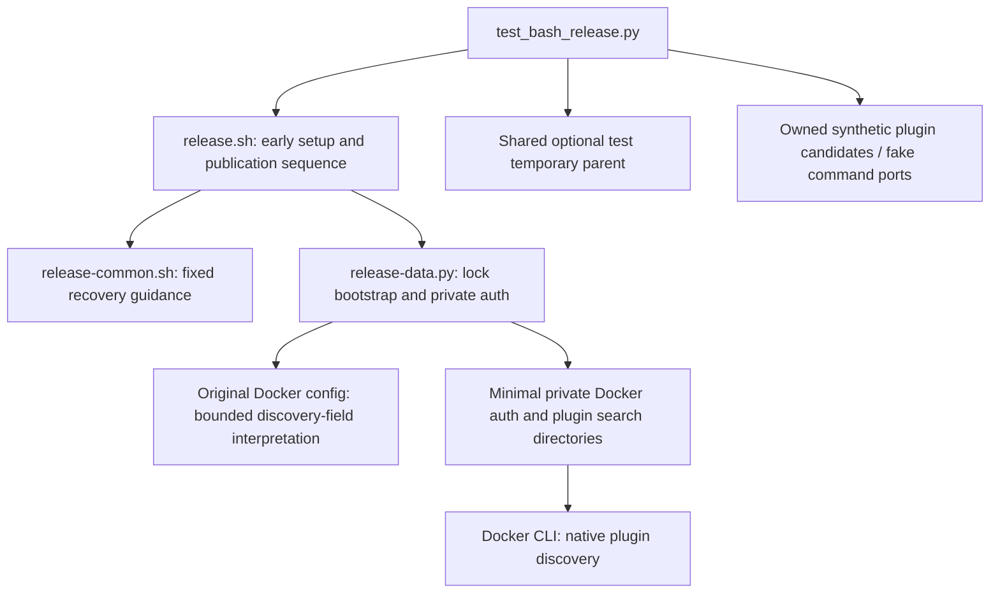

# Brooks-Lint Health Dashboard

- [Brooks-Lint Health Dashboard](#brooks-lint-health-dashboard)
  - [Scores](#scores)
  - [Module Dependency Graph](#module-dependency-graph)
  - [Test Suite Map](#test-suite-map)
  - [Top Findings](#top-findings)
    - [Warning](#warning)
  - [Goal Coverage](#goal-coverage)
  - [Verification and Limits](#verification-and-limits)
  - [Recommendation](#recommendation)

**Mode:** Health Dashboard

**Scope:** Plan-only review of `tasks/21-fix-buildx-discovery-and-setup-guidance/2-plan.md` at `2f54791`, against the updated goal covering F3–F5 and the affected Docker-config, lock-bootstrap, shell-setup, and test boundaries. No `.brooks-lint.yaml` exists; balanced defaults apply. No implementation fixes or plan edits were made.

**Composite Score:** 98/100

**Trend:** 100 → 98 (−2) against the previous dashboard, which reviewed task 20's implementation. Different scopes prevent treating this as a measured implementation regression.

The plan covers F3–F5, but its Docker configuration interpretation needs one explicit compatibility/refusal rule before implementation.

## Scores

- **Code Quality: not applicable.** No working-tree or branch diff against `main` existed at review start; the PR dimension is skipped.
- **Architecture: 95/100.** One Warning, P1: Python field extraction can disagree with Docker's case-insensitive JSON field matching.
- **Tech Debt: 100/100.** No additional scoped R1–R6 finding. Preserving search directories and adding local setup reporting avoid unnecessary recovery machinery.
- **Test Quality: 100/100.** The planned isolation, phase-specific failure assertions, real Bearer execution, and baseline replay are sound. Add P1's boundary cases with its remedy rather than charging the same gap twice.

Balanced scoring deducts five points for P1 only. Redistributed composite: `(95 × 0.30 + 100 × 0.25 + 100 × 0.20) / 0.75 = 98`. Existing unfixed F3–F5 are not counted again as defects in the proposed plan.

## Module Dependency Graph

Arrows show proposed process/data dependencies, not new imports. Bash retains sequencing; Python retains local I/O and bootstrap ownership. P1 concerns disagreement at the configuration boundary, not a missing architectural layer.

## Test Suite Map

- **Existing inventory:** 131 discovered tests: 5 interface/tree/version, 96 publication-flow, and 30 helper cases. Discovery ran without executing the tests.
- **Existing layers:** the previous branch review classified 19 isolated helper cases, 112 local integration/filesystem cases, and zero live end-to-end cases. No count is invented for unwritten tests.
- **Planned F3 checks:** owned plugin-discovery candidates, ordered extra/config-local/system precedence, relative/symlink paths, invalid config refusal, and credential/connection preservation.
- **Planned F4 checks:** lock/open/inherited-descriptor/storage/child-start failures, actionable diagnostics, descriptor release, zero publication writes, and existing signal cleanup.
- **Planned F5 checks:** shared optional parent selection and actual Bearer/publication setup under controlled preferred-parent absence, including isolated `TMPDIR` and temporary-directory cache state.

The opt-in fake plugin model is appropriate local evidence, but it must include input-interpretation differences rather than merely copying the intended Python lookup. The plan correctly avoids global directory deletion, privileged permission changes, native Docker calls, and production test hooks. No independent T1/T2 finding is supported in the proposed tests.

## Top Findings

### Warning

**P1 — Architecture / R5 Dependency Disorder: discovery-field extraction omits Docker's case-insensitive matching contract.**

Symptom: Plan lines 29–31 specify existing Python JSON helpers, extraction of `cliPluginsExtraDirs`, and an empty list when that field is absent. They do not define handling for alternate casing or case-equivalent duplicates. Docker's `ConfigFile.LoadFromReader` decodes into a Go struct, whose JSON decoder accepts case-insensitive field matches. For example, `{"CLIPluginsExtraDirs":["/owned/extra"]}` selects extra directories in Docker, while a literal Python lookup of `cliPluginsExtraDirs` treats the field as absent. The current `unique()` helper rejects exact duplicate keys only; canonical and differently cased keys coexist.

Source: *Clean Architecture* — infrastructure boundary integrity; *Code Complete* — defensive input interpretation must agree with the operation it protects.

Consequence: A straightforward implementation following the plan can pass preflight using the original extra-directory Buildx, then omit that directory from private configuration and select config-local/system Buildx instead. Case-variant duplicate fields can likewise produce different selected lists before and after isolation. This would preserve F3's executable-selection failure despite the planned precedence tests.

Remedy: Define a deliberate field-name policy before implementation. Either normalize a single Docker-recognized case-insensitive spelling or reject noncanonical spellings explicitly before publication. Reject case-equivalent duplicate discovery fields rather than silently choosing a value that differs from Docker. Add uppercase/mixed-case and canonical-plus-case-variant inputs to helper tests and the fake discovery boundary; require identical plugin selection or a safe zero-write refusal. Do not attempt to reproduce every permissive Go JSON behavior.

Evidence: Read Docker CLI v29.0.0's [configuration structure and loader](https://github.com/docker/cli/blob/v29.0.0/cli/config/configfile/file.go), plus Go 1.25.0's [JSON decoder](https://github.com/golang/go/blob/go1.25.0/src/encoding/json/decode.go), which documents case-insensitive struct matching and processes members in order. A synthetic local probe using the current Python `decode()` accepted both examples above: uppercase-only returned `None` under canonical lookup, and canonical-plus-uppercase retained two separate keys. This is a source-backed plan gap, not a claim that unwritten implementation or a deployed Docker binary was executed.

## Goal Coverage

- **F3:** ordered original extra directories followed by config-local discovery, without importing unrelated auth/helpers, is a suitable narrow remedy. Relative-path handling, symlink preservation, login preservation, and source-backed precedence are specified. P1 must be added to the input boundary and regressions.
- **F4:** the plan correctly handles Python errors after shell replacement separately from child-shell lock/storage guards. Fixed advice, raw-path suppression, safe descriptor cleanup, no lock deletion, and unchanged post-write uncertainty semantics address the original diagnostic gap.
- **F5:** the updated goal and plan include portable shared temporary-parent selection and execution of actual assertions when the preferred parent is absent. Isolating ambient/cache state makes this stronger than merely mocking a successful factory call.
- **Preserved constraints:** F1/F2 regressions, schema/annotation identity, original-pin rules, writer/tool configuration exclusion, and local-only verification remain explicit. Preparing 0.6.3 is consistent with the current patch-version convention.

## Verification and Limits

Read the complete goal/plan, shared health/source/risk references, current JSON/auth/lock helpers, and relevant setup/test boundaries. Confirmed the current test-family counts through `unittest.TestLoader`. No tests, native Go/Docker execution, credential access, privileged setup, or live publication ran. Public source retrieval was read-only, and synthetic JSON inputs contained no real configuration or secrets.

Only this review and an appended dashboard-history record are changed. The plan, goal, implementation, tests, version metadata, archived evidence, and `todo.md` remain unchanged. The prior 131-test result belongs to task 20, not verification of this planned implementation.

## Recommendation

Revise the discovery-field interpretation and add P1's regressions before `@implement`. The F4/F5 design needs no further revision from this scan. A larger architecture refactor or full Docker-config compatibility parser is unnecessary.
