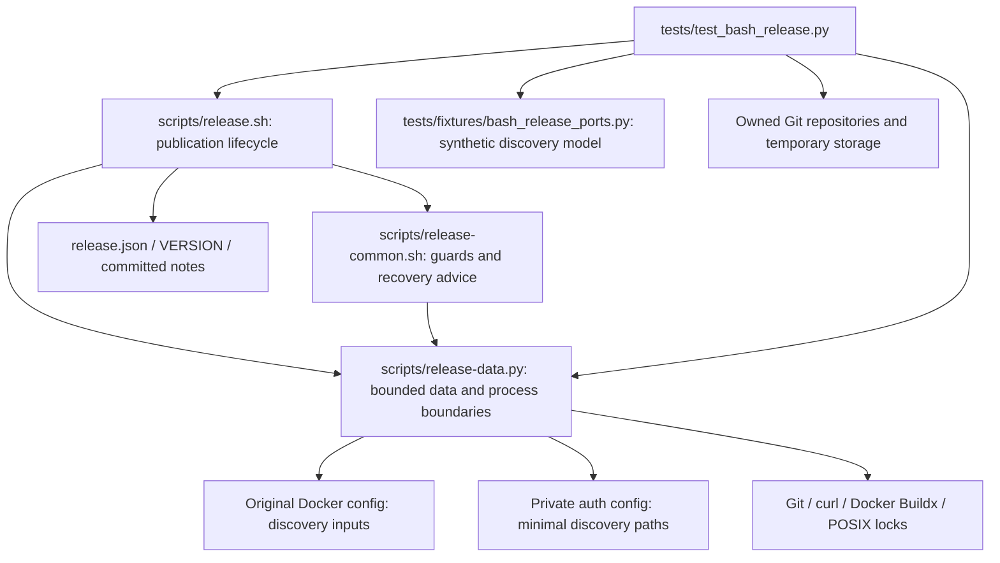

# Brooks-Lint Health Dashboard

- [Brooks-Lint Health Dashboard](#brooks-lint-health-dashboard)
  - [Scores](#scores)
  - [Module Dependency Graph](#module-dependency-graph)
  - [Test Suite Map](#test-suite-map)
  - [Top Findings](#top-findings)
  - [Closure of F3–F5 and P1](#closure-of-f3f5-and-p1)
  - [Compatibility and Remaining Limits](#compatibility-and-remaining-limits)
  - [Verification](#verification)
  - [Recommendation](#recommendation)

**Mode:** Health Dashboard

**Scope:** All 15 changed files on `21-fix-buildx-discovery-and-setup-guidance` through implementation commit `4c203c4`, relative to local `main` at merge base `a51ba8b4e293b208fca25f7daa3237835f3d6ff7`. The branch contains one implementation commit, with 462 insertions and 44 deletions. Reviewed the complete diff and affected production/test boundaries against the updated task 21 plan. No `.brooks-lint.yaml` exists; balanced defaults apply. No implementation fixes were made.

**Composite Score:** 100/100

**Trend:** 98 → 100 (+2) against the previous Health Dashboard, which reviewed the plan rather than implementation. This scoped branch score is not a whole-project or live-publication certificate.

F3–F5 and P1 are resolved for the reviewed scenarios. No new scoped findings were identified.

## Scores

- **Code Quality: 100/100.** Discovery extraction and setup refusals have narrow responsibilities. Extracting `locked()` preserves the existing lifecycle while making failure ownership explicit. No new R1/R2 finding was established.
- **Architecture: 100/100.** Bash retains publication sequencing, Python retains bounded data/process handling, and Docker retains native system-directory fallback. No import cycle, reversed production/test dependency, or unjustified new layer was found.
- **Tech Debt: 100/100.** No independent R1–R6 finding in the changes. Minimal private config avoids copying unrelated Docker policy. Fixed diagnostics cover the two bootstrap boundaries without introducing a recovery framework or write authority.
- **Test Quality: 100/100.** No independent T1/T2 finding in the additions. Owned fixtures exercise observable selection, refusal, descriptor release, and publication boundaries. Narrow OS mocks complement full-entry tests rather than replacing them.

All four dimensions apply. Composite: `100 × 0.25 + 100 × 0.30 + 100 × 0.25 + 100 × 0.20 = 100`. No Critical, Warning, or Suggestion deductions apply within this scope. Function length and multiple related assertions alone do not establish a maintainability defect; the scenario matrices test one discovery/setup invariant each.

## Module Dependency Graph

Arrows show process/data dependencies, not just imports. The existing lock bootstrap launches a Bash child; this is a deliberate process handoff, not an import cycle. Production does not depend on the test fixture. Existing helper fan-out reflects explicit external boundaries rather than a newly introduced layering violation.

## Test Suite Map

- **142 discovered tests:** 5 interface/tree/version checks, 102 publication-flow cases, and 35 helper cases. All 131 previous tests remain; 11 were added.
- **19 isolated helper cases** use in-process injected dependencies without explicit filesystem/subprocess exercises.
- **123 local integration/filesystem cases:** 102 publication cases, 16 helper cases, and 5 interface/tree checks. These exercise Bash, processes, owned files, or real temporary Git repositories; Docker/curl publication ports remain synthetic.
- **0 live end-to-end cases:** no real Docker builder, production registry/Gitea, native plugin metadata exchange, or UI verification.

Discovery coverage includes 11 installation/configuration variants, selected path/content across preflight/build/promotion, and canonical-only refusal despite the original decoder accepting aliases. Temporary-parent simulations run the actual Bearer assertions and publication setup with controlled environment/cache state. The model and direct config tests provide different evidence; neither is represented as native Docker certification.

## Top Findings

None in the branch changes. No fixes were applied during review.

## Closure of F3–F5 and P1

- **F3 closed:** `scripts/release-data.py:289-307,333-337` preserves ordered original extra directories, then original config-local plugins, through private authentication. Relative paths retain caller-working-directory semantics; native system fallback remains Docker's responsibility. Only minimal discovery/auth fields enter the private config. Local-only, shadowed-system, extra-directory, system-only, absent-config, unset/empty-config, relative, space-containing, symlink, and null-field scenarios retain the selected candidate through all three Buildx calls.
- **P1 closed:** the extractor rejects case-fold-equivalent noncanonical discovery keys before canonical lookup. Existing duplicate-key decoding rejects exact duplicates. Tests exercise aliases, both mixed-key orders, equal/conflicting/null values, and Unicode case folding. The independent original-config model accepts aliases, so refusal tests do not merely repeat the extractor's assumptions. Unsupported spelling produces a fixed refusal rather than silently selecting a fallback.
- **F4 closed:** `scripts/release-data.py:629-659` handles lock open/acquisition and locked-child startup failures with fixed setup advice and descriptor cleanup. `scripts/release.sh:24-43` establishes early phases, explicitly checks inherited locking, and converts temporary creation failure into safe guidance before ordinary traps exist. Raw temporary-tool stderr is suppressed; production `TMPDIR` is not silently replaced. Symlink targets and active lock ownership remain intact. Existing post-write uncertainty and signal cleanup paths are retained.
- **F5 closed:** `tests/test_bash_release.py` shares `owned_temporary_directory()` between publication setup and the Bearer case. An existing `/tmp/opencode` is optional; absence delegates parent choice to Python. Controlled simulations exercise both branches without changing a global directory and preserve the original Bearer assertions.

## Compatibility and Remaining Limits

Canonical-only discovery spelling, strict original-config decoding, nonempty control-free paths, and a 1 MiB config bound are approved compatibility restrictions, not full emulation of Docker's permissive decoder. Search-order preservation assumes unchanged plugin files/configuration through completion; it does not pin executable bytes against concurrent replacement. Native plugin metadata, deployed CLI behavior, daemon/TLS routing, live publication, and second-host portability remain uncertified.

F1/F2 destination and confirmed-promotion guards remain unchanged. Schema 1, annotation format, package-link gates, conservative retry authority, and no-repair/no-rollback policy are retained. Version, README, notes heading, and configured notes path agree on 0.6.3; other release settings match the base. Changed script/config hashes still require preserved original checkout/pins for historical publications. Archived evidence and `todo.md` are untouched.

## Verification

- Implementation-stage results recorded in `4-implemented.md`: 12 focused tests passed in 105.834 seconds; all 142 tests passed in 1015.850 seconds. The lengthy full suite was not rerun during review.
- Independent review rerun: seven selected discovery, alias-refusal, lock/storage, config-bound, descriptor-cleanup, and optional-parent tests passed in 104.054 seconds. The discovery test includes all 11 installation/configuration variants.
- Independent baseline replay against copied `a51ba8b` code reproduced F3's missing plugin after successful preflight/login, F4's storage refusal without `Next:`, and F5's `FileNotFoundError`. Current F3 completed and current Bearer assertions passed. The copied fake-login schema assertion was disabled for both F3 runs so it could not mask the original failure; other auth checks remained active.
- Both shell scripts passed `bash -n`; Python files passed AST parsing. Local `./scripts/release.sh --validate`, `git diff --check main...HEAD`, test discovery, version/settings comparison, and active documentation/current-notes/implementation-record link and TOC checks passed.
- All probes used owned synthetic files, tokens, and Git repositories. No real Docker invocation, production credentials, privileged setup, live publication, rollback, or unrelated project changes occurred. Review edits are limited to this report and the appended dashboard-history record.

## Recommendation

Accept scoped closure of F3–F5 and P1. No code changes are requested by this review. Retain explicit approval gates and the documented operational prerequisites for any native Docker or live-release verification.
