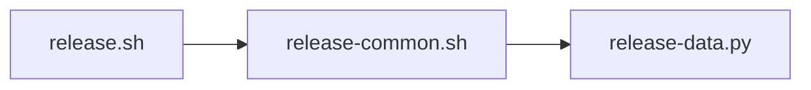

# Plan review

- [Plan review](#plan-review)

**Health Dashboard — task 22 plan.** Composite 99/100: code quality 95, architecture 100, debt 100, tests 100. The plan fits the goal and reuses the existing shell and registry boundaries.

**Warning:** Step 2 checks the version at completion, but does not say when to refuse a changed version during publication. A later Git, registry or association write could proceed on stale evidence. Add the same version check to fresh and association guards, including absence before build. Document the existing single-writer requirement; registry reads are not atomic reservations.
