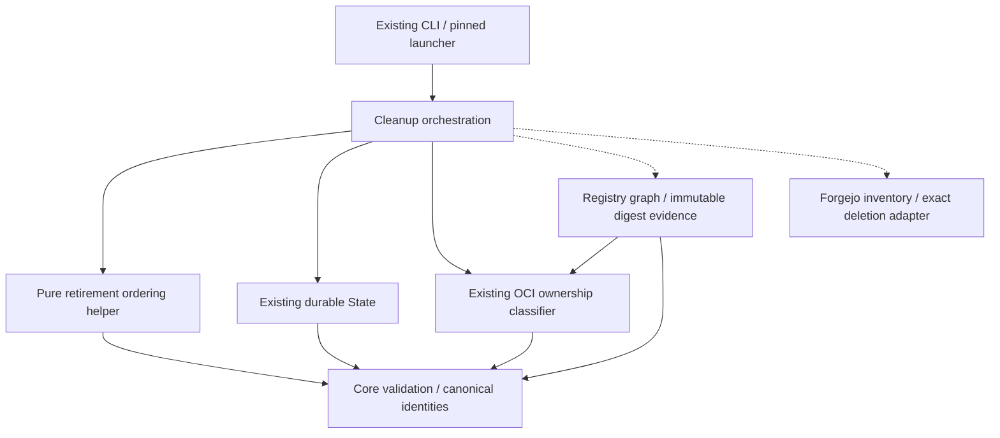

# Brooks-Lint Health Dashboard

- [Brooks-Lint Health Dashboard](#brooks-lint-health-dashboard)
  - [Scope and verdict](#scope-and-verdict)
  - [Dimension scores](#dimension-scores)
  - [Module Dependency Graph](#module-dependency-graph)
  - [Test suite map](#test-suite-map)
  - [Previous finding](#previous-finding)
  - [Top Findings](#top-findings)
  - [Recommendation](#recommendation)
  - [Review limits](#review-limits)

## Scope and verdict

**Mode:** Health Dashboard

**Scope:** Plan-only review of `tasks/3-fix-cleanup-dependency-order/2-plan.md`, committed in `d09cfe7`, against its goal, branch-review warning B1, and existing cleanup/state/registry contracts. No implementation changes are being reviewed or made.

**Composite Score:** 100/100 for the proposed plan, not for implemented cleanup behavior.

**Trend:** 99 → 100 (+1) from the preceding Health Dashboard record. The previous record assessed implementation, not this plan; these different scopes do not demonstrate runtime improvement.

No `.brooks-lint.yaml` exists; balanced defaults apply. Ready for implementation within the stated template-only scope. The plan gives B1 a dependency-aware deletion policy, durable schedule, interruption reconciliation, realistic regression fixtures, and conservative legacy-state handling. No additional concrete planning defect was established. B1 remains an implementation defect until these changes are implemented and verified.

## Dimension scores

- **Code Quality:** Not scored. No implementation diff exists for this task; proposed helper length or nesting cannot yet be assessed.
- **Architecture:** 100/100 for the proposed boundaries. A pure ordering helper consumes validated graph evidence, while cleanup retains I/O orchestration and state retains durable persistence. Existing graph evidence is reused without a new workflow framework or external dependency.
- **Tech Debt:** 100/100 for the proposed design. Referring-manifest-first ordering includes transitive and subject dependencies, candidate identities remain image-scoped, and persisted topology cannot expand deletion authority or replace fresh survivor evidence.
- **Test Quality:** 100/100 for the planned strategy. Removal-aware loopback tests address the specific fake-suite blind spot, including process interruption, lost responses, shared dependencies, changing survivors, and positive completion controls. Actual new test quality and execution remain unverified.
- **Calculation:** `(100 * 0.30 + 100 * 0.25 + 100 * 0.20) / 0.75 = 100`. The absent implementation-diff dimension is omitted and its weight redistributed proportionally. There are no current deductions.

## Module Dependency Graph

This graph shows intended responsibilities, not newly implemented modules. The ordering helper remains inside `cleanup.py`; its separate node describes a pure policy boundary. Dashed arrows indicate supplied adapter calls.

The proposed nested metadata does not alter checkpoint identity or bootstrap policy. Ordering has one retention-specific owner; adapters still collect evidence rather than invent competing deletion rules. No architectural cycle or speculative subsystem is required by the plan.

## Test suite map

- **Planned unit tests:** Deterministic retirement ordering for chains, shared descendants, disconnected candidates, transitive relationships, same digests in different image names, cycles, and malformed evidence. Exact new counts are unavailable.
- **Planned local integration tests:** Real registry traversal over removal-aware loopback fixtures with durable disposable checkpoints; child-first/reversed/shuffled inventories; nested indexes and subject edges; faults around every deletion/completion boundary; candidate absence reconciliation; recreated parents; newly preserved roots; and intact versus ambiguous legacy inventories.
- **Regression suite:** The preceding branch review recorded 83 passing tests. This review did not rerun them. The plan requires rerunning the complete suite, including unrelated publication, installer/update, credential isolation, platform verification, and identity-bound retry guarantees.
- **Live E2E:** None authorized. The plan retains independent same-server deletion evidence and operational single-publisher requirements. Mocked scoped deletion must not be presented as proof of Forgejo storage semantics.
- **Important execution checks already required by the plan:** The fixture must actually make an undeleted parent unreadable after child removal; assertions should verify dependency-relative ordering rather than incidental order among independent records. Lost-response tests must reopen checkpoint state and must not reuse cached graphs as survivor evidence.

## Previous finding

**B1 — raw digest deletion order invalidates pending parent evidence: addressed in the plan.**

- `2-plan.md:32-37` requires the original failing destructive scenario, real registry reads, removal-aware behavior, shared/nested/subject relationships, and restart faults rather than relying on the permissive fake.
- `2-plan.md:41-46` specifies image-scoped referring-manifest-first topological ordering, transitive constraints through unlisted intermediates, shared-parent prerequisites, deterministic ties, and fail-closed cycle handling. No intermediate becomes a deletion candidate just because it appears in topology.
- `2-plan.md:50-54` requires versioned, candidate-bound retirement metadata flushed before the first deletion, complete schedule validation, and failure tests. Completion flags are excluded from identity fingerprints so legitimate progress does not change authority.
- `2-plan.md:58-63` separates confirmed-absence reconciliation from traversal, preserves approved ordering through interruption, and retains fresh publication, ownership, unfinished-run, and transaction-relative survivor checks before destructive progress. Recreated parents and newly preserved roots stop unsafe dependency retirement.
- `2-plan.md:67-70` permits metadata initialization only for intact matching-identity old-shaped inventories, while ambiguous partial states stop without reconstructing content or rewriting identity. Cross-pin adoption remains out of scope.
- `2-plan.md:82-88` turns these decisions into explicit acceptance criteria. These provisions close the planning gap only; they do not prove B1 fixed in the current code.

## Top Findings

No Critical, Warning, or Suggestion finding is established in this plan. Durable scheduling is justified by the observed retry defect, not speculative infrastructure. Conservative refusal of ambiguous legacy states, extra evidence reads, and deferred cross-revision adoption are explicit safety tradeoffs rather than missing recovery promises.

## Recommendation

Proceed with implementation when separately requested. Start with the removal-aware child-first regression and verify its failure against current code, then implement deterministic ordering, durable schedule binding, and absence reconciliation while retaining fresh survivor checks. During implementation review, verify that dependency coverage is derived from actual validated graph reachability, not merely that an arbitrary saved edge list is internally consistent. Keep the live deletion gate closed until separately authorized contract verification. No further plan amendment is required by this review.

## Review limits

- Reviewed the full goal/plan, B1 evidence, current cleanup inventory/revalidation/order behavior, and existing durable state identity checks. Proposed metadata fields and new tests are not implemented yet; no runtime guarantee is inferred from this report.
- No tests, Docker builds, remote creation, pushes, publications, live deletions, or consumer changes occurred during this review. The 83-test result is historical context only.
- Only this review and a scoped health-history entry are written. Goal, plan, implementation, version, bootstrap, credentials, and the unrelated untracked `todo.md` remain untouched.
