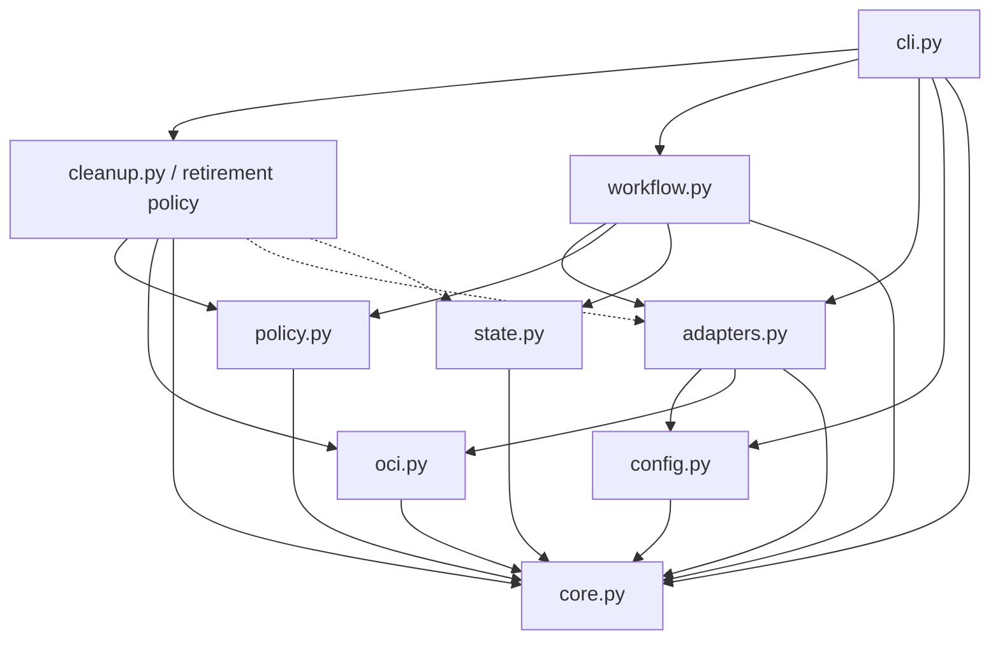

# Brooks-Lint Health Dashboard

- [Brooks-Lint Health Dashboard](#brooks-lint-health-dashboard)
  - [Scope and verdict](#scope-and-verdict)
  - [Dashboard scores](#dashboard-scores)
  - [Module Dependency Graph](#module-dependency-graph)
  - [Top Findings](#top-findings)
  - [Previous finding](#previous-finding)
  - [Verification and test suite map](#verification-and-test-suite-map)
  - [Recommendation and limits](#recommendation-and-limits)

## Scope and verdict

**Mode:** Health Dashboard

**Scope:** All changes in `2-fix-release-review-warnings...3-fix-cleanup-dependency-order` through `e2186b8`. The base and merge base are `14ae3f01227e5b5da33e7cd7c3cca668c80005f9`: 10 changed files, 762 insertions, and 20 deletions. Reviewed cleanup implementation, new retirement tests, workflow test adjustments, version/documentation changes, and implementation results. Existing task planning and unchanged identity/adapter contracts provide context.

**Composite Score:** 100/100

**Trend:** Stable at 100 compared with the preceding Health Dashboard record. That record reviewed the plan, not implementation; this does not establish a directly comparable runtime trend.

No `.brooks-lint.yaml` exists; balanced defaults apply. No new Critical, Warning, or Suggestion finding was established in the reviewed delta. The previous B1 deletion-order defect is addressed with dependency-aware retirement, durable schedule binding, and removal-aware restart coverage. This abbreviated review and passing fixtures do not prove live Forgejo deletion semantics or authorize production cleanup.

## Dashboard scores

- **Code Quality:** 100/100, weight 0.25. The added validation, ordering, and reconciliation helpers have explicit responsibilities. Longer routines reflect a linear safety protocol rather than unexplained nesting or unrelated change propagation.
- **Architecture:** 100/100, weight 0.30. Pure ordering stays within retention policy, adapters supply graph evidence, and the existing state boundary handles durability. Imports remain acyclic; no new external dependency or bootstrap change was introduced.
- **Tech Debt:** 100/100, weight 0.25. Scheduling is explicitly image-scoped and derived from candidate reachability. Persisted metadata cannot expand candidate authority, and current evidence remains mandatory before deletion. Conservative legacy rejection is documented rather than disguised as migration support.
- **Test Quality:** 100/100, weight 0.20. New tests remove the prior fixture blind spot, check observable deletion order and outcomes, and reopen durable state around failure boundaries. No independent T1/T2 issue was established. Multiple assertions support coherent safety scenarios rather than unrelated behavior claims.

No findings incur deductions. Calculation: `100 * 0.25 + 100 * 0.30 + 100 * 0.25 + 100 * 0.20 = 100`.

## Module Dependency Graph

Arrows indicate imports. Dashed arrows indicate runtime calls through supplied workflow objects/adapters. Standard-library imports are omitted.

The new topological helper performs no I/O. Schedule generation and validation share immutable candidate projections, while fresh inventory validation checks live pending reachability against saved evidence. Keeping this bounded retention-specific logic in the existing module is consistent with the approved plan; an additional framework or database is not justified.

## Top Findings

No new findings. The following are intentional, documented limits rather than defects: local checkpoint fingerprints are not signatures; cross-revision checkpoint adoption remains unsupported; ambiguous legacy partial states fail closed; unsupported or inconsistent remote evidence can stop progress; and local locks do not replace cross-host publisher serialization.

## Previous finding

**B1 — child deletion invalidates a pending parent graph: addressed in the reviewed implementation.**

- `release_template/cleanup.py:49-81` orders referring candidates before candidate dependencies, including transitive reachability, shared children, and image namespace separation. Cycles and invalid evidence are rejected rather than resolved by inventory order.
- `release_template/cleanup.py:84-120` binds graph snapshots and deterministic order to the exact run/candidate identities. Completion flags do not alter that identity. Read-only planning proposes metadata without checkpoint writes; apply saves it before any deletion.
- `release_template/cleanup.py:279-348` checks exact absence before traversing remaining records, validates current pending graphs, preserves fresh survivor protection, reconciles absent operations, and requires parent retirement before dependency deletion. Completed parents that reappear do not regain authority.
- `release_template/cleanup.py:351-401` executes the persisted schedule, confirms package absence before completion flush, and preserves final publication verification. Intact matching-identity legacy inventories can initialize metadata; ambiguous partially retired ones cannot be silently adopted.
- `tests/test_retirement.py:158-216` covers the original child-first case plus nested/shared/transitive/subject dependencies with actual removal-aware registry reads. The fixture explicitly demonstrates that deleting a child makes an undeleted parent unreadable.
- `tests/test_retirement.py:238-300` exercises approval durability and 12 deletion/completion fault-and-restart scenarios across four related candidates. Further tests cover changing survivors, recreated completed parents, authentication/inconsistent absence, legacy refusal, and metadata that is internally valid but omits real graph dependencies.

These checks support closing B1 within the reviewed code and fixture model. They are not claims about untested live server behavior.

## Verification and test suite map

- `TMPDIR=/tmp/opencode python3 -B -m unittest discover -s tests`: all 110 tests passed in 32.677 seconds during review.
- `git diff --check 2-fix-release-review-warnings...HEAD`: passed. `bash -n scripts/release.sh`: passed.
- Test inventory: 9 core, 8 CLI, 34 workflow/cleanup, 21 adapter, 27 retirement, and 11 installer/update methods. The 27 new methods comprise six pure policy tests and 21 removal-aware local integration methods.
- Approximate suite layers by primary boundary: 49 small in-process policy/orchestration tests, 61 local integration tests, and zero live-service E2E tests. Methods can mix layers; counts do not represent assertion or subtest totals. The roughly 33-second feedback loop and filesystem/HTTP/durability risk profile justify this integration-heavy mix without a pyramid-ratio finding.
- Reviewed the full changed cleanup module and new test file, the workflow test diff, all changed documentation/version statements, and implementation results. Internal dependency inspection found no cycles. Version statements in README, `VERSION`, and `release_template.__version__` consistently move to `0.1.2`.
- Existing platform/label, identity-bound CLI, source/tag, staging, abandonment, credential isolation, installer/update, and publication/recovery tests pass as part of the full suite. Stable bootstrap, `State`, workflow identity construction, and OCI classification have no implementation changes on this branch.

## Recommendation and limits

No additional code change is required by this review. Keep the independent live deletion gate closed until separately authorized same-server disposable verification succeeds. Preserve checkpoint provenance for legacy failures and maintain single-publisher serialization rather than weakening fresh checks to force progress.

No implementation fixes were made during review. Only this report and a scoped history entry are written. No production credentials, real Docker builds, remote creation, pushes, publications, live deletions, or existing consumer changes occurred. Test termination is simulated; live Forgejo semantics, runtime multi-platform execution, and power-loss behavior remain outside the evidence. The unrelated untracked `todo.md` remains untouched.
