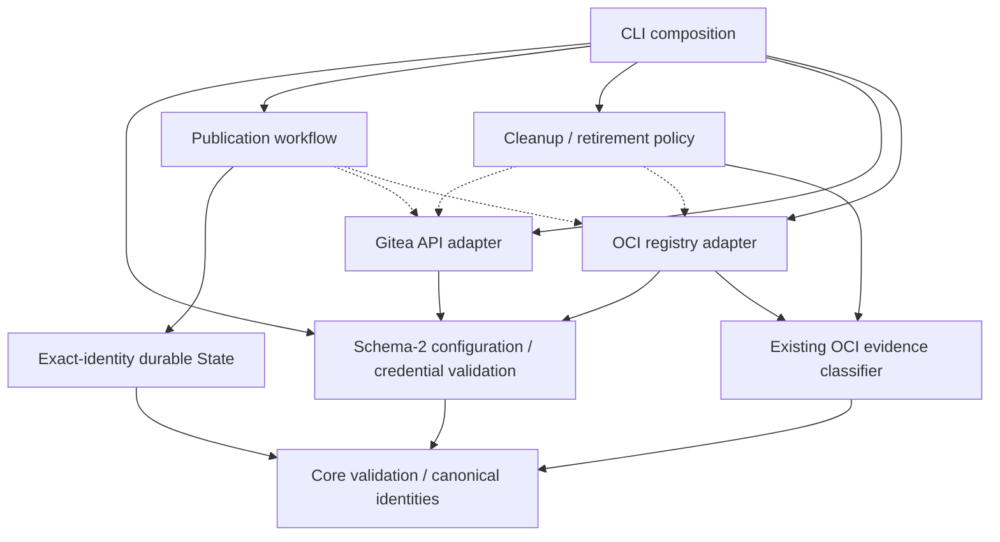

# Brooks-Lint Health Dashboard

- [Brooks-Lint Health Dashboard](#brooks-lint-health-dashboard)
  - [Scope and verdict](#scope-and-verdict)
  - [Dimension scores](#dimension-scores)
  - [Module Dependency Graph](#module-dependency-graph)
  - [Contract review](#contract-review)
  - [Test suite map](#test-suite-map)
  - [Top Findings](#top-findings)
  - [Recommendation](#recommendation)
  - [Review limits](#review-limits)

## Scope and verdict

**Mode:** Health Dashboard

**Scope:** Plan-only review of `tasks/4-migrate-forgejo-to-gitea/2-plan.md` through `8db9c85`, including the user's changes to require `GIT_TOKEN` and a single `GIT_USERNAME` setting. Reviewed against the goal and current configuration, credential isolation, deletion evidence, and checkpoint identity contracts. No implementation diff is being assessed.

**Composite Score:** 100/100 for the proposed plan, not for implemented Gitea compatibility.

**Trend:** Stable at 100 compared with the preceding Health Dashboard record. That record reviewed a different implementation task, so the scores do not establish a comparable runtime trend.

No `.brooks-lint.yaml` exists; balanced defaults apply. Ready for implementation within the stated local, template-only scope. The plan makes the breaking configuration/credential cutover explicit, addresses substantive Gitea API/package differences, and preserves destructive-operation and recovery safeguards. No additional concrete planning defect was established. The current implementation remains Forgejo-oriented until implementation is separately requested and verified.

## Dimension scores

- **Code Quality:** Not scored. There is no new implementation diff to inspect for routine complexity or change propagation. The plan's runtime renames must still be checked in the eventual code review.
- **Architecture:** 100/100 for the proposed boundaries. The existing adapter is migrated without a speculative multi-provider framework. Configuration/credentials, service I/O, workflow identity, and retention policy retain their existing owners; no new dependency cycle is required.
- **Tech Debt:** 100/100 for the proposed design. Schema/version bumps, explicit rejection of retired inputs, full-version evidence binding, and deliberate checkpoint incompatibility avoid hidden compatibility debt or silent credential selection.
- **Test Quality:** 100/100 for the planned strategy. Negative migration paths, actual loopback HTTP contracts, credential isolation, native Git environment preservation, and the existing removal-aware retirement suite are explicitly retained. This does not score readability, brittleness, or coverage of tests not yet written.
- **Calculation:** `(100 * 0.30 + 100 * 0.25 + 100 * 0.20) / 0.75 = 100`. The absent implementation-diff dimension is omitted and its weight redistributed proportionally. There are no current deductions.

## Module Dependency Graph

This is the intended responsibility/dependency flow, not implemented new module names. Helpers/classes may remain within existing files. Dashed arrows represent supplied adapter calls.

Provider-neutral credential names do not require generic backend abstractions. Keeping the service contract Gitea-specific while reusing the existing workflow/retirement boundaries is coherent with the requested scope.

## Contract review

- **Credentials:** `2-plan.md:36-39` supports only `GIT_TOKEN` as a protected token-file path and `GIT_USERNAME` as the authentication login. `GIT_USER` and both provider-specific credential families are rejected rather than treated as aliases. Subprocess isolation lists exact names, preserving native settings such as `GIT_SSH_COMMAND` and author/committer identity. This matches the user's latest direction and avoids blanket `GIT_*` stripping.
- **Configuration and versioning:** `2-plan.md:34-35` defines schema 2 and explicit rejection of old/mixed origins before credential/network use. The planned `0.2.0` release at `2-plan.md:77` makes this intentional break visible. A migration guide replaces implicit fallback; no consumer is silently changed.
- **Service compatibility:** `2-plan.md:24-27` distinguishes documented Gitea endpoint shapes from the unknown private deployment. `2-plan.md:43-48` requires HTTP contract tests, owner-scoped package handling, retained repository association checks, and explicit incomplete reporting when linkage prevents cleanup. Whole-package linking remains operator-controlled rather than automatic reassignment.
- **Deletion evidence:** `2-plan.md:52-57` rejects old Forgejo attestations and major-only checks. New evidence binds product, origin, exact full server version, and disposable verification results. Build/prerelease suffixes are preserved, unavailable evidence stops deletion, and the version endpoint is not misrepresented as product authentication or proof of storage semantics.
- **Recovery and history:** `2-plan.md:61-65` retains template/source/configuration identity refusal, durable retirement metadata, existing recognized release identity parsing, and stable bootstrap bytes. This is not an automatic checkpoint adoption plan. `2-plan.md:71-73` preserves historical task/evidence records and does not retroactively relabel Forgejo verification as Gitea verification.

## Test suite map

- **Planned unit tests:** Schema-2 validation; old/mixed origin rejection; token-file selection and private-file rules; missing/empty login; rejected credential variables; exact-name environment isolation; full server-version/evidence validation; and unchanged identity checks. New counts are unavailable.
- **Planned local integration tests:** Gitea-shaped loopback release/package/version operations with exact payload/status assertions; capped/repeated pagination; malformed/authentication/absence distinctions; linked/unlinked/foreign package records; zero-write rejection cases; same-revision publication/resume/cleanup; and disposable pinned installation.
- **Existing regression baseline:** The preceding branch review recorded 110 passing tests. This review did not rerun them. The plan explicitly retains platform/label verification, stale-resume refusal, build-once recovery, survivor protection, dependency ordering, durable retry/absence reconciliation, and installer/update coverage.
- **Live E2E tests:** None authorized by this task. The actual Gitea version, import/linkage state, and deletion behavior remain unknown. Fresh same-server disposable verification is required before destructive cleanup; local fixture attestations cannot satisfy that operational gate.
- **Implementation review priorities:** Verify that unsupported-variable rejection precedes token reads, only exact credential names are stripped, every cleanup path uses the new evidence gate, and missing/foreign links remain visible as incomplete rather than disappearing from skipped diagnostics. Existing checkpoint refusal tests must remain distinct from same-revision positive cases.

## Top Findings

No Critical, Warning, or Suggestion finding is established in the reviewed plan. Intentional incompatibility with old configurations/checkpoints, Gitea-specific default credential storage, no automatic package linking, full-version re-attestation after upgrades, and deferred live verification are explicit design decisions rather than hidden missing behavior. No book citation is added without a concrete finding.

## Recommendation

Proceed with implementation when separately requested. Start with focused contract/credential/evidence tests, then migrate the adapter and callers while preserving the current retirement and identity protocols. Keep `GIT_TOKEN` and `GIT_USERNAME` as the only supported credential settings, update active documentation without falsifying history, and leave live cleanup disabled pending separately authorized Gitea verification. No further plan amendment is required by this review.

## Review limits

- Read the complete goal and amended plan, checked current config/credential handling, runner environment filtering, Forgejo evidence/version checks, and workflow/state identity binding. Public API research recorded in the plan is compatibility context, not private-deployment validation.
- No tests, credential reads, Docker builds, deployment probes, remote reconfiguration, pushes, publications, live deletions, or consumer changes occurred during this review. No Gitea implementation or runtime test result is claimed.
- Only this review and its scoped health-history entry are written. Goal, plan, implementation, version, historical archives, existing history records, and the unrelated untracked `todo.md` remain unchanged.
