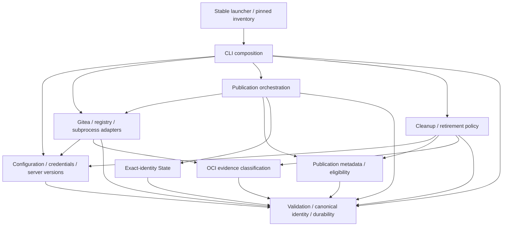

# Brooks-Lint Health Dashboard

- [Brooks-Lint Health Dashboard](#brooks-lint-health-dashboard)
  - [Scope and verdict](#scope-and-verdict)
  - [Dimension scores](#dimension-scores)
  - [Module Dependency Graph](#module-dependency-graph)
  - [Test suite map](#test-suite-map)
  - [Top Findings](#top-findings)
    - [Warning](#warning)
  - [Verification](#verification)
  - [Recommendation](#recommendation)
  - [Review limits](#review-limits)

## Scope and verdict

**Mode:** Health Dashboard

**Scope:** All 31 changed files on `4-migrate-forgejo-to-gitea` through `91a7a63`, relative to base `main` at merge base `c88f6e901eb1acf20cb2223be0ee721d43b8faef`. Includes implementation commit `7619784` and the user's token-path correction in `91a7a63`. Reviewed changed runtime modules, tests, examples, documentation, and implementation results, with unchanged state/OCI/bootstrap code as supporting context.

**Composite Score:** 99/100

**Trend:** 100 → 99 (−1) compared with the latest Health Dashboard record. That record assessed a plan, not this implementation, so this is not a comparable runtime-quality trend.

One Warning remains: successful JSON `null` responses are indistinguishable from HTTP 404 absence. Fix that boundary before merging; all 132 existing tests pass despite the reproduced false cleanup-complete result. No implementation fixes were made in this review. No `.brooks-lint.yaml` exists; balanced defaults apply.

## Dimension scores

- **Code Quality:** 100/100. The abbreviated R1/R2 scan found no new concrete overload or unrelated change-propagation issue. Coordinated service renaming is intentional within one bounded context.
- **Architecture:** 100/100. No module import cycles or new layering violation. Configuration owns credential names and full server-version validation; adapters own I/O; workflow and cleanup retain their existing orchestration boundaries.
- **Tech Debt:** 95/100. One R6 Warning: the migrated API boundary still collapses malformed successful results into absence. This finding is counted here only, not deducted again for its missing test case.
- **Test Quality:** 100/100. The abbreviated T1/T2 scan found no concrete new obscurity or brittleness finding. Exact request assertions cover public wire contracts; durable-state and emitted-command assertions cover operational invariants rather than incidental implementation details.
- **Calculation:** `100 × 0.25 + 100 × 0.30 + 95 × 0.25 + 100 × 0.20 = 98.75`, rounded half-up to `99`. Balanced deductions are 15/5/1 for Critical/Warning/Suggestion. Finding counts: 0 Critical, 1 Warning, 0 Suggestion. Scores describe this scoped lightweight review, not a live compatibility certification.

## Module Dependency Graph

These are local static dependencies; workflow and cleanup also call injected Gitea/registry/runner objects. The existing workflow import of `git_identity` is orchestration glue, not a new dependency introduced by this migration. Bootstrap bytes, updater, outer checkpoint schema, identity construction, release marker/schema, and nested retirement protocol remain unchanged.

## Test suite map

- **Small unit/policy tests:** 23, comprising 8 core/configuration tests, 9 migration-contract tests, and 6 retirement-policy tests. Temporary file checks remain in this group; subprocess checks do not.
- **Local integration/component tests:** 109, comprising 21 adapter, 10 CLI, 6 Gitea HTTP, 4 deletion-gate migration, 21 retirement integration, 11 updater/installation, 34 workflow, and 2 subprocess tests from the core/migration classes. Fakes deliberately isolate external systems while real local state and loopback HTTP exercise important boundaries.
- **Live end-to-end tests:** 0. No real Gitea deployment, Docker registry publication, multi-platform runtime, or storage deletion was exercised.
- **Total:** 132 test methods. The 110-test baseline is retained, with 22 additional tests. The local integration-heavy distribution is justified by I/O/recovery risk and a roughly 36-second full-suite run; it is not an inverted-pyramid finding by ratio alone.

## Top Findings

### Warning

**B1 — R6: Successful null JSON is treated as confirmed absence**

Symptom: `release_template/adapters.py:150-152` returns `None` both for HTTP 404 and for HTTP 200 containing JSON `null`. The new release-shape guard at `release_template/adapters.py:170-173` permits that `None`; package lookups use the same helper without a shape guard. `release_template/cleanup.py:394-404` then treats the result as an absent target and records the candidate complete. The malformed-response tests at `tests/test_gitea_migration.py:178-186` omit JSON `null`. This is an inherited helper behavior carried into the new Gitea contract, not a newly introduced transport regression.

Source: *Domain-Driven Design* — domain-model fidelity: confirmed absence and invalid evidence are different states. *Code Complete* — defensive programming and explicit error handling at external boundaries.

Consequence: A malformed successful lookup can make cleanup report complete while the package remains listed and its staging alias still resolves. Release publication at `release_template/workflow.py:227-229` can also choose POST after malformed evidence rather than stopping; only an actual 404 should establish absence. The existing tests therefore do not substantiate the documented fail-closed malformed-response contract for this case. This does not demonstrate unauthorized deletion or a live Gitea defect.

Remedy: Preserve the status distinction in the adapter: reserve `None` for an explicitly allowed HTTP 404 and reject JSON `null` on HTTP 200. Require object-shaped successful release/package lookup results. Add loopback 200-null regressions plus workflow/cleanup assertions that malformed lookups neither authorize POST/DELETE nor mark a pending candidate or cleanup complete. Retain the separate valid-404 idempotence cases.

Reproduction: Using the existing disposable loopback fixture, configured release and package GET routes as `(200, None)`; both returned `None` without an error. Separately used the existing deletion-gate fixture with valid evidence and null-equivalent package lookup results while preserving the version response. `apply()` returned normally with `cleanup_complete == True`, zero recorded DELETEs, and the staging alias still resolvable and present in the package listing. Reproductions ran inline and did not modify source or tests.

## Verification

- `TMPDIR=/tmp/opencode python3 -B -m unittest discover -s tests`: 132 tests passed in 36.280 seconds.
- `bash -n scripts/release.sh` and `git diff --check main...HEAD` passed.
- All five examples passed credential-free validation through `scripts/launch.py`. Python AST syntax and `0.2.0` version consistency checks passed. README and all seven documentation pages passed contents/local-link checks.
- AST analysis found no local engine module import cycles. Reviewed old/mixed configuration rejection before credentials/clients, exact-name credential filtering with native Git preservation, private-file checks, and exact product/origin/full-version deletion gating for normal cleanup and abandoned runs.
- Old-pin/old-config refusal, same-revision publish/resume/cleanup, legacy release prose, complete survivor protection, removal-aware parent-before-child retirement, and lost-response/absence reconciliation scenarios remain covered. The extra skipped-record expectation reflects the intended explicit foreign-link diagnostic, not a dropped safety assertion.
- `git diff --exit-code main...HEAD -- scripts release_template/state.py tasks/_archives .brooks-lint-history.json` passed before writing this review. Prior history entries remain unchanged; this review appends one new record only. The user's latest default `~/.config/git/token` is consistent in runtime, tests, README, and active credential/migration docs. The older path in the approved plan and implementation record describes the earlier commit and was not rewritten.

## Recommendation

Address B1 before merging, then rerun the full suite with the new null-response regressions. Tech debt is the lowest-scoring dimension; a focused `brooks-debt` pass is optional if further boundary cleanup is desired, not a prerequisite for this narrowly scoped fix. Keep live deletion gated pending separately approved same-server Gitea version/storage verification. The intentional schema/pin incompatibility, no automatic linking/adoption, and deferred deployment checks are documented decisions, not additional findings.

## Review limits

This is a branch-scoped abbreviated four-dimension review, not a whole-project exhaustive audit or fresh public-API research. Public API findings in the approved plan and local HTTP tests do not prove the actual deployment's version, product, permission scopes, repository links, or storage semantics. No actual credentials were read, private deployment probed, real Docker login/build performed, consumer migrated, remote reconfigured, source pushed, live release published, or live package deleted. Historical archives, existing review records, implementation files, and untracked `todo.md` remain untouched. Only this report and the appended health-history record are committed; no push is authorized.
