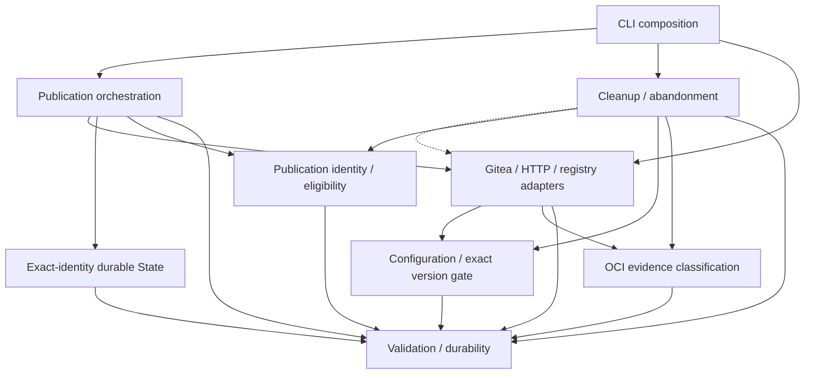

# Brooks-Lint Health Dashboard

- [Brooks-Lint Health Dashboard](#brooks-lint-health-dashboard)
  - [Scope and verdict](#scope-and-verdict)
  - [Dimension scores](#dimension-scores)
  - [Module Dependency Graph](#module-dependency-graph)
  - [Contract review](#contract-review)
  - [Test suite map](#test-suite-map)
  - [Top Findings](#top-findings)
  - [Recommendation](#recommendation)
  - [Review limits](#review-limits)

## Scope and verdict

**Mode:** Health Dashboard

**Scope:** Plan-only review of `tasks/5-fix-gitea-null-response/2-plan.md` at `c010f37`, checked against its goal, B1 in the previous task's code review, and the current Gitea adapter, publication, cleanup, and abandonment call sites. The proposed patch is not implemented or being assessed as an implementation diff.

**Composite Score:** 100/100 for the proposed plan.

**Trend:** 99 → 100 (+1) compared with the preceding Health Dashboard record. That record reviewed the migration implementation; this plan score does not establish that B1 is fixed or that runtime quality improved.

Ready for implementation within the stated local scope. The plan addresses the reproduced null/404 conflation at its source and covers the affected operation boundaries without changing checkpoint or retirement authority. No additional concrete planning finding was established. No `.brooks-lint.yaml` exists; balanced defaults apply.

## Dimension scores

- **Code Quality:** Not scored. No implementation diff exists for this task; the planned adapter guard must still be reviewed after implementation.
- **Architecture:** 100/100. The response-status/shape contract stays in `Gitea.get()`, its existing boundary owner. Optional-object validation does not impose object shapes on paginated collections or alter the shared OCI decoder. No new dependency cycle, provider abstraction, or state schema is proposed.
- **Tech Debt:** 100/100 for the proposed design. An allowed 404 is the only source of the absence sentinel. Rejecting successful null and non-object optional lookups resolves the modeled-state ambiguity without new sentinels, path heuristics, rollback logic, or checkpoint adoption.
- **Test Quality:** 100/100 for the planned strategy. Tests traverse production status/JSON validation, assert durable state and remote requests, distinguish pre-delete from post-delete failures, and pair malformed-response failures with valid-404 recovery. Existing 132 safety cases remain required.
- **Calculation:** `(100 × 0.30 + 100 × 0.25 + 100 × 0.20) / 0.75 = 100`. The absent implementation-diff dimension is omitted and its weight redistributed proportionally. Finding counts: 0 Critical, 0 Warning, 0 Suggestion. These scores assess the plan, not unwritten tests or deployed Gitea compatibility.

## Module Dependency Graph

The graph summarizes relevant existing boundaries; the dashed arrow is injected adapter use. The planned change is internal to Gitea GET response handling. No new module or dependency edge is required. Workflow's existing `git_identity` import remains orchestration glue.

## Contract review

- **Absence versus malformed success:** `2-plan.md:30-34` reserves `None` for an explicitly allowed HTTP 404 and rejects HTTP 200 null even for required reads. It also makes optional lookups object-shaped, while preserving valid array pages and existing caller field/identity validation. Empty objects do not become absence.
- **Compatibility of the tightened flag:** Current `absent=True` calls are release lookup and scoped package-version lookups. Required `/version` reads already validate their object/full-version shape separately; pagination expects arrays. The proposed shape rule matches these actual callers rather than an assumed generic GET API.
- **Complete affected call sites:** `2-plan.md:39-44` covers the publication decision, listed package candidate, omitted-candidate reconciliation, post-delete absence confirmation, older release retirement, and abandoned-run lookup. The current-publication verification must remain valid in targeted retirement tests so failures reach the intended boundary.
- **Side effects and durable progress:** `2-plan.md:39,42,51,77` correctly distinguishes failures before a target mutation from uncertainty after one authorized DELETE. It preserves preceding legitimate publication work and durable intent, blocks false candidate/publication/abandonment completion, and requires verified absence to recover without duplicate DELETE or retired-graph traversal. No impossible all-or-nothing guarantee is made.
- **Regression realism:** `2-plan.md:38,45,49-52` requires production decoding through loopback or status/byte transport fixtures, fresh state per case, bounded secret-free diagnostics, valid object/array/404 controls, and unchanged removal-aware retirement tests. Returning Python `None` from a high-level fake would bypass the bug and is explicitly excluded as proof of the fix.
- **Scope and delivery:** `2-plan.md:56-61,75-79` calls for a fresh task-named implementation branch, patch version `0.2.1`, focused/full verification, and scoped documentation/results. It preserves schema 2, `GIT_TOKEN`, `GIT_USERNAME`, `~/.config/git/token`, stable bootstrap bytes, identity checks, live evidence gating, history, and unrelated `todo.md`. Already false-complete old checkpoints remain a separate operator-recovery problem, not silently repaired or adopted.

## Test suite map

- **Planned unit/contract cases:** Required/optional GET null rejection; optional lookup non-object rejection; successful object lookup; required 404 failure; optional 404 absence; valid empty/nonempty array pages; unchanged version validation and bounded errors.
- **Planned local operation tests:** Real decoding connected to publication, all three package absence-sensitive locations, older release retirement, and abandoned-run processing. Assertions include POST/DELETE counts, pending durable operation/candidate state, unchanged retirement approval, retained successful publication, and valid retry without rebuilding or repeating confirmed-absent deletion.
- **Existing regression baseline:** The preceding review recorded 132 passing tests: 23 small unit/policy and 109 local integration/component cases under its stated classification, with no live end-to-end tests. This plan review did not rerun them. Existing state/identity, platform, survivor protection, removal-aware dependency order, lost-response, and installer cases remain acceptance requirements.
- **New counts:** Not yet available; the plan correctly requires reporting actual implemented counts rather than promising a specific number.
- **Live verification:** None authorized. Synthetic transport/status handling can prove local absence discrimination, not actual deployed product/version, storage behavior, or deletion semantics.

## Top Findings

No Critical, Warning, or Suggestion finding is established in the proposed plan. B1 is explicitly addressed in design but remains present in the current implementation until a separately authorized implementation and verification stage. The existing optional-lookup flag is intentionally tightened for its current object callers; this small bounded change does not justify a speculative response-type framework. No book citation is added without a concrete finding.

## Recommendation

Proceed with implementation. Begin with failing status/JSON regressions, then repair the adapter boundary and demonstrate durable operation-level failure/recovery behavior. No plan amendment is required. The later code review should verify that null rejection happens before any absence interpretation, collection arrays remain valid, and post-delete uncertainty cannot flush false completion or trigger dependent deletion. Keep the deployment evidence gate and original checkpoint provenance intact.

## Review limits

Read the complete goal and plan, the prior B1 finding, and relevant adapter/publication/cleanup call sites. Applied the Brooks health checklists and source-coverage exceptions to the proposed design and tests; did not treat intentional scope or compatibility decisions as findings. No implementation code, goal, plan, existing task record, or prior history entry was changed. Only this review and one appended health-history entry are written and committed. No tests, actual credential reads, live HTTP requests, Docker operations, remote mutations, consumer changes, or pushes occurred. Untracked `todo.md` remains untouched.
