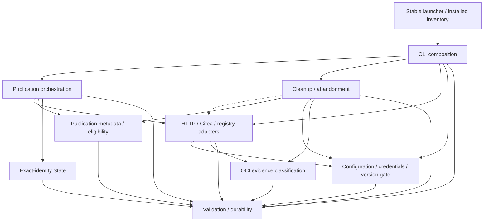

# Brooks-Lint Health Dashboard

- [Brooks-Lint Health Dashboard](#brooks-lint-health-dashboard)
  - [Scope and verdict](#scope-and-verdict)
  - [Dimension scores](#dimension-scores)
  - [Module Dependency Graph](#module-dependency-graph)
  - [Contract review](#contract-review)
  - [Test suite map](#test-suite-map)
  - [Top Findings](#top-findings)
  - [Verification](#verification)
  - [Recommendation](#recommendation)
  - [Review limits](#review-limits)

## Scope and verdict

**Mode:** Health Dashboard

**Scope:** All 10 changed files on `5-fix-gitea-null-response` through `93f6b26`, relative to its parent branch `4-migrate-forgejo-to-gitea` at merge base `e3453c8fa799d81aa470d57eac84c83780cc8b56`. The implementation commit is the complete branch delta; inherited migration/planning/review commits are not newly attributed to this task. Reviewed adapter behavior, new/extended tests, version/docs/results, and unchanged operation/state callers against the approved plan.

**Composite Score:** 100/100

**Trend:** Stable at 100 compared with the most recent Health Dashboard record. That record reviewed this task's plan; it is not a directly comparable runtime-quality score. The earlier implementation Warning B1 is resolved by this patch and its regressions.

Ready to merge within the approved template-only scope. No Critical, Warning, or Suggestion finding was established. All 141 tests pass. No `.brooks-lint.yaml` exists; balanced defaults apply. This score does not certify deployed Gitea/storage behavior or guarantee that unrelated code has no defects.

## Dimension scores

- **Code Quality:** 100/100. The production change is a short status-aware guard in the existing Gitea GET boundary. It adds no unrelated propagation, deep nesting, or speculative abstraction. Caller control flow remains unchanged.
- **Architecture:** 100/100. HTTP retains status enforcement, Gitea owns successful response validation, and callers retain identity/ownership/persistence policy. The shared OCI decoder is unchanged. AST analysis found no local engine import cycles or new dependency edges.
- **Tech Debt:** 100/100. Successful null no longer shares the confirmed-absence representation. The existing optional-object flag is deliberately tightened for its actual release/package callers; collection pages retain their array contract. No checkpoint adoption, forced rollback, or second response-type framework is introduced.
- **Test Quality:** 100/100. T1/T2 scans found no concrete new obscurity or brittleness issue. Tests distinguish wire shape from operation effects and assert persisted progress, request counts, retained content, and retry behavior. The transport fixture intentionally replaces I/O beneath production Gitea decoding rather than returning fake high-level absence.
- **Calculation:** `100 × 0.25 + 100 × 0.30 + 100 × 0.25 + 100 × 0.20 = 100`. All four dimensions apply. Balanced deductions are 15/5/1 for Critical/Warning/Suggestion; finding counts are 0/0/0.

## Module Dependency Graph

Solid edges summarize local dependencies and bootstrap entry; the dashed edge represents injected adapter use. The only production behavior change is inside `Gitea.get()`. Existing workflow `git_identity` coupling is unchanged orchestration glue. State, workflow, cleanup, configuration, OCI classification, stable bootstrap, and updater files have no branch diff.

## Contract review

- **B1 fixed at its source:** `release_template/adapters.py:150-158` passes `(200, 404)` only for optional lookup and `(200,)` for required reads. `HTTP.request()` rejects disallowed statuses before returning. Only the explicit 404 branch returns `None`; decoded HTTP 200 null raises a fixed `ReleaseError` before callers can infer absence. Optional successful non-objects also fail.
- **Collections and diagnostics preserved:** `Gitea.pages()` still receives arrays, including `[]` for exhaustion; no global object-only decoder change was made. Lookup shape errors contain no remote values or token. Existing malformed JSON, repeated pagination, authentication/error status, URL encoding, and redirect safeguards remain.
- **Publication proof:** The new transport-backed publication test reaches the current-release decision with prepared output and durable intent. Null blocks POST and leaves the release operation pending/unpublished. An allowed-404 retry creates exactly one release without another build. Tests and docs correctly allow legitimate earlier preparation effects rather than claiming atomic rollback.
- **Retirement and abandonment proof:** Listed package null leaves its candidate pending, staging listed/resolvable, and publication successful. Omitted-candidate null cannot reconcile absence or change saved approval/checkpoint bytes. Older-release null leaves its candidate pending with no DELETE. Abandoned-package null preserves checkpoint bytes and its staging alias without setting abandonment.
- **Post-delete uncertainty and recovery:** `tests/test_retirement.py:494-540` uses the existing removal-aware loopback registry with actual Gitea GET decoding at the status/byte seam. One authorized parent DELETE really removes content; null confirmation stops before child DELETE and leaves both candidates pending in durable state. Reopened-state retry confirms 404, avoids another parent DELETE and retired-parent graph fetch, and retires the child under the same approved schedule/fingerprint.
- **Compatibility and scope:** Version declarations agree on `0.2.1`; README/retention/verification text matches the repair. Schema 2, `GIT_TOKEN`, `GIT_USERNAME`, `~/.config/git/token`, source/config/template identity refusal, publication metadata, nested retirement authority, and live evidence gating are unchanged. Old falsely completed checkpoints are explicitly not automatically repaired or adopted.

## Test suite map

- **Small unit/policy tests:** 23, unchanged from the parent branch: 8 core/configuration, 9 migration-contract, and 6 retirement-policy tests. The core/migration subprocess checks are counted below rather than here.
- **Local integration/component tests:** 118: 21 adapter, 10 CLI, 9 Gitea HTTP, 4 deletion-gate migration, 5 new Gitea absence operations, 22 retirement integration, 11 updater/installation, 34 workflow, and 2 core/migration subprocess cases. Nine new methods supplement all 132 baseline cases.
- **Live end-to-end tests:** 0. Tests use loopback HTTP/OCI or injected transport, disposable files/state, and fake Git/Docker behavior. No target deployment or real multi-platform runtime is exercised.
- **Total:** 141 methods. The local integration-heavy shape is appropriate for status/JSON and durable recovery risks, with feedback under 40 seconds in this run. Exact request counts and saved approval comparisons test relevant observable invariants, not arbitrary private call order.

## Top Findings

No Critical, Warning, or Suggestion finding was established in the scoped changes. B1 from the parent migration review is resolved: the decoder/status distinction and downstream durable failure/retry cases are now covered. Optional lookup object enforcement is a justified bounded contract change; it does not require a speculative generic response-schema layer. No book citation is added without a concrete finding.

## Verification

- `TMPDIR=/tmp/opencode python3 -B -m unittest discover -s tests`: 141 tests passed in 38.900 seconds during this review.
- `bash -n scripts/release.sh` and `git diff --check 4-migrate-forgejo-to-gitea...HEAD` passed.
- Python AST syntax checks passed for engine, scripts, tests, and example hooks; local engine import graph is acyclic. Version consistency checks passed for `0.2.1`.
- All five examples passed credential-free validation through `scripts/launch.py`. Changed README/docs and implementation results passed table-of-contents/local-link checks. AST comparison confirmed every parent-branch test method remains present.
- Before writing the review, `git diff --exit-code 4-migrate-forgejo-to-gitea...HEAD -- scripts release_template/state.py release_template/oci.py release_template/workflow.py release_template/cleanup.py release_template/config.py tasks/_archives .brooks-lint-history.json tasks/4-migrate-forgejo-to-gitea` passed. Prior task/history records remain unchanged; this review appends one new health record only.

## Recommendation

Merge the patch through the normal repository workflow; no further implementation change is requested by this review. Retain the nine new regression methods and the existing removal-aware retirement suite. Consumer updates still require a separately approved pinned adoption, and a new pin must not silently resume old-pin checkpoints. Keep live destructive cleanup gated pending actual same-server exact-version/storage verification. No additional focused quality pass is indicated by these findings.

## Review limits

This is an abbreviated four-dimension branch review, not a whole-project exhaustive audit. The prior failed-before test results are recorded implementation evidence; this review independently reran the current passing suite and inspected the corresponding behavior/call sites. No live compatibility or storage safety is inferred from fixture versions or local tests. No implementation fixes, credential-file access, private deployment probe, real Docker operation, consumer migration, remote reconfiguration, push, publication, or live deletion occurred. Only this report and one appended history entry are committed. Untracked `todo.md` remains untouched.
