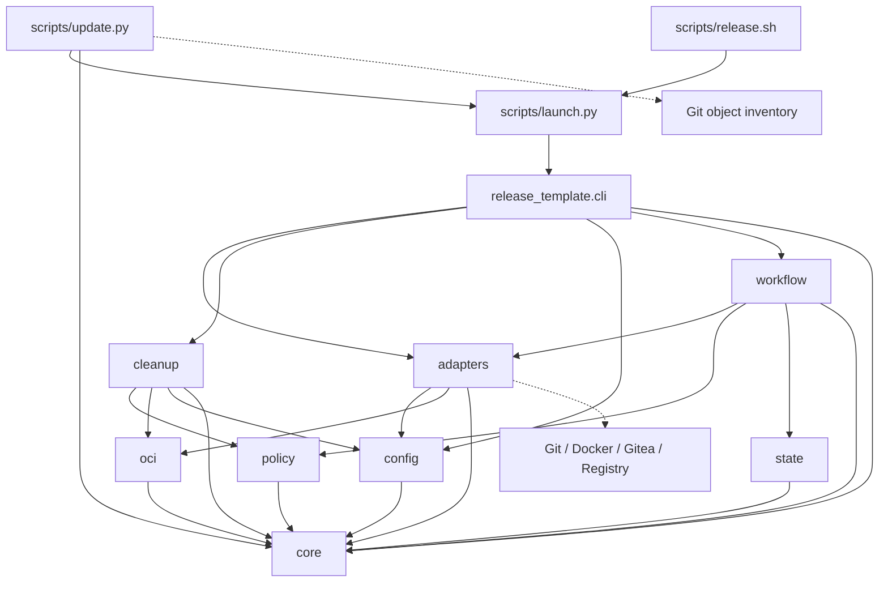

# Brooks-Lint Health Dashboard

- [Brooks-Lint Health Dashboard](#brooks-lint-health-dashboard)
  - [Dashboard](#dashboard)
  - [Module Dependency Graph](#module-dependency-graph)
  - [Test Suite Map](#test-suite-map)
  - [Top Findings](#top-findings)
    - [Warning](#warning)
  - [Verification and Limits](#verification-and-limits)
  - [Recommendation](#recommendation)

**Mode:** Health Dashboard
**Scope:** Whole container-release-template project at `d03d3b9` on `main`: engine, bootstrap/updater, tests, example hooks/configuration, and current documentation. Archived tasks supply historical context, not current implementation authority. Untracked `todo.md` is excluded and untouched.
**Composite Score:** 97/100
**Trend:** 100 → 97 (−3) versus the latest recorded dashboard. That entry reviewed a branch fix, so this broader review is not a like-for-like regression measurement.

The project has coherent dependency boundaries and strong recovery tests, but two retirement invariants remain incompletely enforced.

## Dashboard

- Code Quality: skipped. No staged or tracked working-tree changes exist, and `main...HEAD` is empty. The unrelated untracked file is not a review diff.
- Architecture: 100/100. No import cycles or unjustified dependency inversions found.
- Tech Debt: 90/100. Two R6 warnings concern deletion-evidence validity and abandonment completion.
- Test Quality: 100/100. No material T1 obscurity or T2 brittleness findings in this abbreviated scan. This does not mean all failure modes are covered.
- Scoring: balanced deductions of 5 per warning. With PR skipped, the remaining weights are `0.30 / 0.75`, `0.25 / 0.75`, and `0.20 / 0.75`. The composite is `round_half_up((100 × 0.30 + 90 × 0.25 + 100 × 0.20) / 0.75) = 97`.
- Findings: 0 critical, 2 warning, 0 suggestion. Each finding is counted only in Tech Debt; no duplicate deductions apply.
- Configuration: no `.brooks-lint.yaml` exists; default risks and balanced strictness apply.

## Module Dependency Graph

Arrows show local imports or entry-point delegation. External systems appear separately. `cli` and `workflow` are orchestration boundaries, so their concrete dependencies are intentional. The graph includes function-local imports; none introduces a cycle.

The core/policy/OCI modules contain reusable rules without importing workflow or network clients. Durable state is isolated. Cleanup uses workflow capabilities through an explicit orchestration argument rather than a reverse import. The bootstrap's independent path/checksum validation is justified: it must run before importing managed engine code, so its overlap with `core.child` is not automatically DRY debt. Data dictionaries represent deliberately small boundary records, not an anemic enterprise domain model.

## Test Suite Map

Counts refer to discovered test methods, not individual `subTest` cases. These categories distinguish fake-port/policy tests from real subprocess, HTTP, and installer integration boundaries; temporary checkpoint I/O alone does not make a workflow test an integration test.

- Unit/policy/fake-port: 76. Core has 8, CLI has 9, migration contracts have 10, deletion-gate scenarios have 4, retirement policy has 6, fake-port workflows have 34, and injected-transport Gitea operation scenarios have 5.
- Local integration: 65. Adapter fixtures have 21, Gitea HTTP contracts have 9, removal-aware retirement has 22, installer/launcher has 11, abrupt subprocess checkpoint persistence has 1, and standalone CLI rejection has 1. Some adapter methods only use part of their shared server fixture.
- Live end-to-end: 0. No deployed Gitea/Docker release or deletion was attempted.
- Total: 141 tests across eight test modules, all passing in 39.025 seconds.

Tests generally name scenarios and expected outcomes, use isolated temporary state, and check observable release/deletion results. Fault injections around durable transitions are appropriate seams, not inherently brittle private-method tests. Local integration coverage is justified by this project's filesystem, HTTP, and recovery risks; a fixed pyramid ratio would not improve this assessment. Missing regressions for the findings below are described with their production consequences rather than deducted again as test-quality issues.

## Top Findings

### Warning

**D1 — R6 Domain Model Distortion: abandonment records completion without confirming alias retirement.**

Symptom: `release_template/cleanup.py:432-444` resolves the staging digest and performs a package lookup, calls `delete_package`, then writes `abandoned = True` without a post-delete absence check. Normal package cleanup explicitly verifies absence at `release_template/cleanup.py:400-402`. In an isolated reproduction using the existing fake ports, a deletion that returned without removing the package caused `abandon` to return successfully and persist abandonment while both the selected alias and package remained present.

Source: *Domain-Driven Design* — invariant ownership and lifecycle transitions; *Code Complete* — Defensive Programming and explicit error paths.

Consequence: a successful DELETE response with a still-visible package produces false retirement success and a misleading checkpoint. An operator can believe selected staging aliases were retired when they remain available. Graph protection remains intact, so this finding does not claim deletion of protected manifests.

Remedy: define abandonment completion in terms of confirmed scoped package absence, matching normal cleanup's status-aware lookup contract. Keep the checkpoint unmarked if confirmation is present, malformed, or unavailable; confirm absence on retry without unnecessarily repeating an accepted deletion. Add regression cases for a no-op successful DELETE, malformed post-delete lookup, and accepted-but-response-lost recovery. Preserve the existing rule that abandoned-run graph protection is not erased.

**D2 — R6 Domain Model Distortion: the fresh-evidence gate treats verification time as arbitrary text.**

Symptom: `release_template/cleanup.py:129-147` validates `verified_at` only as a nonempty string of at most 256 characters. It never parses a date or compares it with a freshness policy. With otherwise valid fixture evidence and an exact matching runtime version, `deletion_environment` accepted `1900-01-01`, `not-a-date`, and `2999-01-01`. `docs/retention.md:13` nevertheless says stale or malformed evidence cannot enable deletion, and the gate's error message requires fresh results.

Source: *Domain-Driven Design* — Value Objects and invariant ownership; *Code Complete* — input validation and Defensive Programming.

Consequence: exact server-version equality cannot establish recency. Old, nonsensical, or future-dated evidence can pass the gate, including after storage changes that do not alter the reported version. The attestation is intentionally trusted operator input, so this is not a claim that timestamps prove live safety; it is an unenforced validity contract that can conceal operator mistakes.

Remedy: agree on an explicit accepted date/time format, clock-skew tolerance, and freshness policy before implementation. Reject malformed and unreasonably future dates, then enforce the documented age policy with an injectable clock and boundary tests. If freshness is intentionally only an operator responsibility, state that limitation plainly and remove the automated stale-evidence guarantee. Continue requiring reverification after storage changes; age checks cannot detect those changes or prove the attestation truthful.

## Verification and Limits

- Passed: `python3 -B -m unittest discover -s tests -v` — 141 tests.
- Passed: `bash -n scripts/release.sh`.
- Passed: `python3 -B scripts/launch.py validate --config examples/explicit.json`.
- Inspected local imports with Python AST, including nested imports, and found no cycle.
- Reproduced D1 and D2 using disposable files under `/tmp/opencode` and existing fake clients. No real credentials, registry, server, or consumer project was used.
- D1's reproduction simulates a successful deletion response whose visible package remains; it does not establish that a deployed Gitea server behaves this way.
- Live registry pullability, Docker/Buildx execution, deployed Gitea API compatibility, storage deletion semantics, and power-loss durability remain unverified. Existing documentation correctly discloses these limits.
- This is an abbreviated four-dimension health scan, not an exhaustive security audit. The Test Quality score specifically reflects T1/T2 checks, not a measured coverage percentage.
- No implementation fixes, version changes, consumer installations, remote writes, or edits to `todo.md` are included. Only this report and the required review-history record are changed.

## Recommendation

Address D1 first so abandonment uses the same confirmed-absence rule as normal retirement. Resolve D2's policy/documentation mismatch before enabling destructive cleanup with operator evidence. Run a focused Tech Debt assessment of retirement lifecycle invariants if a deeper follow-up is needed; no broad architectural rewrite is justified by this scan.
