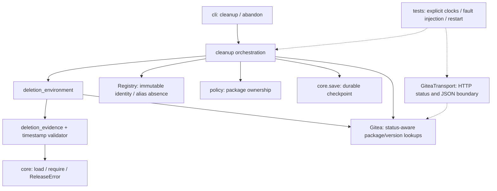

# Brooks-Lint Plan Review

- [Brooks-Lint Plan Review](#brooks-lint-plan-review)
  - [Dashboard](#dashboard)
  - [Module Dependency Graph](#module-dependency-graph)
  - [Goal and Risk Coverage](#goal-and-risk-coverage)
  - [Test Suite Map](#test-suite-map)
  - [Top Findings](#top-findings)
  - [Decisions and Limits](#decisions-and-limits)
  - [Recommendation](#recommendation)

**Mode:** Health Dashboard
**Scope:** Plan-only review of `tasks/7-fix-retirement-review-warnings/2-plan.md` at `63159d9`, checked against its goal, the D1/D2 review findings, current cleanup/CLI code, test seams, and retention documentation. Scores assess the proposed design, not implemented fixes.
**Composite Score:** 100/100
**Trend:** 97 → 100 (+3) compared with the latest dashboard. The previous run assessed current implementation; this plan-only score does not demonstrate that implementation health improved.

The plan addresses both warnings with explicit failure semantics, bounded policy choices, and suitable regression coverage; no blocking design findings were identified.

## Dashboard

- Code Quality: skipped. No staged or tracked working-tree changes exist, and `main...HEAD` is empty. The plan is reviewed as a design artifact, not a production-code PR.
- Architecture: 100/100. Proposed validation and orchestration remain within existing boundaries; no new import cycle or infrastructure dependency in core policy is required.
- Tech Debt: 100/100. D1/D2 have concrete remedies, and the plan avoids a generalized cleanup framework, schema migration, or force-recovery bypass.
- Test Quality: 100/100. Planned tests expose scenarios, inject time at a narrow seam, reopen durable state, and check meaningful effects rather than incidental private implementation details.
- Scoring: no findings produce no deductions. With PR omitted, `(100 × 0.30 + 100 × 0.25 + 100 × 0.20) / 0.75 = 100`.
- Findings: 0 critical, 0 warning, 0 suggestion. No `.brooks-lint.yaml` exists; balanced defaults apply.

## Module Dependency Graph

Arrows show the relevant existing dependencies and proposed call flow. The timestamp validator is planned inside `cleanup`, not as a new public subsystem. This graph describes the affected design slice, not a new implementation.

Keeping a small validator close to deletion authorization is appropriate information hiding. Requiring package and registry agreement is a deliberate conservative consistency policy, not accidental coupling; the plan states its availability cost and avoids pretending these systems form an atomic transaction.

## Goal and Risk Coverage

- D1 is addressed by `2-plan.md:31-38`: always consult the scoped package endpoint, refuse inconsistent views, verify absence after deletion, and save abandonment only after all aliases in the affected run reconcile. Retry observes absence without repeating a confirmed deletion. Preserving captured outputs and `cleanup_complete` maintains the existing `protected_graph` behavior at `release_template/cleanup.py:151-183`.
- D2 is addressed by `2-plan.md:22-27` and `78-80`: define exact formats and inclusive age/skew limits, validate locally before the runtime version request, keep full-version/product/origin binding, and explain invocation-entry rather than continuous freshness enforcement. This corrects the mismatch between arbitrary text accepted at `release_template/cleanup.py:129-140` and the freshness guarantee in `docs/retention.md:13`.
- Failure handling respects *Code Complete* — Defensive Programming: malformed evidence does not become absence, and ambiguous deletion confirmation stops progress.
- Lifecycle completion respects *Domain-Driven Design* — invariant ownership: the abandonment flag follows confirmed retirement rather than a successful request alone. Small dictionaries remain appropriate boundary records; no rich entity framework is warranted.
- The plan follows *A Philosophy of Software Design* — Information Hiding by naming one owner for timestamp policy and keeping existing transport/status validation intact.
- Version/documentation changes are coordinated within one release contract. Their file count is not evidence of Shotgun Surgery, and preserving exact-pin refusal avoids an unreviewed compatibility promise.

## Test Suite Map

- Existing baseline: 141 test methods across eight `test_*.py` modules, confirmed by AST enumeration during this review. Using the preceding whole-project review's boundary classification, these comprise 76 unit/policy/fake-port methods, 65 local integration methods, and 0 live end-to-end methods. This review did not rerun the suite.
- Proposed unit coverage: valid/invalid timestamp parsing, calendar validation, UTC semantics, age/skew boundaries, and explicit clock values. Final new-test counts depend on implementation and are not claimed here.
- Proposed local integration coverage: real Gitea status/JSON decoding with injected transport, no-op and lost-response deletion, persistent/malformed confirmation, API/registry disagreement, durable checkpoint reopening, multi-alias/multi-run progress, graph preservation, and CLI failure reporting.
- Proposed live end-to-end coverage: none. Separately authorized Gitea/Docker verification remains outside this task.
- T1/T2 assessment: scenario-specific faults and persisted/remote outcomes have clear intent. Explicit time injection and fixture timestamp overrides prevent fixed-date expiry from creating erratic tests. Reusing transport seams avoids changing production behavior solely to support mocks.

## Top Findings

No actionable plan-level findings. The original implementation warnings remain open until their code, tests, and documentation are changed and verified; they are not counted again as defects in a plan that explicitly remedies them.

## Decisions and Limits

- The 30-day maximum age and 5-minute future tolerance are proposed product policy, not facts established by the original goal or a deployed server. The plan makes these assumptions visible. They are technically implementable as written; stakeholder acceptance of the operational window is separate from this design review.
- Strict date-only UTC-midnight interpretation preserves the existing lexical format but can shorten practical validity by part of a day. The plan correctly documents that tradeoff and offers precise UTC-second timestamps.
- Stricter two-view absence can stop cleanup during eventual consistency. Explicit retry is an intentional safety choice, not a claim that every successful DELETE has immediate read-after-write visibility.
- Time validation at entry is not a lease spanning every DELETE. The documentation must retain that limit, plus the requirement to reverify after storage changes regardless of attestation age.
- `GiteaTransport.request` currently JSON-encodes every override at `tests/test_gitea_absence.py:27-34`. Implementing the planned malformed-JSON case will require a small raw-response fault seam or the existing loopback fixture; do not simulate malformed bytes by encoding a valid JSON string and claim equivalent coverage. This is a test implementation detail, not a blocker to the specified behavioral test.
- No implementation code or plan text is changed by this review. No live server, credentials, consumer installation, or `todo.md` is accessed. A passing plan review does not authorize live deletion or certify storage semantics.

## Recommendation

The plan is ready for implementation from a technical design perspective, subject to accepting its explicitly proposed freshness window. Implement the narrow D1/D2 changes and their regression tests, then assess actual behavior before closing either warning. No architectural rewrite or additional broad audit is needed to execute this task.
