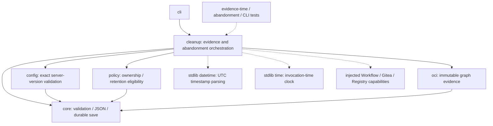

# Brooks-Lint Branch Review

- [Brooks-Lint Branch Review](#brooks-lint-branch-review)
  - [Dashboard](#dashboard)
  - [Module Dependency Graph](#module-dependency-graph)
  - [Change and Plan Assessment](#change-and-plan-assessment)
  - [Test Suite Map](#test-suite-map)
  - [Top Findings](#top-findings)
  - [Verification](#verification)
  - [Recommendation and Limits](#recommendation-and-limits)

**Mode:** Health Dashboard
**Scope:** All 13 changed files on `7-fix-retirement-review-warnings` through `384a093`, compared with base branch `main` at merge-base `bef17df15451af254f106f079fda2bfc3fee6053`. This includes cleanup code, version metadata, README, four documentation files, three changed test/support files, the new evidence-time tests, and the implementation record. Review artifacts created by this review are not included in the assessed diff. Untracked `todo.md` is excluded and untouched.
**Composite Score:** 100/100
**Trend:** Stable at 100 compared with the latest recorded dashboard. That record assessed the plan; this review assesses implemented branch changes, so equal scores do not represent a like-for-like trend measurement.

The branch remedies D1 and D2 within the reviewed scope, and no new actionable correctness or maintainability findings were identified.

## Dashboard

- Code Quality: 100/100. The timestamp validator and alias-retirement helper have clear guard paths and bounded responsibilities. Release/version/documentation edits are intentional coordinated changes, not unrelated change propagation.
- Architecture: 100/100. Changes stay in cleanup orchestration, with no import cycle, reversed dependency, new framework, or bootstrap change.
- Tech Debt: 100/100. The implementation replaces the two ambiguous retirement rules with explicit validation and completion conditions, without a new bypass or checkpoint migration.
- Test Quality: 100/100. Scenario names, explicit time values, raw response faults, and durable-state assertions make failures diagnosable. No material T1 obscurity or T2 brittleness finding was identified.
- Scoring: all four dimensions apply because a branch diff exists. `100 × 0.25 + 100 × 0.30 + 100 × 0.25 + 100 × 0.20 = 100`. There are no deductions under balanced strictness.
- Findings: 0 critical, 0 warning, 0 suggestion. No `.brooks-lint.yaml` exists; defaults apply. This score is not a coverage percentage or deployment safety certificate.

## Module Dependency Graph

This graph shows the affected architectural slice. Arrows represent local dependencies or boundary calls; the new helpers remain within `cleanup`. Static inspection of all relative engine imports, including nested imports, found no cycle.

The alias helper hides reconciliation details while the containing function retains selected-run validation and durable completion. This is a useful extraction rather than a pure forwarding wrapper. The clock parameter isolates time-dependent policy without introducing a clock service or dependency-injection framework.

## Change and Plan Assessment

- D1: `release_template/cleanup.py:431-447` always performs a scoped package lookup, even when the registry alias is absent. Captured digest and repository association checks remain mandatory for present content. API/registry disagreement stops progress. A successful DELETE must be followed by package absence and registry absence before the helper returns. `abandon` writes the flag only after every alias in that run succeeds at `release_template/cleanup.py:465-473`.
- D1 recovery: consistent initial absence returns without DELETE. Failed or lost confirmation leaves an initially unmarked run unmarked on disk, while prior remote deletions remain legitimate progress. Tests reopen current workflow state and load selected checkpoints from disk, demonstrate no duplicate DELETE after confirmed absence, preserve output/operation records and graph protection, and exercise both checkpoint-save boundaries. The existing abandonment flag is not a short-circuit.
- D2: `release_template/cleanup.py:129-140` combines exact ASCII lexical shape with calendar/time parsing, assigns UTC explicitly, and rejects ages outside inclusive 30-day and 300-second bounds. `deletion_evidence` invokes it before `deletion_environment` makes the runtime version request at lines 143-165. Existing product, origin, full-version, and disposable-result binding remains unchanged; evidence bytes are not rewritten.
- D2 behavior matches the reviewed plan: date-only values mean midnight UTC; fractional seconds, offsets, whitespace, and missing timestamp `Z` are refused. Invocation-entry validation is deliberately not a per-DELETE lease. The constant clock values used for boundary tests avoid calendar-dependent expiry failures; ordinary synthetic attestations are created fresh.
- Documentation and version metadata consistently describe `0.2.2`, the two-view confirmation requirement, inclusive freshness limits, eventual-consistency retry costs, and operator-owned storage/product verification. Schema identities, exact-pin refusal, bootstrap scripts, and other engine modules are unchanged.
- The changes follow *Code Complete* — Defensive Programming through explicit rejection paths; *Domain-Driven Design* — invariant ownership by tying abandonment to confirmed retirement; and *A Philosophy of Software Design* — Information Hiding through focused helpers. Small boundary dictionaries and deliberate fake ports are appropriate here, not evidence of an anemic domain or unnecessary abstraction.

## Test Suite Map

Counts refer to test methods, not `subTest` cases. Classification follows the preceding project review: policy/fake-port scenarios count as unit-style even when they use temporary checkpoints; real subprocess, HTTP-server, and installer boundaries count as local integration.

- Full suite: 100 unit/policy/fake-port methods, 65 local integration methods, and 0 live end-to-end methods; 165 total across nine test modules.
- Changed test modules: 39 methods, comprising 38 unit/policy/fake-port methods and one standalone-CLI subprocess integration method. The shared evidence-fixture change also affects the rest of the suite.
- Additions: nine evidence-time methods, fourteen abandonment-confirmation methods, and one CLI abandonment-failure method. All 141 pre-existing test method bodies remain unchanged relative to `main`.
- Important verified outcomes include local rejection before version requests/deletion/checkpoint writes, immutable approved cleanup on expired retry, real status/JSON decoding of raw malformed bytes, both directions of remote presence disagreement, accepted-but-response-lost deletion, before/after checkpoint interruption, multi-alias/multi-run partial progress, no rebuild or raw-digest deletion, and continued graph protection.
- Shared preservation assertions support one coherent retirement-safety claim. Fault injection into external transport and durable-save boundaries is justified by nondeterminism; counting exact DELETE requests verifies the required no-duplicate-side-effect contract, not incidental internal call order. Fresh fixture time is far from expiry boundaries, while exact limits use controlled clocks.

## Top Findings

No actionable findings. D1 and D2 are addressed in code and local regression tests; the previous findings are not duplicated as unresolved branch issues. The review does not extend that conclusion to live deployment semantics or unrelated existing modules.

## Verification

- Passed `python3 -B -m unittest discover -s tests -q`: 165 tests in 41.450 seconds.
- Passed `bash -n scripts/release.sh`.
- Passed `python3 -B scripts/launch.py validate --config examples/explicit.json`: configuration valid, without credentials or remote operations.
- Passed `git diff --check main...HEAD`.
- Independently checked version agreement among `VERSION`, `release_template.__version__`, and README; checked table-of-contents anchors for changed Markdown files, excluding fenced code examples.
- Compared original test bodies using AST against `main`: all 141 remain unchanged. Checked relative-import graph acyclicity and confirmed unchanged bootstrap/updater scripts, adapters, workflow, state, and policy modules.
- No implementation fixes or version changes were made during review. Only this report and the required dashboard-history record are added by the review commit.

## Recommendation and Limits

The branch is ready to merge based on the reviewed scope and passing local verification. No follow-up code fix is required by this review. Continue to require separately authorized same-server disposable Gitea verification before enabling destructive cleanup; no live service, real credentials, consumer installation, or remote mutation was used here. Strict remote agreement may require explicit retry, timestamps cannot detect storage changes or prove attestations truthful, and simulated termination does not establish power-loss durability. Cross-pin checkpoint adoption and automatic repair of old falsely completed state remain unsupported as documented.
