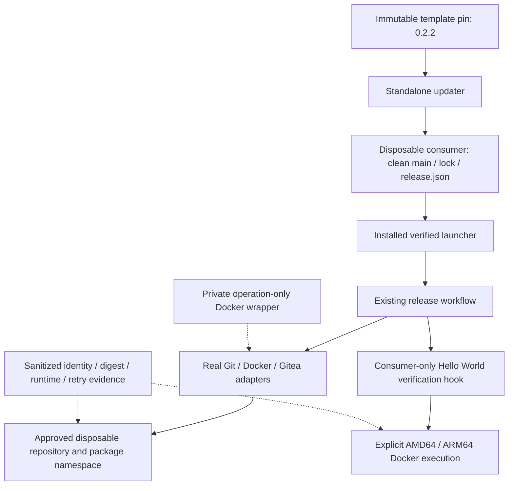

# Brooks-Lint Plan Review

- [Brooks-Lint Plan Review](#brooks-lint-plan-review)
  - [Dashboard](#dashboard)
  - [Module Dependency Graph](#module-dependency-graph)
  - [Goal and Contract Assessment](#goal-and-contract-assessment)
  - [Test Suite Map](#test-suite-map)
  - [Top Findings](#top-findings)
  - [Execution Gates and Limits](#execution-gates-and-limits)
  - [Recommendation](#recommendation)

**Mode:** Health Dashboard
**Scope:** Plan-only review of `tasks/8-test-ubuntu-release-workflow/2-plan.md` at `9100726`, compared with `1-goal.md`, the existing installer, publication/retry implementation, cleanup gate, credential isolation, and verification contracts. Scores evaluate the proposed test design, not successful execution or deployment readiness.
**Composite Score:** 100/100
**Trend:** Stable at 100 compared with the latest recorded dashboard. That record assessed task 7 implementation; this plan review has a different scope and is not evidence of equivalent live verification.

The plan is technically actionable and respects the requested disposable scope; no blocking design finding was identified, but live execution still requires approved targets and permissions.

## Dashboard

- Code Quality: skipped. No staged or tracked working-tree changes exist, and `main...HEAD` is empty. The untracked `todo.md` is unrelated and excluded.
- Architecture: 100/100. The plan exercises the real pinned installer/launcher/default builder instead of adding a new release engine or modifying consumers.
- Tech Debt: 100/100. Separate fixture and evidence directories, fixed identities, and a narrow operation trace avoid coupling the experiment to production code or ambient credentials.
- Test Quality: 100/100. Expected output, per-platform checks, release identity, retry side effects, and the deliberately closed cleanup gate each have explicit outcomes. Environmental dependencies are declared execution gates rather than hidden fixtures.
- Scoring: no findings produce no deductions under balanced strictness. With PR omitted, `(100 × 0.30 + 100 × 0.25 + 100 × 0.20) / 0.75 = 100`.
- Findings: 0 critical, 0 warning, 0 suggestion. No `.brooks-lint.yaml` exists; default settings apply. This score is neither test coverage nor authorization to perform live writes.

## Module Dependency Graph

Arrows show the planned execution boundaries, not new engine modules. Disposable fixture code and external tracing stay outside the template engine; credential-free results are the intended persisted output.

The wrapper is a sensing seam around real commands, not a substitute implementation. One small runtime hook is justified by application-level verification that the engine cannot infer from OCI labels. No plugin framework, schema change, or cyclic import is proposed.

## Goal and Contract Assessment

- The fixture preserves the requested `FROM ubuntu:24.04` and default `CMD ["echo", "Hello World"]`. The plan does not substitute an explicit command during runtime checks and therefore tests the intended default behavior rather than a different echo invocation.
- The installer accepts the specified immutable 40-character pin. Static inspection confirmed commit `af15c2d9b24c02d44f4e379bdef5dfffe4a36cc2` exists and its `VERSION` is `0.2.2`. A separate committed consumer on its own clean `main` satisfies the engine's source/remote checks without trying to release this template's task branch.
- Explicit source push before publication matches `source_push: false`. Keeping source, configuration, installed pin, and checkpoint directory unchanged through retry matches `Workflow` identity checks. Runtime verification receives an immutable reference through the existing `verify` hook contract at `release_template/workflow.py:164-167`.
- Expected nonzero publication status is grounded in `release_template/cli.py:49-54`: publication is recorded before cleanup is attempted. Requiring both the exact missing-evidence error and independent checkpoint/remote verification prevents a false pass on an earlier failure.
- Same-checkpoint retry expectations match `release_template/workflow.py:213-229`: published outputs are reverified without rebuilding; unchanged aliases avoid `imagetools create`; an existing matching release avoids another creation. Counting real Docker command invocations provides stronger build-once evidence than equal output digests alone.
- Read-only planning needs no deletion evidence, while `cleanup.apply` validates the evidence gate before approving or executing cleanup. The plan correctly separates these outcomes and does not manufacture a passing attestation, automatically link packages, or imply that a retained staging alias is a failed publication.
- Independent digest/configuration inspection and actual per-platform execution follow *How Google Tests Software* — risk-based suite portfolios: live checks complement, rather than repeat or replace, fake-port regressions. Explicit results and prerequisites follow *xUnit Test Patterns* — avoiding Mystery Guest and *The Art of Unit Testing* — clear scenario/outcome claims.
- Fixed pinning, unchanged checkpoint provenance, bounded helper scope, and avoiding production edits support *Software Engineering at Google* — dependency/compatibility discipline and *A Philosophy of Software Design* — Information Hiding. The optional deletion contract is correctly separated from the primary publication test.

## Test Suite Map

- Existing baseline: 165 test methods across nine modules, confirmed by AST enumeration during this review. Using the preceding branch review's boundary classification, these comprise 100 unit/policy/fake-port methods, 65 local integration methods, and 0 automated live end-to-end methods. The suite was not rerun during this plan-only review.
- Existing local smoke evidence: one completed AMD64 Docker build/run printing `Hello World`. It is not counted as a live release test or ARM64 verification.
- Proposed addition: one opt-in live release experiment comprising initial publication, independent metadata/digest checks, two platform runtime checks, same-checkpoint retry, read-only cleanup planning, and deliberate evidence-free cleanup refusal. These are planned stages, not implemented automated test-method counts or observed passes.
- No live interrupted-write or deletion contract scenario is included in the primary experiment. Existing synthetic fault tests remain relevant, and the plan explicitly keeps unexercised live claims unverified.
- T1/T2 assessment: required target identifiers, versions, platforms, output bytes, state identities, and command-count deltas are visible. The plan avoids mutable-pin retries, sleeps as proof, private engine rewrites, and inference of runtime support from builder advertising alone. Its operation trace checks externally meaningful build/promotion side effects, not incidental internal call order.

## Top Findings

No actionable plan-level findings. Missing live target details are explicitly handled prerequisites, not an undisclosed test dependency or a reason to weaken assertions. No implementation or plan changes are required by this review.

## Execution Gates and Limits

- The exact Gitea origin, disposable repository, owner-scoped image name, permitted Git URL, account/token-file path, source/publication permissions, and repository-creation responsibility still require confirmation. Do not infer them from this project's remote or expose token contents.
- Confirm both runnable platforms and trusted transport before publication. Multiple runtime contexts, if needed, must be mapped explicitly into the consumer verification procedure; a recorded builder platform list alone cannot satisfy runtime acceptance. Do not install privileged emulation or silently reduce scope.
- Keep the trace, credentials, Docker connection material, and logs outside the committed consumer snapshot. The wrapper must forward actual commands and record only enumerated operations, including commands invoked by the consumer hook; no full argument/environment/stdin logging is needed for this test.
- Publication permission does not include optional deletion, package linking, repository teardown, or a second contract-test namespace. The existing gate also requires the attestation's contract-test repository to differ from the consumer under cleanup. Preserve these separate approvals even if the primary publication passes.
- The plan deliberately distinguishes source fixture version `1.0.0`, tested template version `0.2.2`, and any later documentation/workflow metadata change. Do not change the tested pin or fixture identity to satisfy a repository bookkeeping step mid-experiment.
- This review used only local file/Git/static inspection. It did not read credentials, probe a live server, build/pull/run a container, install a consumer, publish, delete, or modify `todo.md`. The proposed recipe and live outcome records do not exist yet.

## Recommendation

Proceed with the plan after the required target, permissions, authentication path, trust, and platform prerequisites are confirmed. Until then, record live execution as blocked rather than treating this review as approval to write remotely. Preserve the closed deletion gate and report publication, each runtime platform, retry, and cleanup as separate outcomes; no additional broad architecture or debt audit is needed before this bounded experiment.
