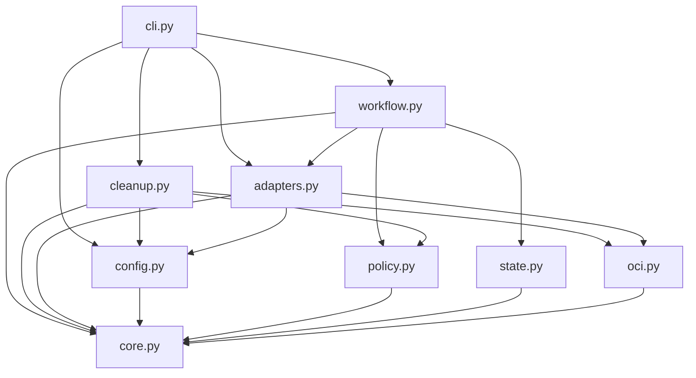

# Brooks-Lint Health Dashboard

- [Brooks-Lint Health Dashboard](#brooks-lint-health-dashboard)
  - [Scope And Verdict](#scope-and-verdict)
  - [Dimension Scores](#dimension-scores)
  - [Module Dependency Graph](#module-dependency-graph)
  - [Test Suite Map](#test-suite-map)
  - [Top Findings](#top-findings)
    - [Warning](#warning)
  - [Accepted Design Decisions](#accepted-design-decisions)
  - [Verification And Limits](#verification-and-limits)
  - [Recommendation](#recommendation)

## Scope And Verdict

**Mode:** Health Dashboard

**Scope:** Plan-only review of `tasks/9-publish-images-readable-releases/2-plan.md` at `0919f82`, with targeted inspection of existing publication, configuration, adapters, checkpoints, cleanup, launcher locking, and tests. The latest user clarifications supersede the image-focused wording in `1-goal.md`. No whole-branch implementation review is implied.

**Composite Score:** 96/100

**Trend:** 100 → 96 (−4) against the most recent Health Dashboard record. That record reviewed task 8's plan; this is a different scope, not measured implementation regression.

The plan addresses the requested outcomes, but three safety details need resolution before implementation. These are proposed-design findings, not claims that task 9 code already exists or fails.

## Dimension Scores

| Dimension | Score | Top Finding |
|-----------|-------|-------------|
| Code Quality | 100/100 | No separate R1/R2 finding in the proposed changes |
| Architecture | 90/100 | Local ownership needs durable restart semantics; package linking needs a concurrency contract |
| Tech Debt | 95/100 | Exact-reference image removal can still delete untagged parents |
| Test Quality | 100/100 | Good proposed boundary/recovery coverage; add the finding-specific cases below |

Balanced deductions apply: each warning deducts five points from its assigned dimension, without duplicate counting. All four dimensions apply to this explicit plan-change review. Composite: `100 × 0.25 + 90 × 0.30 + 95 × 0.25 + 100 × 0.20 = 95.75`, rounded half-up to 96. Test and code scores assess the plan, not verified future behavior.

## Module Dependency Graph

The graph shows current local module dependencies relevant to this plan. The proposed Git/tag and local-Docker helpers belong behind adapter boundaries; pure identity policy should remain free of network calls.

No circular dependency appeared in the inspected imports. Workflow orchestration already owns durable operations, making it the natural owner of local-image provenance and package-link sequencing. Avoid adding these responsibilities to pure policy code.

## Test Suite Map

Static discovery found 169 test methods in ten test modules. This review did not run them. The following are file-family counts, not a claim that every method in a family uses the same test level.

- Primarily unit/fake-port suites: 95 methods across `test_core.py`, `test_evidence_time.py`, `test_workflow.py`, `test_retirement.py`, `test_cli.py`, and `test_ubuntu_hello.py`. Ubuntu hook tests mock subprocesses; they do not execute both architectures.
- Adapter and compatibility suites: 63 methods across `test_adapters.py`, `test_gitea_absence.py`, and `test_gitea_migration.py`, mixing injected transports, subprocess mocks, loopback HTTP, and local Git checks.
- Installation/update integration suite: 11 methods in `test_update.py`, using temporary source/consumer repositories and launcher execution.
- New-format Git integration, package linking, and local removal tests remain proposed. Existing live task 8 evidence is historical and does not verify task 9. No automated live Gitea/Docker end-to-end run was executed here.

## Top Findings

### Warning

**P1 — Architecture / R6 Domain Model Distortion: local ownership loses its meaning across restarts.**

Symptom: `2-plan.md:69-76` asks for a baseline before each publish/resume invocation and tracking as references become known, but does not define a durable original baseline or write-ahead ownership record. A process can die after a hook pulls an image and before tracking it. A new invocation then sees that release-created image as pre-existing. Current `State` persists outputs and remote operations, not local ownership (`release_template/state.py:17-19`); hooks pull outside the runner (`examples/ubuntu-hello/verify.py:17-21`).

Source: *Domain-Driven Design* — explicit domain identity and lifecycle; *Working Effectively with Legacy Code* — establish observable seams around external effects.

Consequence: A successful resume can safely skip images created by the same release and leave local cleanup unfinished indefinitely. Alternatively, an implementation that reconstructs ownership from current names could delete an image it never owned. Recording only a context name also cannot distinguish a context repointed to a different daemon.

Remedy: Define a durable local-finalization record outside the immutable publication identity, bound to the run and verified daemon identity. Save the original baseline before any hook/build/pull, preserve it across resume, and persist exact pull/reference intents before side effects where observable. Specify how opaque custom hooks report owned references and how uncertain outcomes fail closed. Refresh current safety evidence without replacing the original ownership baseline. Add reopen-after-pull, crash-before-tracking, partial-removal restart, and same-context/different-daemon cases.

**P2 — Architecture / R5 Dependency Disorder: package-link refusal lacks an owner-wide concurrency boundary.**

Symptom: `2-plan.md:59-62` describes reading an unlinked association and then issuing a link POST. The proposed route has no expected-association precondition. Another writer can change the association between those operations. Existing `.template-operation.lock` serializes one destination checkout only (`scripts/launch.py:53-60`), not all users of an owner-scoped package. The plan acknowledges serialization for Git tags but does not establish it for linking.

Source: *The Pragmatic Programmer* — temporal coupling and shared-state concurrency; *Clean Architecture* — make external-system constraints explicit at boundaries.

Consequence: Fresh reads and post-confirmation alone cannot guarantee the promised refusal of foreign reassignment if the deployed POST permits replacing a concurrent link. Detecting a foreign link after the POST would be too late to prevent that mutation. The deployed concurrent behavior is not established by this review.

Remedy: Make the server's concurrent-link semantics an explicit contract check. If it rejects replacement atomically, test that conflict path. Otherwise require an operationally enforced single-writer window for the exact owner/package, including other repositories and UI/API writers, before enabling the mutating step; do not present a checkout-local lock as sufficient. Document the residual external-writer assumption. Add an injected association change between lookup and POST, and require no foreign reassignment under the supported contract.

**P3 — Tech Debt / R6 Domain Model Distortion: exact-reference removal is not necessarily exact-scope deletion.**

Symptom: `2-plan.md:70-71` protects base/pre-existing images and specifies `docker image rm` without force, but omits `--no-prune`. Local `docker image rm --help` explicitly describes `--no-prune` as “Do not delete untagged parents.” The command's default behavior therefore has a broader deletion scope than checking only the selected reference.

Source: *Code Complete* — defensive programming at external interfaces; *The Pragmatic Programmer* — understand tool behavior rather than infer it from command names.

Consequence: On a supported store with eligible untagged ancestors, removing an owned image can also delete a pre-existing untagged parent outside the recorded ownership set. Skipping a named base such as `ubuntu:24.04` does not cover that case.

Remedy: Require `docker image rm --no-prune <exact-reference>` without force, in addition to the planned identity/shared/container checks. Explicitly protect untagged ancestors and assert the flag at the subprocess boundary. Add a fixture with a task-owned child and pre-existing untagged parent; do not perform real host deletion in unit tests. Shared-layer reclamation and builder-cache cleanup must remain outside the success claim.

## Accepted Design Decisions

- Curated committed project notes, frozen text/digest, and annotated-tag identity satisfy the latest description requirement without smuggling metadata into prose.
- Pure policy validation with adapter-based Git I/O preserves layering. Annotated-object identity, direct commit targets, exact-pin recovery, and malformed-new-format downgrade refusal are appropriate safeguards.
- Static legacy fixtures and mixed-generation predecessor tests address the compatibility transition. Keeping historical `v0.2.3` tags, descriptions, and checkpoints unchanged avoids an unauthorized migration.
- Explicit `link_packages` and `remove_local_images` defaults avoid silently adding mutations for existing consumers. Separate reporting for publication, remote cleanup, and local finalization is essential and correctly planned.
- Real local Git integration and fault injection are justified here, not unnecessary test complexity. Guarded local cleanup is narrower than a general Docker garbage collector; safe skips and retained caches are acceptable limits.
- The required notes input is a deliberate stricter contract under configuration schema 2. The plan documents migration instead of claiming unchanged input compatibility.

## Verification And Limits

- Read the latest goal/plan, shared review instructions, dashboard references, relevant production modules, launcher lock code, and representative test fixtures. No `.brooks-lint.yaml` or repository `AGENTS.md` was found.
- Counted test methods through Python AST inspection. Inspected local Docker CLI help to confirm parent-pruning behavior; this did not contact the daemon or remove images.
- Did not run runtime tests, access credentials, query remote services, publish anything, link packages, alter images, or change implementation code. Package-link concurrency remains a contract question, not an observed live failure.
- This report and the dashboard-history record are the only intended review changes. The plan remains unchanged. Scores across different tasks are not directly comparable quality measurements.

## Recommendation

Resolve P1–P3 in the plan before implementation: persist ownership across restart, establish the package-link concurrency contract, and disable implicit parent pruning. Keep the existing release-note, legacy-reading, recovery, and deletion-gate design. An implementation review must later verify the concrete adapters and restart tests; this plan review does not approve new live publication or remote deletion.
