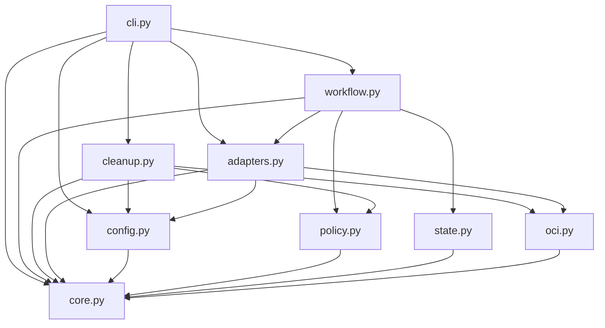

# Brooks-Lint Health Dashboard

- [Brooks-Lint Health Dashboard](#brooks-lint-health-dashboard)
  - [Scope And Verdict](#scope-and-verdict)
  - [Dimension Scores](#dimension-scores)
  - [Module Dependency Graph](#module-dependency-graph)
  - [Test Suite Map](#test-suite-map)
  - [Top Findings](#top-findings)
  - [Previous Finding Disposition](#previous-finding-disposition)
  - [Tradeoffs And Execution Gates](#tradeoffs-and-execution-gates)
  - [Verification And Limits](#verification-and-limits)
  - [Recommendation](#recommendation)

## Scope And Verdict

**Mode:** Health Dashboard

**Scope:** Second plan-only review of `tasks/9-publish-images-readable-releases/2-plan.md` at `a92c87e`, including its changes since the first review at `f579c58`. Targeted implementation/test inspection checks feasibility and compatibility, not completion. The latest user clarifications supersede the image-focused wording in `1-goal.md`.

**Composite Score:** 100/100

**Trend:** 96 → 100 (+4) over the last two task 9 plan reviews.

P1–P3 are addressed in the proposed design. No remaining actionable finding was identified within this plan-review scope. This is not an implementation score or permission to perform live mutations.

## Dimension Scores

| Dimension | Score | Top Finding |
|-----------|-------|-------------|
| Code Quality | 100/100 | No new R1/R2 finding in the plan changes |
| Architecture | 100/100 | Durable ownership and explicit external concurrency boundaries address P1/P2 |
| Tech Debt | 100/100 | Mandatory `--no-prune` and parent protection address P3 |
| Test Quality | 100/100 | Proposed boundary, restart, and fault tests cover the revised safety contract |

All four dimensions apply to the explicit plan-change review. Balanced scoring produces no deductions: `100 × 0.25 + 100 × 0.30 + 100 × 0.25 + 100 × 0.20 = 100`. Scores measure identified design risks, not proof that future code or operational procedures work.

## Module Dependency Graph

The graph shows current local module dependencies. The plan preserves pure policy validation, adapter-owned external I/O, workflow-owned sequencing, and state-owned durability.

Static import inspection found no cycle. The added local-finalization checkpoint section can use existing atomic, fsynced persistence without changing immutable publication identity (`release_template/state.py:22-32`, `release_template/core.py:68-86`). The CLI must still implement the planned separate publication/remote-cleanup/local-finalization outcomes; its current single cleanup exception path is not evidence that this integration already exists (`release_template/cli.py:49-67`).

## Test Suite Map

Static AST discovery again found 169 test methods in ten modules. These are file-family counts rather than exact test-level classifications, because several modules mix levels.

- Primarily unit/fake-port suites: 95 methods across core, evidence-time, workflow, retirement, CLI, and Ubuntu-hook tests. The four Ubuntu-hook tests mock subprocesses and do not execute either architecture.
- Adapter/compatibility suites: 63 methods across `test_adapters.py`, `test_gitea_absence.py`, and `test_gitea_migration.py`, using injected transports, subprocess mocks, loopback HTTP, and local Git checks.
- Installation/update integration suite: 11 methods in `test_update.py`, including temporary repositories and launcher execution.
- Live task 9 end-to-end tests executed in this review: zero. New annotated-tag, package-link-window, durable provenance, and guarded local-removal tests remain implementation requirements.

The revised tests distinguish observable safety behavior from irrelevant implementation wiring. Exact emitted `--no-prune` commands and forbidden POST/DELETE assertions are justified boundary contracts, not test brittleness. Restart tests reopen durable state; API and Git integration tests supplement fake-port workflow tests. No new T1/T2 finding was identified in the scoped changes.

## Top Findings

No active Critical, Warning, or Suggestion findings. The previous three warnings are resolved in the plan, not verified as fixed in implementation.

## Previous Finding Disposition

- **P1 — Addressed in design:** `2-plan.md:73-76` defines a versioned `local_finalization` section bound to the original run and verified daemon identity. It preserves the original baseline, journals declared hook effects before execution, reconciles interrupted effects, and records progress separately from publication identity. Missing historical provenance, opaque hook effects, changed daemons, and uncertain ownership cannot authorize deletion. `2-plan.md:100` requires restart, partial-removal, missing-record, daemon-repointing, and distinct platform/image-ID cases. This addresses explicit domain lifecycle and observable external-effect seams from *Domain-Driven Design* and *Working Effectively with Legacy Code*.
- **P2 — Addressed in design with an operational prerequisite:** `2-plan.md:60-66` does not invent compare-and-swap semantics. Every link POST requires a valid scoped operator window plus actual exclusion of all owner/package writers, followed by a final association lookup. Matching links need no POST or window; renewed window evidence stays outside immutable intent. `2-plan.md:97` tests gate failures, expiry, renewal, conflicts, and changing associations. `2-plan.md:148` explicitly says that a JSON assertion alone does not enforce exclusion. This makes temporal/shared-state constraints explicit, consistent with *The Pragmatic Programmer* and *Clean Architecture*. Server behavior and real exclusion remain execution gates, not claims established by this review.
- **P3 — Addressed in design:** `2-plan.md:78` mandates `docker image rm --no-prune <exact-reference>` without force and protects pre-existing untagged ancestors. `2-plan.md:101` requires subprocess-boundary assertions and a pre-existing-parent fixture without real host deletion. Documentation, live checks, acceptance criteria, and retry rules carry the same requirement. This addresses the external-command defensive-programming issue identified through *Code Complete*.

## Tradeoffs And Execution Gates

- The package-link-window record adds a permission boundary for a real owner-scoped mutation. Requiring it even on apparently conflict-safe servers is conservative but explicit. No new distributed locking subsystem is proposed. The existing linked fixture should exercise verification without this mutation prerequisite.
- The operator must actually exclude UI/API/CI and other checkout writers during any link mutation. Validate the record and fail closed when that prerequisite is unconfirmed; do not claim software can prove external exclusion from prose or a local lock.
- Durable local provenance is necessary because retries must distinguish release-owned images from pre-existing content. Opaque custom hooks remain usable with explicit safe skips, rather than forcing an incompatible hook migration or guessing ownership.
- Local ownership also depends on the documented no-concurrent-writer assumption for exact references. Rechecks narrow races but do not prove who pulled identical content. Uncertain provenance must remain a skip, not a successful removal claim.
- Required committed notes and identity schema 2 are deliberate compatibility changes. Legacy schema-1 descriptions/lightweight tags remain read-only inputs, malformed new records cannot downgrade, and old checkpoints are not automatically adopted across pins.
- Local image removal may leave shared layers, protected parents, and builder caches. Success means confirmed removal or clearly reported protection of authorized references, not guaranteed free-space recovery. Remote deletion gates remain unchanged.

## Verification And Limits

- Re-read the shared review instructions/references, latest task plan, previous review context, and dashboard history. No repository `AGENTS.md` or `.brooks-lint.yaml` was found.
- Compared the updated plan against `f579c58`. Confirmed no implementation, example, launcher, or test changes between that review commit and `a92c87e`.
- Inspected current state persistence, atomic file writes, CLI outcome handling, legacy policy, workflow recovery tests, and the Ubuntu hook/tests. Recounted test methods and inspected package-local imports statically.
- No runtime tests, credential access, remote service requests, publication, linking, Docker daemon operations, or image deletion occurred. Historical task 8 runtime evidence does not verify task 9.
- Only this report and `.brooks-lint-history.json` are changed by this review. `2-plan.md`, implementation files, and `todo.md` remain untouched. The first review remains available in Git history at `f579c58`.

## Recommendation

The revised plan is ready for implementation within its stated scope and execution gates. Preserve the P1–P3 contracts in code and test them at the actual adapter/checkpoint boundaries. Implementation review must verify restart behavior, CLI outcome separation, hook-journal validation, mandatory non-pruning removal, and package-link prerequisites. Reconfirm live publication authority separately; this review authorizes neither a new release nor remote deletion.
