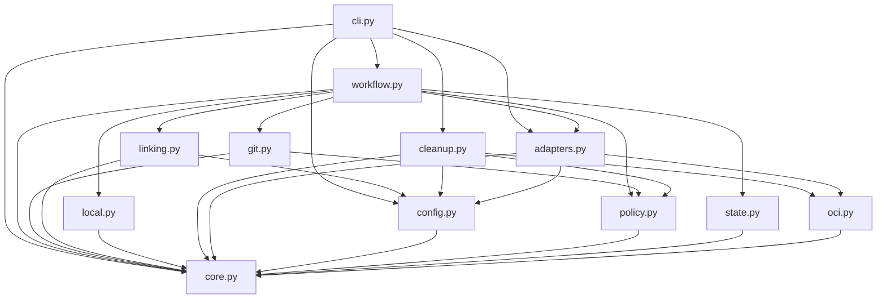

# Brooks-Lint Health Dashboard

- [Brooks-Lint Health Dashboard](#brooks-lint-health-dashboard)
  - [Scope And Verdict](#scope-and-verdict)
  - [Dimension Scores](#dimension-scores)
  - [Module Dependency Graph](#module-dependency-graph)
  - [Test Suite Map](#test-suite-map)
  - [Top Findings](#top-findings)
    - [Warning](#warning)
  - [Accepted Design And Evidence](#accepted-design-and-evidence)
  - [Verification And Limits](#verification-and-limits)
  - [Recommendation](#recommendation)

## Scope And Verdict

**Mode:** Health Dashboard

**Scope:** All 39 changed files on `9-publish-images-readable-releases` through `f2d0c97`, relative to its actual parent branch `8-test-ubuntu-release-workflow` at merge base `4caac0b4d85d3c91693a92c35e4da82131a4e75f`. The branch contains three implementation/results commits with 1,961 insertions and 48 deletions. Earlier task 9 goal/plan/review commits were inherited from the parent branch and are not separate implementation changes in this diff. This is not a whole-project audit against local main.

**Composite Score:** 96/100

**Trend:** 100 → 96 (−4) from the latest Health Dashboard record. That record assessed the task plan, not implementation; the change is not a measured runtime regression.

The principal release and guarded-local-removal paths pass, but three reproduced boundary/recovery warnings remain. No Critical finding was identified. Address these warnings before treating authorization timing and long-lived recovery as fully covered; they do not invalidate the recorded successful live publications.

## Dimension Scores

| Dimension | Score | Top Finding |
|-----------|-------|-------------|
| Code Quality | 95/100 | B3: historical blob reads depend on current checkout layout |
| Architecture | 90/100 | B1: post-check I/O can outlive authorization; B2: pending tag objects have no GC root |
| Tech Debt | 100/100 | No separate systemic finding in the scoped changes |
| Test Quality | 100/100 | Useful state/boundary tests; the three reproduced edge cases need regression coverage |

Balanced scoring deducts five points for each Warning in its assigned dimension, without duplicate deductions for missing tests of the same bug. Composite: `95 × 0.25 + 90 × 0.30 + 100 × 0.25 + 100 × 0.20 = 95.75`, rounded half-up to 96. All four dimensions apply to this nonempty branch diff. Scores reflect the capped findings shown here, not a safety certificate or coverage percentage.

## Module Dependency Graph

Static package-local import inspection found no cycle. Workflow's seven-module fan-out is justified composition/orchestration, not automatically a dependency violation. Policy remains free of network calls. The warnings concern temporal and lifecycle dependencies across otherwise reasonable module boundaries, not a demand for additional framework layers.

## Test Suite Map

`python3 -B -m unittest discover -s tests -q` passed all 230 tests in 45.681 seconds during this review. Static discovery found 13 test modules and an increase of 61 methods from the parent branch's 169-method baseline.

- Primarily unit/fake-port file families: 140 methods across core, evidence-time, workflow, retirement, CLI, Ubuntu-hook, local-image, and package-linking tests. Some include filesystem persistence or emitted-command boundaries; this is not an exact test-level classification.
- Mixed adapter/identity/compatibility families: 79 methods across `test_adapters.py`, `test_gitea_absence.py`, `test_gitea_migration.py`, and `test_publication_notes.py`. These combine pure checks, injected transports, loopback HTTP, subprocess mocks, and real temporary Git/bare-remote tests.
- Installer/update integration: 11 methods in `test_update.py`, including temporary source/consumer repositories and real launcher execution.
- Live end-to-end operations performed by this review: zero. Committed task evidence records the separately approved v0.2.4/v0.2.5 publication/runtime/retry experiments; those were not repeated here.

The new tests generally assert useful observable behavior: exact safe removal commands, durable intent/completion, no duplicate confirmed writes, default runtime output, and preservation of protected references. No independent T1/T2 test-decay finding is raised. The existing expiry test changes time at entry to the third window-validation call, rather than during its network lookup; the tag tests retain objects throughout retry; and the historical-note test changes ordinary file bytes, not the current path's type. These explain why the following probes pass outside the suite's present scenario coverage.

## Top Findings

### Warning

**B1 — Architecture / R5 Dependency Disorder: the final window check performs network I/O after checking expiry.**

Symptom: `release_template/linking.py:78-82` reads the clock and validates the exclusion window, then synchronously queries `/api/v1/version`. The final call at `release_template/linking.py:106-107` returns from that lookup directly into the link POST without another clock check. Thus a valid window can expire during the version request. Repeating this helper three times does not make its last check occur after its last blocking operation.

Source: *The Pragmatic Programmer* — temporal coupling and shared-state concurrency; *Clean Architecture* — keep policy decisions explicit at external I/O boundaries.

Consequence: A link POST can run and be marked complete after its recorded authority has expired. This contradicts the promised exclusive-expiry gate and is particularly relevant when an operator's exclusion window is ending. The external exclusion prerequisite still applies; no real foreign reassignment or live failure is claimed.

Remedy: Perform server/scope validation before the final mutation-time decision, then recheck the current time after all blocking validation and persistence, immediately before POST. Use the same validated authority snapshot for the durable evidence and actual request. Keep operator exclusion effective through in-flight completion as documented. Add an injected-clock test where the final version lookup advances time from just before expiry to just after it, and require zero POSTs and pending intent.

Reproduction: Reused the synthetic `PackageLinkTests` fixture, froze time one second before `expires_at`, and advanced it to one second after expiry inside the third `/api/v1/version` lookup. `link_packages` still issued one fake POST and saved `link:application` as `complete`. No HTTP connection was made.

**B2 — Architecture / R6 Domain Model Distortion: a checkpoint object ID does not keep a pending annotated tag alive in Git.**

Symptom: `release_template/git.py:60-71` writes the tag with `git mktag` but creates no protecting Git ref. `release_template/workflow.py:118-120` reloads the stored object ID from pending intent and calls `inspect` directly; it neither ensures the object exists nor reconstructs the identical deterministic object. The checkpoint JSON is durable, but Git does not treat it as an object-reachability root. Fetching by object ID with no tag/FETCH_HEAD update also does not establish such a root.

Source: *Domain-Driven Design* — make identity and lifecycle ownership explicit; *Working Effectively with Legacy Code* — characterize recovery across external-storage seams.

Consequence: Once unreachable objects become eligible for pruning, a long-paused publication can retain a valid checkpoint while losing the exact annotation it needs to resume. Retry stops before reconciling/pushing the tag even though all prepared image identities remain available. This is a recoverability issue, not permission to rebuild or replace the intended tag.

Remedy: Preserve pending tag objects through an owned private Git ref, or deterministically recreate missing objects from approved identity and require the resulting ID to equal the checkpointed ID before any remote mutation. Reconcile matching remote objects where applicable; never adopt a different annotation or force-update a tag. Add a real temporary-Git test that checkpoints tag intent, interrupts before push, prunes the unreferenced object, and resumes with the same object ID and no repeated image build.

Reproduction: In an exclusively owned temporary Git/bare-remote fixture, invoked real `Workflow.tag_source`, interrupted immediately before push after durable intent, and ran `git prune --expire=now` only in that fixture. Reopened `tag_source` failed with `Command failed: git (exit 128)`, while the tag operation remained pending. A separate probe confirmed deterministic creation reconstructs the original ID. Forced immediate expiry only makes this lifecycle test deterministic; it is not a claim that normal Git GC prunes a freshly created object immediately.

**B3 — Code Quality / R2 Change Propagation: a current symlink can invalidate valid historical notes.**

Symptom: `release_template/adapters.py:69-72` calls filesystem-aware `child(self.root, path)` before reading a blob from the requested commit. `child` resolves and rejects symlinks in the current checkout, not the captured commit. `release_template/git.py:55` uses this same loader for predecessor notes. A later clean source can legitimately replace an old notes path with an internal symlink while storing its next release's regular notes elsewhere.

Source: *A Philosophy of Software Design* — information hiding and change coupling; *The Pragmatic Programmer* — orthogonality between captured inputs and mutable/current layout.

Consequence: Predecessor verification and future publication can fail because of current tree layout even though the predecessor's note path is a regular committed blob, its text/hash is unchanged, and the next configured notes path is valid. Historical identity gains an undocumented dependency on retaining the same path type in every later checkout.

Remedy: Validate committed-object paths lexically for absolute paths, traversal, NUL, and exact path identity, then enforce regular-file/type rules in the requested commit's tree. Keep filesystem-aware symlink checks for actual working-tree paths where needed; do not use them to grant or deny access to a historical Git blob. Add a two-commit clean-checkout regression: regular old notes in the first commit, an internal symlink at that old path plus separate new notes in the second, and successful old-identity verification from the second checkout. Continue rejecting symlinks in the captured tree itself.

Reproduction: Created a real temporary repository with `notes.md` mode `100644` in the old commit, then committed an internal symlink at that path in the current source. The checkout was clean. `Git.notes(old_commit, "notes.md", "1.0.0")` failed with `Symlink destination refused`, although the old tree still reported `100644` and its blob was intact.

## Accepted Design And Evidence

- Committed project notes are separated from machine identity, and schema-2 parsing rejects duplicate/unknown identity fields and malformed annotations without legacy downgrade. The required notes input and old-binary limitation are explicitly documented rather than hidden as unchanged compatibility.
- Package linking is opt-in, whole-package scoped, confirmed through paginated/scoped evidence, and refuses foreign/uncertain associations. The operator record is correctly described as evidence of external exclusion, not a distributed lock or deletion attestation. B1 concerns enforcement timing within that explicit contract.
- Local ownership has a durable original baseline, daemon binding, separate store/member observations, exact run-specific staging intent, and non-force `--no-prune` removal. Proven same-run reference groups do not override unrelated or pre-existing references. Publication, remote cleanup, and local outcomes are reported separately.
- The v0.2.5 correction is explicitly approved and recorded as a new release, not a rewrite/adoption of v0.2.4 state. The committed evidence honestly distinguishes v0.2.4 safe skips from v0.2.5 removal and records original local alias restoration during independent verification. API/HTML visibility is not mislabeled as visual browser verification.
- Bootstrap scripts, outer checkpoint handling in `state.py`, and remote-retirement implementation in `cleanup.py` are unchanged in the branch diff. The absence-of-evidence remote deletion gate is retained. No additional speculative framework, broad cache pruning, or unrelated refactoring is justified by this review.

## Verification And Limits

- Read shared instructions and all dashboard references. No `.brooks-lint.yaml` or repository `AGENTS.md` was found. Established the base from branch ancestry rather than comparing against remote main, which has already advanced during the separately approved publication.
- Reviewed every changed production/config/example/test/documentation/task-evidence file. Ran the 230-test suite, static test/import inventory, and `git diff --check 4caac0b..HEAD`. Reviewed committed live evidence as historical results, without new server queries.
- Reproduced B1 with injected time and in-memory API fixtures, and B2/B3 in newly created temporary Git repositories. Only probe-owned temporary Git objects/files were pruned or replaced. No live checkpoint, captured release source, repository tag, real Docker image, credential file, package, or remote resource was modified or accessed by these probes.
- No implementation or test fixes are applied. The only intended tracked review changes are this report and the appended dashboard-history record. Existing published v0.2.3/v0.2.4/v0.2.5 history and all implementation results remain unchanged. `todo.md` is untouched.

## Recommendation

Fix B1 first at the authorization/mutation boundary, then add GC-safe pending-object recovery for B2 and commit-local blob-path validation for B3. Preserve the existing safety gates and add the specific regression scenarios before the next implementation/release decision. This review does not authorize republishing, retagging, checkpoint rewriting, cleanup, or fixes during the review stage.
